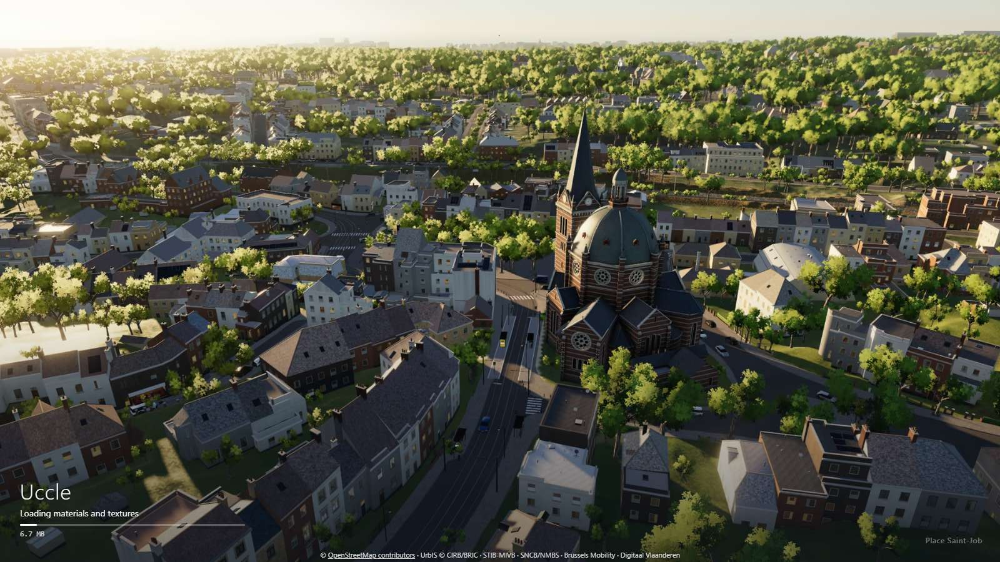
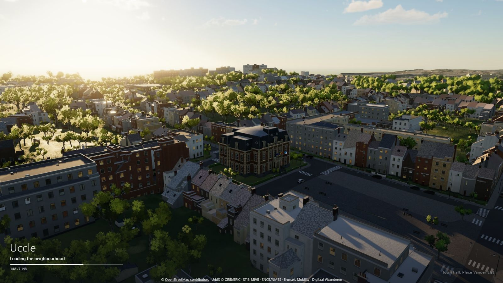

# Boot: the loading screen and the startup (boot2, 2026-11-15)

Owner, 2026-11-15: the loader's live aerial flight JUMPS ("nothing more annoying than jumps"), and the startup regressed
(cover 14.4 s on 2026-11-13, 20-25 s on 2026-11-14). Branch `claude/boot2`. Earlier boot work: docs/perf/AUDIT.md
step 10 (the flight, the boot order, the warm-up) and step 11.

**Machine state for every number below: YELLOW / RED** (preflight: 2.5-3.4 GB free, another agent's city tab and a
Blender bake on the GPU / CPU for part of the session, GPU 33-99 % busy at rest). Absolute times are 1.5-2x what a quiet
machine gives; compare only the pairs taken back to back. All runs local (`tools/serve_nocache.py`), the tab in front.

## 1. The loading screen

- **Three stills of the city itself** at golden hour: Place Saint-Job and the church, the Royal Observatory, the town
  hall on Place Vander Elst (`viewer/loader/stills/*.avif`, 258-289 KB; `.jpg` fallbacks 292-301 KB; 1920 x 1080).
  Rendered by the city: `debug/loaderShots.js` (frames the view, waits for streaming, renders at ~1.6x and downsamples,
  posts the PNG to a local receiver) then `python tools/loader_stills.py <png folder>` (AVIF + JPG at the best quality
  under 300 KB). Change a view: edit `VIEWS` in debug/loaderShots.js, boot `?tile=<its tile>`, shoot, encode.
- **Only CSS moves** (index.html `#loaderUi`): each slide zooms slowly (scale 1 -> 1.05 over 11.5 s) and the three
  cross-fade (9 s each, 2.5 s fades, a 27 s loop); the bottom slide never fades (no dip to the background), each zoom
  resets while its slide is hidden. Compositor animations (checked in the trace: lsZoom / lsMid / lsTop / the bar run
  composited; the one main-thread animation, a no-op opacity, was removed). The place's name fades with its slide.
  `prefers-reduced-motion`: no zoom, the cross-fades only.
- **Mr.doob's bar** (slop-newyork js/main.js:30-75, 751-766): one bar through every stage (`data, renderer, materials,
  landmarks, tiles, tile, neighbours, warmup, gpu`), each stage's share sized by its measured median (STAGES in
  `viewer/loader/loader.js`), the fill glides to the stage's end as a linear CSS transition lasting the stage's typical
  time x the machine's pace (how fast the earlier stages ran vs the table, 0.5-4x). Counted progress (the warm-up's
  pipelines) only ever moves it forward (retargeting a running transition starts from its current value: no jump).
  `__loader.times` gives each stage's start (re-calibrate STAGES from a few `debug/bootSummary.js` runs).
- **The cover stays until the GPU finished a real frame** (main.js `gpu` stage: a frame, then
  `queue.onSubmittedWorkDone()`), then fades out (1.1 s) while the bar completes.
- `?loader=flight`: the old aerial flight (viewer/loader/flight.js + loaderWorker.js), `?loader=0`: the plain cover.

### Jumps: what stalls a CSS animation during the boot

A trace of the boot (`performance_start_trace`, `python tools/perf/trace_frames.py trace.json.gz --from A --to B --gpu
100`) counts the compositor frames actually presented (viz `Swap`) and lists the GPU process' main-thread tasks.
Finding: **the page's compositor frames are drawn on the GPU process' main thread**, the same thread that executes the
boot's WebGPU work. During every stall the GPU main thread was 100 % busy (5.4-7.4 s: 1,995 ms busy of a 2,005 ms gap;
17.4 s: 603 of 606 ms) while the viz and renderer compositor threads idled. So "compositor-only" CSS is necessary but
not sufficient: a boot that floods the GPU process freezes ANY loading screen. `debug/gpuCalls.js` (an init script
logging every WebGPU call, with `sync@ms` marks to align with the trace) showed what floods it: texture creation +
uploads (22-92 MB `createTexture`, 64 MB `writeTexture`, 28 MB `copyExternalImageToTexture` in one window), ~1,800
`createBuffer`s, shader modules; pipelines were a small part (async ones compile on Dawn's worker threads).

The biggest flood was the **early warm-up** (main.js: one forced frame drawing all 309 kit drawables while the worker
builds the first tile). It now runs in **chunks of 40 drawables, one frame each, `queue.onSubmittedWorkDone()` between
them** (`warmNowChunked`, `?warmchunk=N`, `?warmchunk=0` = one frame as before). The warm-up takes 4.3 s instead of
1.6-2.1 s, inside the ~10 s the worker needs anyway (the first tile did not come later).

| boot (same session, back to back) | presented fps under the cover | gaps > 100 ms | > 250 ms | longest | GPU-main tasks >= 100 ms |
|---|---|---|---|---|---|
| before: `?loader=flight`, one-frame warm-up (f1) | 41.8 | 23 | 12 | **2,099 ms** (3 gaps of ~2 s) | 25, 5.2 s |
| stills, one-frame warm-up (s1) | 57.3 | 23 | 10 | 2,005 ms | 26, 5.1 s |
| **stills + chunked warm-up (s2, the default)** | **56.7** | **19** | **3** | **581 ms** | **18, 2.8 s** |

With the slow zoom, the longest remaining stall (0.58 s) moves the picture by ~0.25 % (2-3 px at the frame's edge, 0 at
the focus point) and the bar by ~2 % of its width: a hesitation, not a jump. The flight's camera moved several metres in
a 2 s stall. Proof files (not committed, 35-50 MB each): the traces t_f1 / t_s1 / t_s2 in the session's scratchpad.

## 2. Startup

### Where the time goes (the regression 14.4 -> 20-25 s)

The cover's critical path is **the tile worker building the start tile**: the "tiles" stage is 7-11.7 s of every boot
(I6, worker log "tile I6 built in the worker"): roads 3.5-5.7 s (surfaces + width fit 0.9-1.5, road meshes + carve
1.4-3.3; step 10 measured 1.3-4.7 s for the road step), **drive colliders 1.3-2.2 s** (the collisions work, 2026-11-13),
**facade analysis 0.9-1.6 s** (155 ms when the facade kit landed: street life, ground fit, storeys since), terrain
simplify 0.5-1.1 s. The worker competes for the CPU with the main thread's node builds. Then the neighbourhood (far ring
+ one full tile, 2-7 s) and the boot warm-up (4.3-6.5 s).

**The weather's materials** (`?weather=old` A/B, same session): node builds before the cover 400 / 8.7 s and 364 /
7.0 s (default) vs **319 / 4.7 s** (weather=old): +45-80 builds and **+2.3-4 s of main-thread node building**. It runs
in parallel with the worker, so the cover barely moved (31.6 vs 31.9 s), but it is the biggest main-thread long-task
source (the early warm-up's 2-6 s tasks). Without storeys + ground fit (`?storeys=old&groundfit=old`) the worker saved
~0.3-0.7 s (facade analysis 903 ms, no wall feet). Not changed here: the next levers (below).

### Changes (each behind a switch)

| change | switch | measured |
|---|---|---|
| stills loader (no WebGPU device or 3D scene of its own) | `?loader=flight` / `0` | cover in the same band (26-32 s on this machine either way) |
| chunked early warm-up | `?warmchunk=0` = before | loading-screen stalls 2.0 s -> 0.58 s max; cover unchanged |
| **tile cache ON by default** (built tiles in IndexedDB, viewer/tileCache.js) | `?tilecache=0` = off | return visit: the start tile read back instead of built; **cover 30-31 s -> 20.2 / 25.4 s**, first tile 16-18 s -> 9.6-12.6 s |
| **service worker** (`/sw.js`): the city's data in Cache Storage, keyed by content hash | `?sw=0` = unregister + clear | return visit: **147.7 -> 10.6 MB from the network** (the code only) |
| far landmarks / bridges after the cover (viewer/bootGate.js) | `?bootdefer=1` (OFF by default) | 146 -> 109 MB and 359 -> 226 pipelines before the cover, but no cover gain beyond noise and **2.2-3.8 s of long tasks right after the reveal** (their processing moved there): kept off |
| async pipelines paced N at a time | `?pipepace=N` (0 = off, default) | not a win: the stalls were uploads, not pipelines; left off |

Boot timelines (debug/bootSummary.js; RED/YELLOW machine; cold = no service-worker list, no tile cache hit):

| run | loader | cover | first tile | long tasks before cover | node builds before cover | net MB before cover | after-cover long tasks |
|---|---|---|---|---|---|---|---|
| B1 old (`?loader=flight&bootdefer=0`) | flight | 31.6 s | 18.9 s | 45, 18.3 s (max 6.0 s) | 407, 9.2 s | 146.3 | 0.7 s |
| N2 stills | stills | 29.8 s | 15.7 s | 49, 17.9 s | 400, 8.7 s | 146.3 | 0.6 s |
| N1 / N3 stills + bootdefer | stills | 26.2 / 31.7 s | 14.0 / 18.1 s | 38 / 41, 13.4 / 15.2 s | 335 / 336, 5.8 / 6.5 s | 109.1 | **3.0 / 3.8 s** |
| W1 warm service worker | stills | 31.9 s | 17.7 s | 57, 16.5 s | 364, 7.0 s | **9.8** | 0.6 s |
| TC5 warm SW + tile cache (today's default on a return visit) | stills | **20.2 s** | **9.6 s** | 34, 13.4 s | 400, 7.6 s | 9.8 | 0.4 s |

Chrome's GPU shader disk cache: every local run here was already "warm" for it (dozens of boots of the same WGSL); not
separable on this machine. On the live site the cold / warm difference includes it.

### The service worker (sw.js)

- Only files listed in `/asset_hashes.json` are cached, each under `path?__h=<content hash>`; the list is fetched fresh
  (no-store) on every page load, before the page's own requests; a changed file has a new hash, the old copy is pruned.
  Code (viewer/*.js, the HTML) is never cached by it. three.js / meshoptimizer from the CDN (pinned versions) are.
- `/asset_hashes.json` is written by the **Vercel build**: `vercel.json` `buildCommand: node tools/asset_hashes.mjs`
  (2,057 files hashed in ~3 s; .gitignored). No list (a local dev server) = the service worker passes everything through.
  To test return visits locally: `node tools/asset_hashes.mjs` once, boot twice; delete the file afterwards (or a data
  edit is served stale from the cache until the list is regenerated).
- `/sw.js` and `/asset_hashes.json` are served `no-cache` (vercel.json).

## 3. Measure on the live site (coordinator)

After the deploy (https://uccle-city-pipeline.vercel.app/), with chrome-devtools, ONE tab in front:

1. **Cold boot**: a fresh context (no cache, no service worker, no IndexedDB):
   `new_page({ url: "about:blank", isolatedContext: "boot-cold-<n>" })`, then
   `navigate_page({ url: "https://uccle-city-pipeline.vercel.app/viewer/index.html", initScript: <the text of debug/bootTimeline.js> })`
   (or the one-liner `(function(){var x=new XMLHttpRequest();x.open('GET','/debug/bootTimeline.js',false);x.send();(0,eval)(x.responseText)})()`),
   then `evaluate_script({ sourcePath: "<repo>/debug/bootSummary.js" })` (copy it into the MCP's workspace if the path
   is refused). Note `cover`, `firstTile`, `stages`, `netMB`, `longTasksBeforeCover`, `gapsAfterCover`.
2. **Return visit**: in the SAME tab, navigate again to the same URL with the same init script (the service worker and
   the tile cache are now filled), summary again. `viaServiceWorker` > 0 and `netMB` ~10 show the cache works.
3. A/B: `?sw=0` (also clears it), `?tilecache=0`, `?loader=flight`, `?warmchunk=0`.
4. Jumps: `performance_start_trace({ reload: true, autoStop: false, filePath })`, wait for the cover, stop, then
   `python tools/perf/trace_frames.py <trace> --from 1500 --to <cover ms> --gpu 100` (gaps > 250 ms, the longest).
5. Run `tools/perf/preflight.ps1` before; note the verdict with the numbers. Close the isolated tab / park on about:blank.

## 4. Weak spots / next levers

- **The tile worker is the cover's critical path** (7-11.7 s for I6): roads (surfaces + width fit, meshes + carve),
  drive colliders, facade analysis. Profile the worker; precompute the start tile offline (it never changes between
  deploys) or ship the tile cache's record for I6 as a static file.
- **The weather's node graphs**: +2.3-4 s of main-thread node builds; share one wx graph per material family / build the
  snow / wet variants after the cover (asked by the owner, not done here).
- **Remaining loading-screen stalls** (max 0.58 s, three > 250 ms): tile landing (11.5 s) and the neighbour tile (17.1 s):
  their geometry / texture uploads in one task; the boot warm-up's forced frames (vendor warmGamePipelines) could be
  chunked like the early warm-up.
- **Big uploads that need not be**: the street-life atlas (16 pages 2048 x 1024 RGBA, ~128 MB GPU), the rail bridges' /
  landmarks' AO maps as 2.2 MB PNGs (`copyExternalImageToTexture` + mip generation on the GPU): KTX2 / JPG would cut
  both the download (~10 MB) and the GPU-process time.
- A ~2 s frame gap 3-4 s after the reveal appeared in most runs (also before this branch): not attributed yet.
- `?bootdefer=1` would save 37 MB before the cover once the landmarks' processing no longer makes long tasks (their
  material clones / fade variants, AUDIT step 11).
- The stills are golden hour whatever `?time=` the city boots with; re-shoot them when the city's look changes a lot.
- The tile cache stores ~37 MB per full tile in IndexedDB (600 MB cap, LRU); a first visit's stores are in the worker.
