# Cortenbosch / Lycée Français Jean Monnet: a detail pass

The owner lives around the Lycée Français, Chemin de Cortenbosch: "it would be cool to check it and see some nice
details". This pass makes the neighbourhood recognisable to a local: the lane's real surfaces, its hedges, its houses'
brick, the school's yards, courts and running track, its railing, gate, flags and lettering.

Switch: **`?cortenbosch=old`** = the neighbourhood exactly as before (features.js row "Cortenbosch / Lycée Français as
before", A/B section). Branch `claude/cortenbosch`. Debug views: `const c = await import("/debug/cortenbosch.js");
await c.go("lane")` (views: campus, front, entrance, lane, laneBack, oldLane, laneAir, courts, track), `c.audit()`.

## 1. Research (what is really there)

Sources: OSM (Overpass, 2026-11-16), UrbIS street surfaces / buildings / orthophoto 2024 (CC0), Google Street View
(look only; newest panoramas Apr 2024, one Jul 2013 for the gate's geometry; nothing traced, stored or shipped).

**The street is the "Chemin privé 't Cortenbosch" (Private Weg 't Cortenbosch)**, a private living street (OSM
`highway=living_street`, 20 km/h, no parking, ways 30498114 and 1235727248), not a sunken lane. Two very different parts:

| part | where (city m) | what Street View shows | what the city drew |
|---|---|---|---|
| the 1990s development, n. 40-65 (UrbIS surface 32128) | x -197..-64, z 965..1058, east of the avenue's end | ~4.5 m, flush, **grey concrete pavers in herringbone**, no kerbs; "Private Weg" / "Cortenbosch" painted on it; every plot closed by **clipped beech hedges** (copper-brown held leaves in April) and a few ivy hedges, open driveways; detached houses of **buff / salmon brick** with cream-painted or dark-stained timber under the eaves, hip roofs; slim lamp posts | asphalt; red-brick garden walls, brick pillars, black iron gates; houses in random looks (white render, half-timbered "cottages", maison-de-maître stone surrounds) |
| the old lane up to n. 5 (UrbIS 30121, 149914, the mouth 27386) | from the avenue's end north-west to x -330, z 823 | ~3 m of **grey setts** with a concrete-paver strip, green banks, overgrown hedges and conifers, a dark green metal railing, red-brick cottages | asphalt; brick walls, white pillars, iron gates |

**Avenue du Lycée Français** (asphalt, 30 km/h) runs from Rue Geleytsbeek to the school's roundabout; its last stretch
(n. 18-30) has painted parking bays and ivy hedges; the setts start where it meets the lane. Neighbours: Rue Geleytsbeek
(setts), Avenue de la Chênaie (setts, the potager "DéChenaîe"), the Kauwberg / Kinsendael-Kriekenput woods and the
L124 railway behind the school.

**The Lycée Français Jean Monnet** (Avenue du Lycée Français 9; OSM way 25223019, ~2,650 pupils): a long campus between
the avenue and the railway.
- the entrance: a white **railing of vertical bars on a low concrete plinth** (pupils sit on it) along the sidewalk,
  the **gatehouse** (UrbIS 533140, the stone-clad booth with the "9"), a **black sliding vehicle gate** beside it
  (white swing gates in 2013), **three flags: Belgium, the EU, France** on the forecourt, the brown pyramid canopy;
- the teaching block by the entrance (UrbIS 553227, OSM "D"): a 4-storey **glass curtain wall in a burgundy grid**;
- the long **white block with the round stair tower** on the car park (533155, OSM "A", 4-5 storeys), with **"Lycée
  Français / Jean Monnet"** in grey letters on its north-east end by the tower; a beige 2-storey block behind the railing
  (533161);
- the yards are hard surfaces, not lawn: the playground along the white block is **asphalt with a painted running track**
  (5 lines round two curves, a centre circle); the east yard is asphalt; **four basketball courts** (OSM maps 3) lie on
  one **brick-red acrylic block**, each court pale green with white lines (2024 orthophoto).

## 2. Defects found in the city (before)

| # | defect | seen in |
|---|---|---|
| 1 | the lane's 1990s part in asphalt (pavers in reality); the old lane in asphalt (setts) | lane_before, oldlane_before |
| 2 | red-brick garden walls, pillars and black iron gates along the whole lane (hedges in reality) | lane_before, laneback_before, oldlane_before |
| 3 | the lane's houses in random looks: white render, half-timbering, maison-de-maître dress | laneback_before, laneair_before |
| 4 | the school's yards, track and courts drawn as **lawn** (OSM `landuse=recreation_ground` = park grass) | campus_before, courts_before, track_before |
| 5 | the teaching block in yellow brick with plain windows (burgundy glass grid in reality); the beige / white blocks generic | front_before |
| 6 | hedges along the school's front, no railing, no gate, no flags, no lettering: the entrance unrecognisable | front_before, entrance_before |
| 7 | (found on the way, NOT fixed here: city-wide) the street-surface name vote of viewer/surfaces.js never matches: UrbIS names are French only, OSM's are bilingual ("Rue X - Xstraat"), and the UrbIS names in surfaces.json are double-encoded UTF-8 ("Lycée"). 55 streets OSM tags as setts / pavers (Rue Geleytsbeek, Avenue de la Chênaie, Rue de Verrewinkel, Rue Kinsendael, Venelle de Saint-Job ...) draw their measured surface in asphalt; only the engine carriageway kept over them reads the OSM surface | code reading + `data/tiles/*/surfaces.json` |

In the views above no saw-tooth ground edge, z-fighting or floating join stood out on the existing pieces (not a
systematic audit of the area); the new pieces were checked (section 4).

## 3. What changed

| fix | how (existing systems first) | data / code |
|---|---|---|
| lane surfaces | `streetSurfaces` overrides: UrbIS surface id -> OSM surface (`paving_stones` for 32128, `sett` for 30121 / 149914 / 27386), + the OSM road ids whose engine carriageway is kept over them; read in the tile worker, `s.surface` wins over the name vote in surfaces.js | data/overrides.json `streetSurfaces`; viewer/tileData.js, viewer/surfaces.js (1 line) |
| hedges, not walls | `gardenRestyle` polygons: inside, the garden kit's wall / railing runs become chained clipped hedges set back off the street (beech on the 1990s part, 1.4 m; privet on the old lane, 1.6 m), pillars and driveway gates go, the kit's own hedges take the species | data/overrides.json `gardenRestyle`; viewer/gardens/cityGardens.js `restyleHedges` |
| house looks | `buildingLooks` (set "cortenbosch"): 10 lane houses buff brick / cream brick / white brick, type 0 (no cottage timbering); the school: 553227 red + window bands (closest to the burgundy grid), 533155 white render + bands, 533161 cream + bands; roofs keep their orthophoto colour | data/overrides.json `buildingLooks` |
| hard grounds | new **viewer/grounds.js** (one mesh, one draw per tile): the yards' rings clipped, triangulated, draped 4 cm over the drawn terrain with a 22 cm skirt (JOINS), procedural asphalt; a small paint atlas (6 cm / px) with the running track (stadium, 5 lines, centre circle) and the courts block (red acrylic, 4 green courts, basketball lines); the rings also clear generated plants / garden pieces and are solids for the grass | data/overrides.json `grounds` (frames read on the 2024 ortho); viewer/main.js |
| the school's front | new **viewer/lyceeFront.js** (tile F7, 2 draws): the white railing (2.5 m panels of 2.5 cm bars on a 35 cm plinth buried 30 cm, along the sidewalk's back edge), the black sliding gate across the road at the gatehouse, three 8 m poles, the lettering (canvas quad 5 cm off the north-east end of 533155, between the window rows); a clear strip along the railing | viewer/lyceeFront.js; viewer/main.js |
| the flags | the town hall's flag code generalised: `flyFlags({ poles, wall, shown })` in viewer/flagsCity.js (baked loops in the worker, live cloth within 45 m, hidden beyond 700 m); a France design | viewer/flagsCity.js, viewer/flags/flagDesigns.js |

## 4. Before / after (city, midday preset; `?cortenbosch=old` vs default)

| view | before | after |
|---|---|---|
| the campus from above | 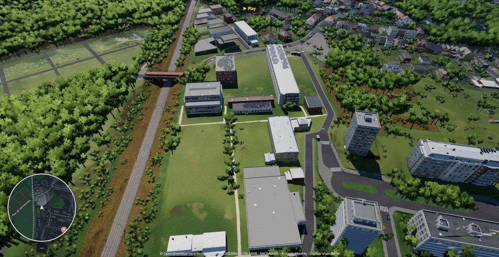 | 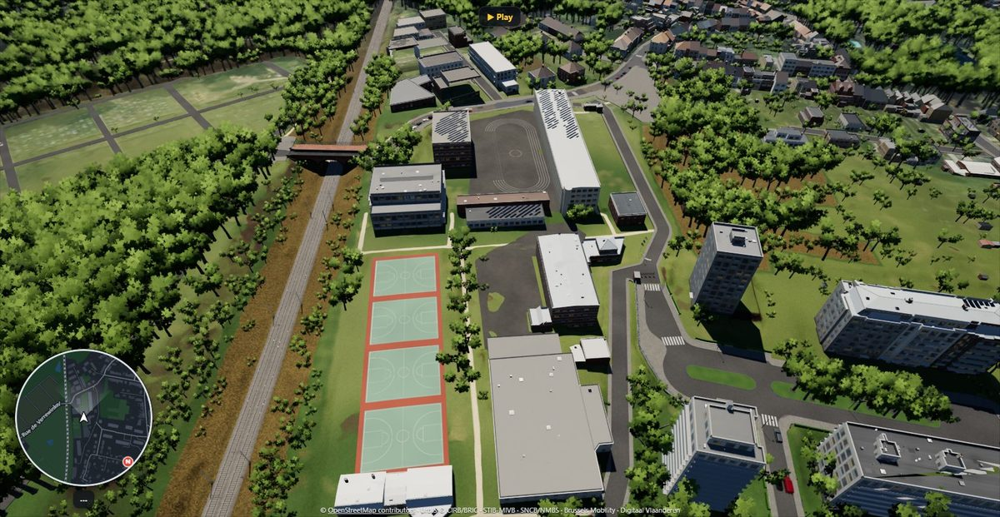 |
| the courts | 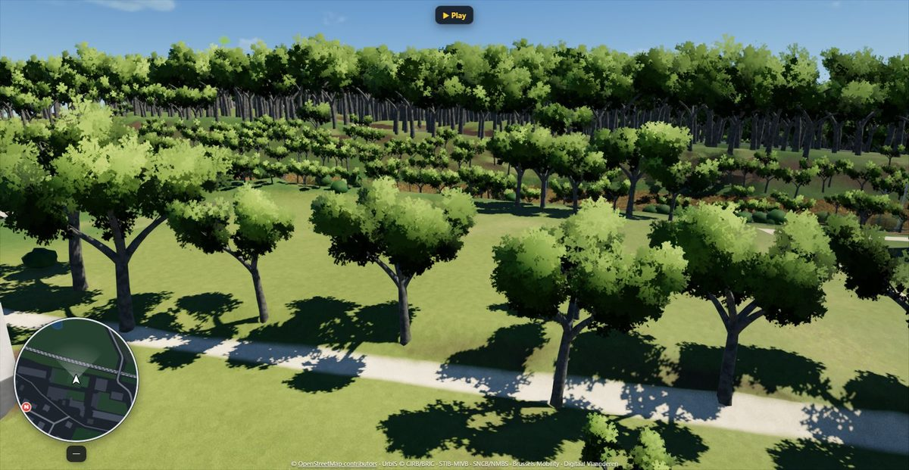 | 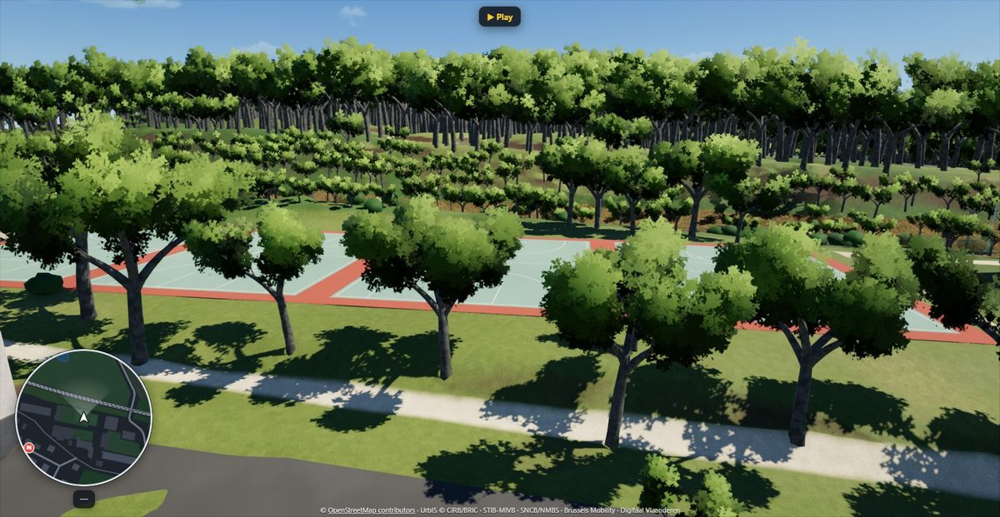 |
| the playground and its track | 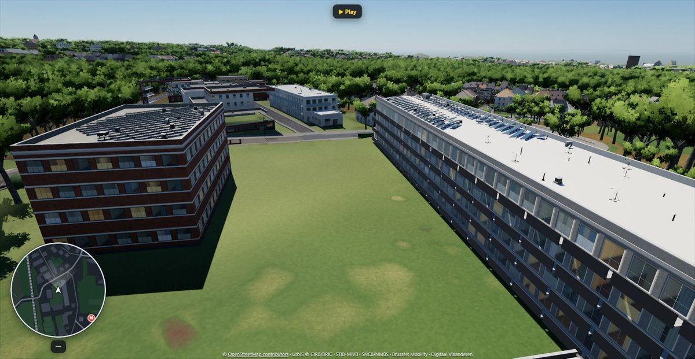 | 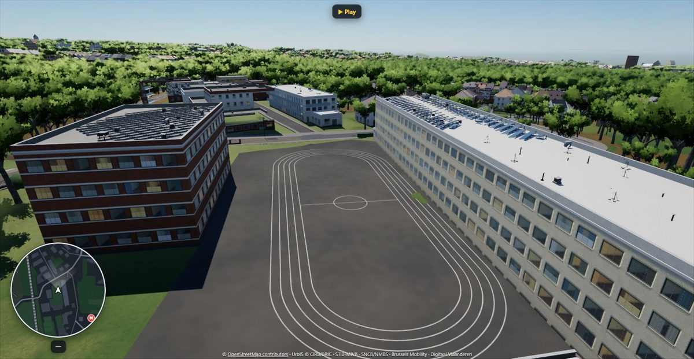 |
| the entrance | 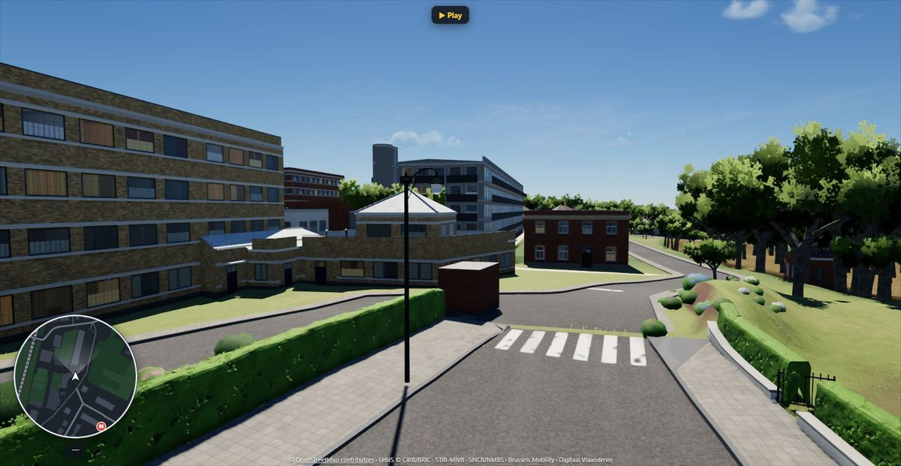 | 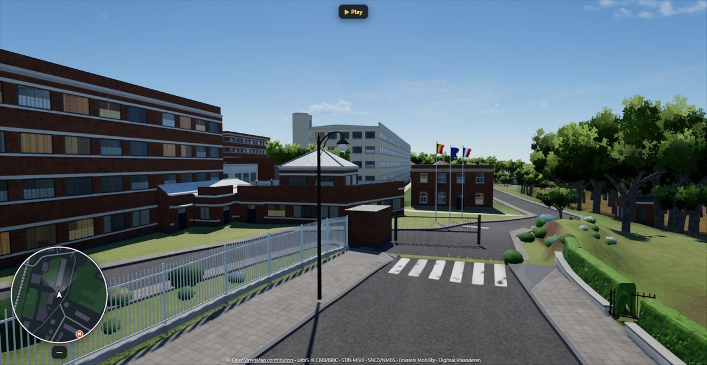 |
| the school front from the avenue | 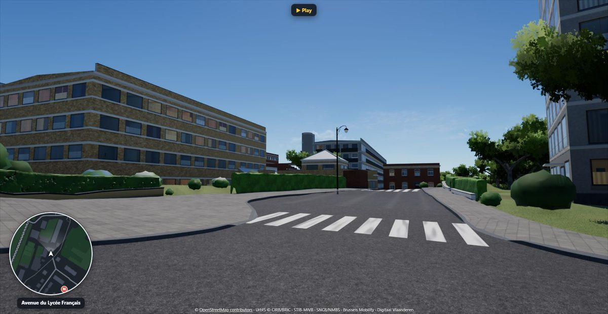 | 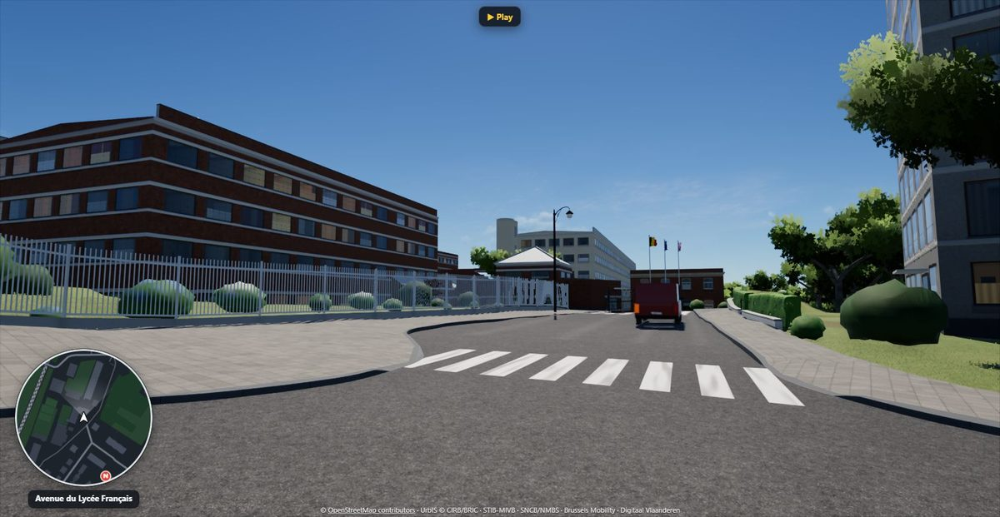 |
| the lane (1990s part), looking west | 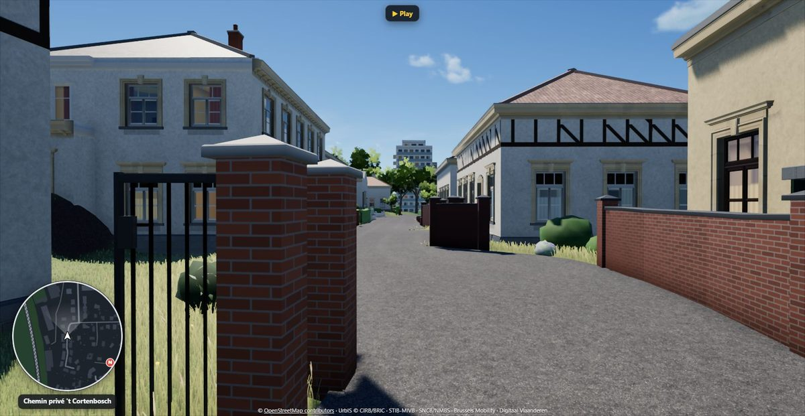 | 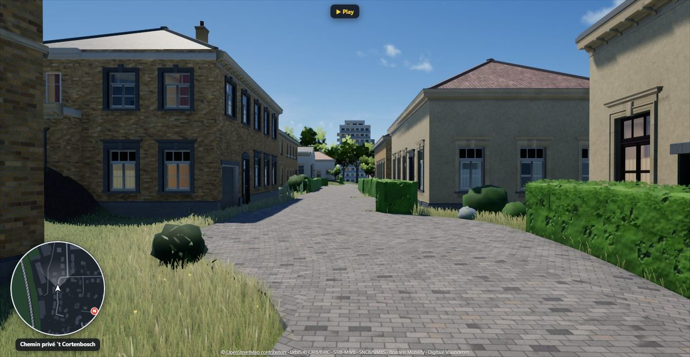 |
| the lane, looking east | 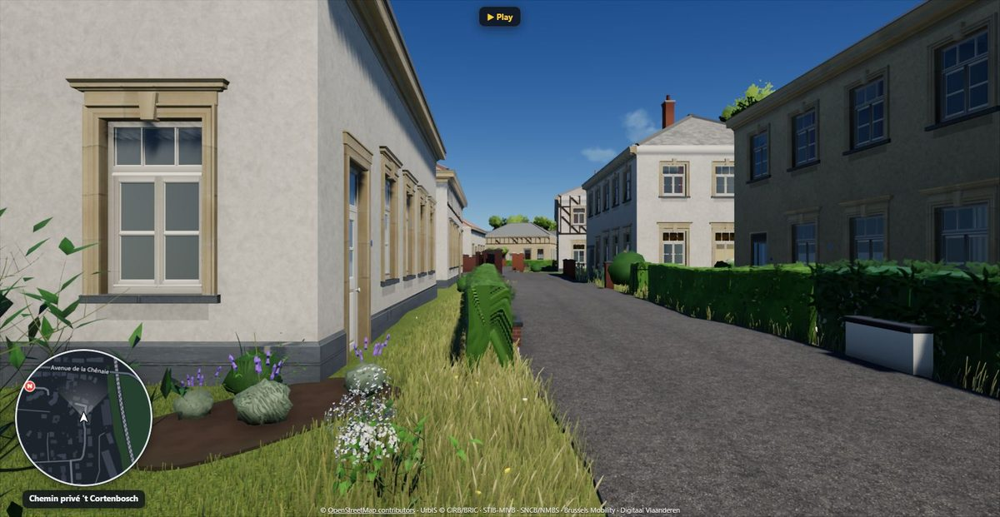 | 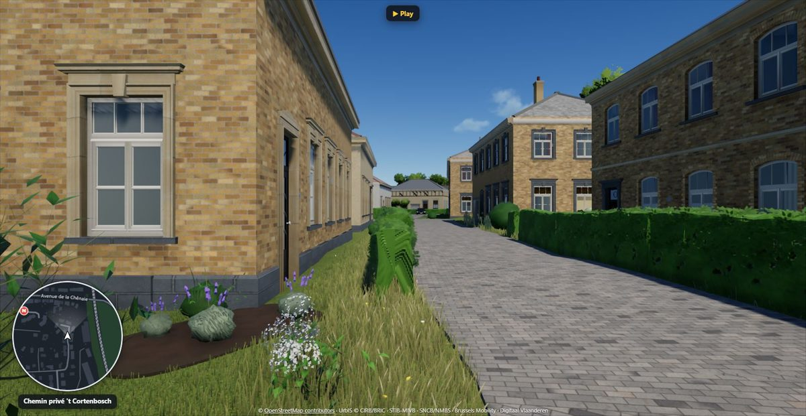 |
| the old lane | 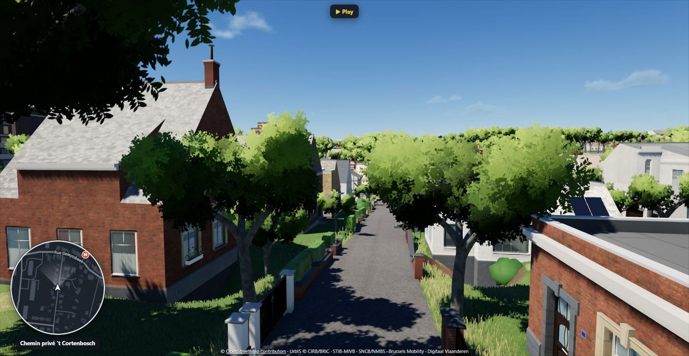 | 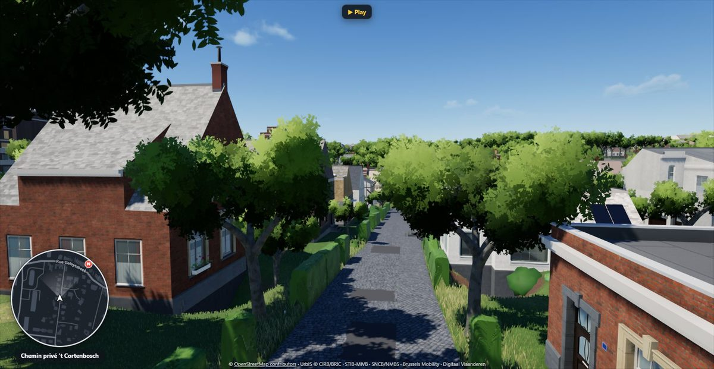 |
| the lane's houses from above | 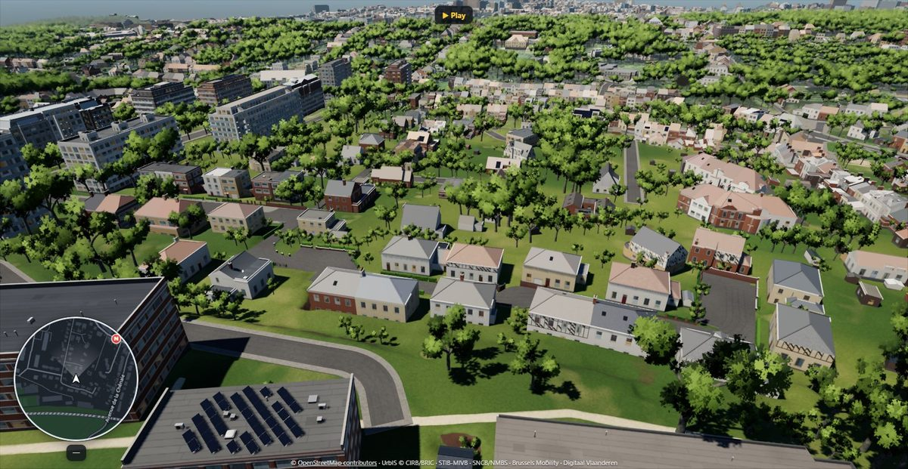 | 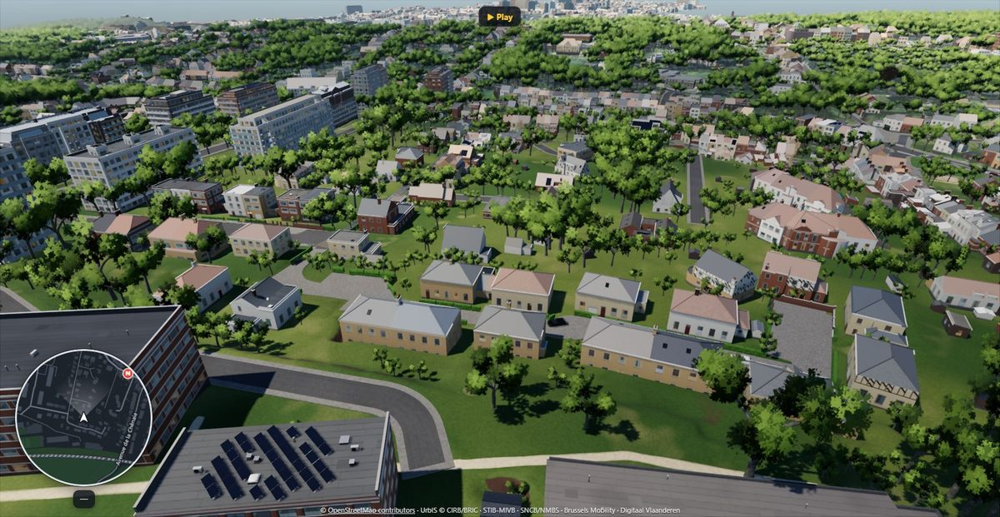 |

More: the railing and the flags close up (`flags_after.jpg`), the lettering (`lettering_after.jpg`), the entrance at
night (`entrance_night.jpg`: the grounds take the lamp light like the plazas, the railing reads against the lamps).

**Checks.** Contact audit (`viewer.contactAudit("lycee-front")`): 0 floating, 0 blocking (6 "openings" = the gate's
middle rail and the railing's end, by design). `viewer.contactAudit("roads:F7")`: no item on the grounds mesh (the
listed items in the area are the existing Rue de Verrewinkel sidewalks). Garden contact (`c.audit()`): F6 / F7 0 floating
segments, 0 floating hedge modules, 0 floating pillars. No console error in any run (day, night, old).

**Cost** (structural; the machine preflight was RED: the owner's apps, 1.8 GB free, GPU 88 % busy at rest, so no ms
numbers): draws at the entrance 161 -> 176 (+15: the grounds, the railing / gate / poles mesh, the lettering, the three
flags, each in the shadow and main passes), campus view +7, school front +8, the lane -4 (fewer garden pieces);
triangles +~40 k (the grounds mesh: 36 k triangles in tile F7, 1.2 m subdivision). No new lights, no dynamic buffers;
the flags are the existing system (a worker records their loops; the live cloth only within 45 m).

## 5. What's left

- **A 1990s house type** in the façade system: the lane's houses are now the right brick but keep the generic grid's
  window surrounds and eaves moulding; the real ones have plain dark frames, a timber band under the eaves, garages
  (a new type in viewer/buildingTypes.js + facades.js, or a façade-kit piece set).
- **The burgundy curtain wall** of 553227: a glass-grid façade style does not exist; red brick + bands is a stand-in.
- **Herringbone**: the street texture array's pavers are stretcher bond; a herringbone layer (texture factory) would
  match the lane exactly.
- **"Private Weg" / "Cortenbosch"** painted on the lane (several places; seen on Street View, exact spots not measured):
  a road-text decal in the measured-paint layer.
- **The 55 streets** of defect 7: fix the name vote (split " - ", repair the double-encoded UrbIS names) behind its
  own switch, city-wide look change for the owner to review first.
- Colliders: the railing and the gate are not walk / drive colliders yet (heroColliders / addStatic).
- The school's other blocks (gym 533648, 533156, 533157, 533181) keep their generated looks (not seen on Street View).
