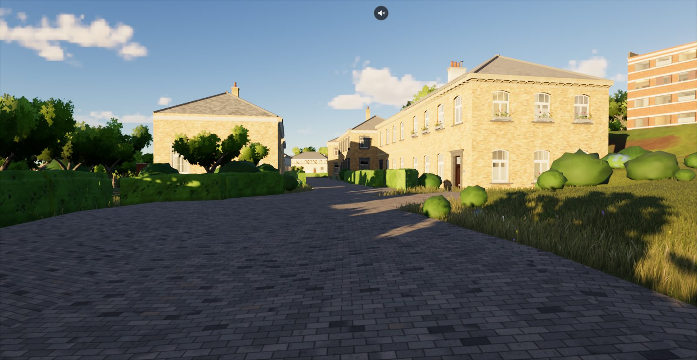
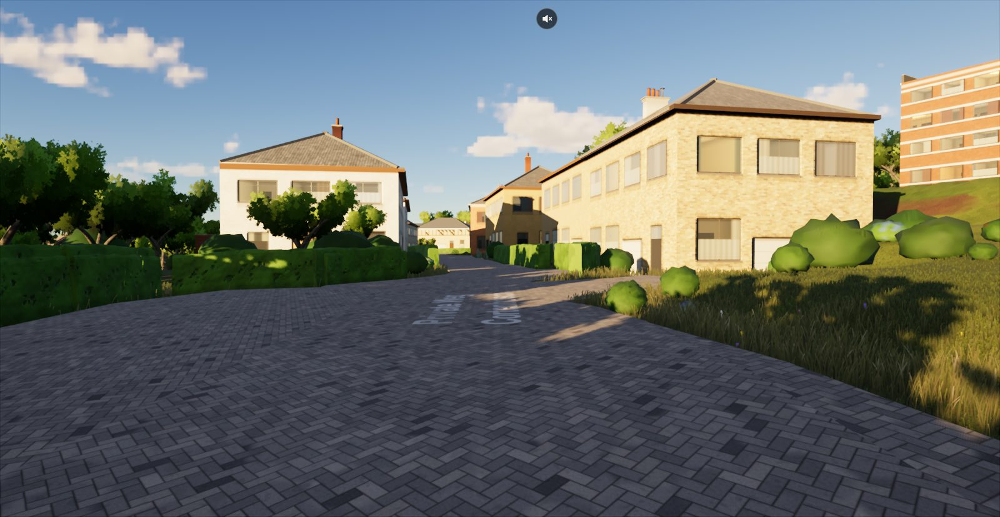
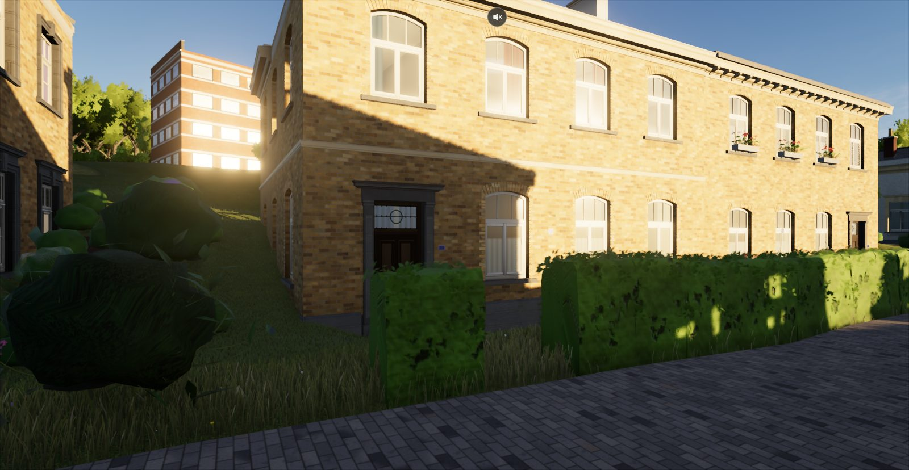
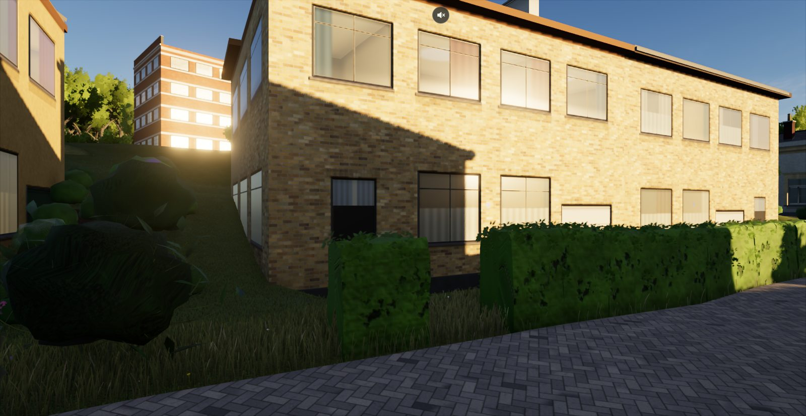
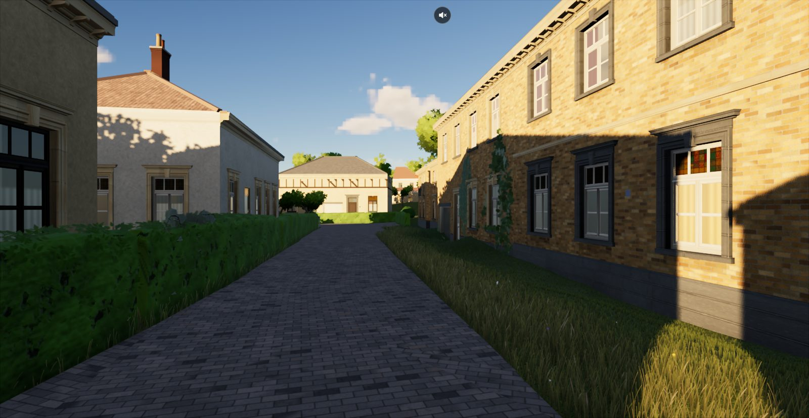
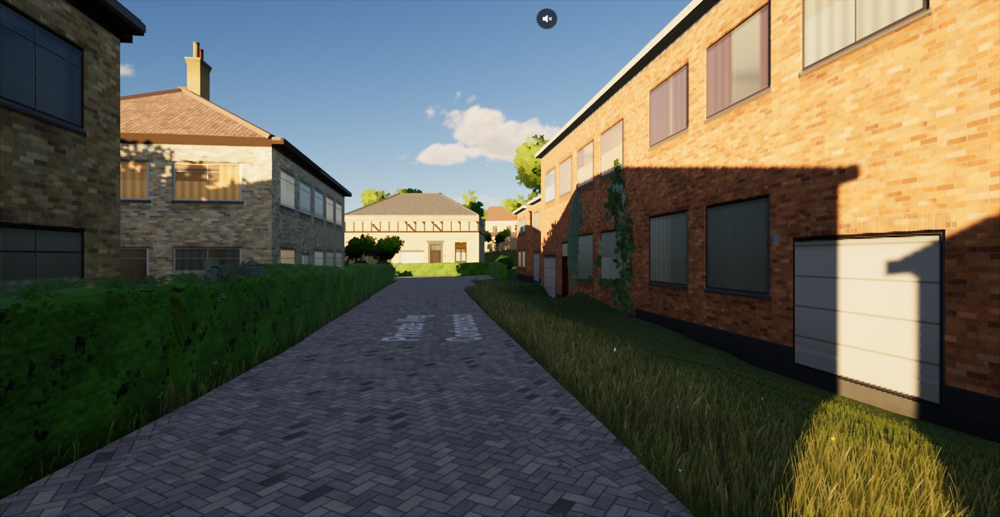
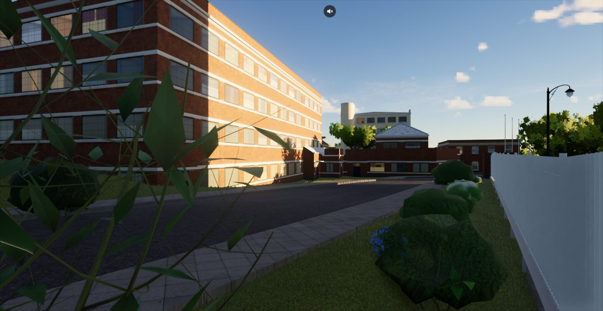
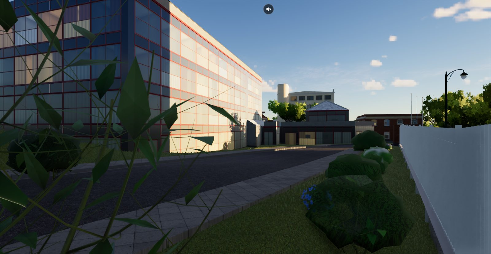
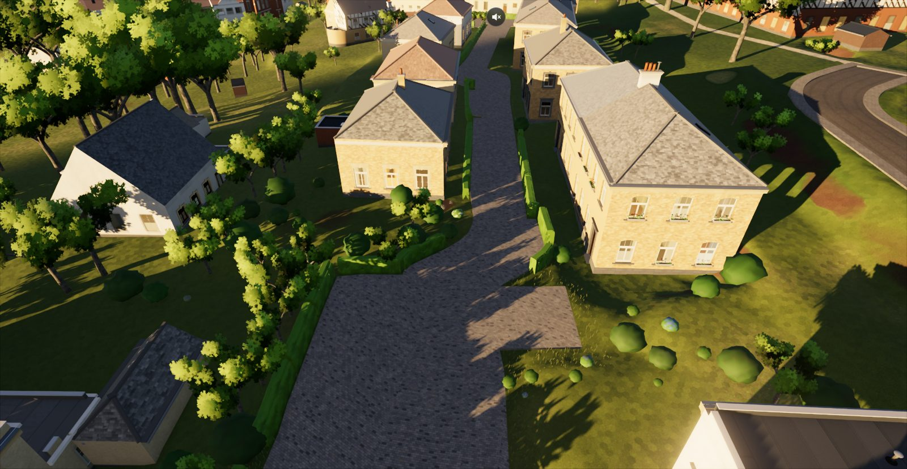
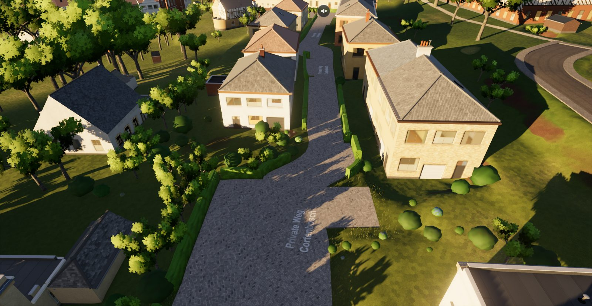

# Cortenbosch, round 2: the 1990s house, the curtain wall, the lane's pavers and paint

Round 1 (docs/CORTENBOSCH.md) left: no 1990s house in the façade system, no glass curtain wall, stretcher-bond pavers on
a herringbone lane, the painted "Private Weg" / "Cortenbosch" missing, the railing and the gate not solid, the school's
other blocks generated. Branch `claude/cortenbosch2`. Switch: **`?cortenbosch2=old`** = round 1 exactly (features.js
row "Cortenbosch round 2 as before", A/B section; `?cortenbosch=old` drops both rounds). Node check:
`node --import ./tools/road_audit/register.mjs tools/cortenbosch2/check.mjs [F7 F6] [--old]`.

## 1. Two new façade types, usable city-wide

Types 6 and 7 of viewer/buildingTypes.js (aBld.z = street + 2 type + 16 garage holds 0-7). `classify()` never draws
them: a curated look gives them (data/overrides.json `buildingLooks` `{ "type": 6 | 7, ... }`), anywhere in the city.
Their sub-look rides in the wall style's fraction (`typedStyle`: the style stays in its band, so the material library,
the far colours and every style test keep working).

**Type 6, the 1990s Brussels-periphery house** (the lotissements of Uccle's south, Linkebeek, Drogenbos, Rhode):

| part | how |
|---|---|
| face brick | the yellow-brick set (its bond, joints, texture) tinted per house: `tone` buff, salmon, cream (cream-white), orange (orange-red), brown (brown-buff); missing: buff / salmon / cream by the building's hash |
| windows | TYPE_GRID row 6: wide, low (min(2.1 m, 0.74 bay), sill / head 0.30 / 0.78 ground, 0.33 / 0.80 upper), lower storeys (step 2.95 m, k 0.80-1.12: 2.7-3.1 m storeys); thin 5 cm frames (`frame` white, brown, anthracite PVC / aluminium), casements of ~0.95 m, a top light on half of the houses; the front door in the frames' colour on 55 % |
| no stone dress | no surrounds, no keystones, no moulded cornice; blue-stone sills kept (the Belgian norm in the 1990s), a 0.3 m plinth |
| lintels | a **soldier course** (bricks on end, 21 cm, 6.8 cm wide, a tone per brick, joints fading out before ~4 px) over every window, the door and the garage, 10 cm past each side |
| eaves | a fascia board over a 35 cm soffit (detail strip) and a 30 cm painted band: `fascia` cream (cream-painted timber), stained (dark-stained timber), fibre (grey fibre-cement) |
| garage | `garage: true` gives the garage door where the classifier did not (the sectional / board door of the bel-étage type) |
| roof | `roofTile: "concrete"` (any type): aRoof.w + 2, the roof shader lays the pantile profile (concrete interlocking tiles) in the roof's own orthophoto colour, whatever its hue |
| kit | off (painted joinery, like types 2-4) |

**Type 7, the glass curtain wall** (the Lycée's teaching block D, 553227; reusable for offices / schools): the glass
fills each bay (TYPE_GRID row 7: wwFrac 1, sill 0.06, head 0.80 of a 3.4 m storey); the rest is spandrel / corner panels
(`spandrel` glass: dark enamelled glass with the sky in it; metal: the grid's colour; grey: a light panel); `grid`
burgundy / anthracite / silver / green mullions (6 cm) at every bay edge and every ~1.35 m light, running on through the
spandrels, transoms at each spandrel's edges, a metal coping (strip + band) in the grid's colour; the glass a grey-green
solar tint with more sky; no sills, the glass 4 cm back; the wide glazed entrance of the blocks.

Files: viewer/buildingTypes.js (types, `typedStyle`, TYPE_GRID rows 6-7), viewer/facades.js (decode, colours, the dress,
glazing, frames, cornice / fascia / coping bands, sills, roofs' concrete flag), viewer/facadeGeom.js (look type / style /
garage / roofTile, fascia and coping strips), viewer/farLook.js + farLookData.js (the far tiles now read the looks too:
before, a curated look was lost past the full-tile range), viewer/facadeKit/placement.js (kit off for 6 / 7),
viewer/interior/facadeWindows.js (the curtain wall's door width, KEEP IN SYNC), viewer/tileData.js (`lookSet`: an entry's
`v2` fields over its round-1 look, set "cortenbosch2" entries; far looks).

Applied (data/overrides.json `buildingLooks`, `v2` on the round-1 entries): the lane's seven buff / salmon houses
(527939, 533244, 533362, 557473, 557524, 757489, 757490: type 6, white frames, cream fascia, garage, concrete tiles),
533271 (cream-white brick, dark-stained timber), 533330 / 537192 (cream brick); 553227 = type 7, burgundy grid, dark
spandrel glass. Which house is buff and which salmon, and which have garages: **to check on Street View** (browser
turn).

## 2. The lane's surface: herringbone pavers

A new layer of the street texture array: **layer 4 "herringbone"**, the texture factory's `pavers:b` (the same grey
concrete pavers as layer 2, 22.5 x 11.25 cm, laid in 90-degree herringbone; tools/texturefactory/tf/units.py
`herringbone()`, materials/ground.py; 1K KTX2 UASTC as the other layers: viewer/materials/textures/streets/pavers_hb_*,
1.8 MB on disk, ~2.8 MB GPU). It tiles on 1.8 m (16 bricks); the hex-tiled sampler may only shift it by 4 bricks per axis
(lattice [4, 8]: X = Y mod 4 keeps the herringbone lattice), so its joints stay continuous. The layer has a `switch`
(cortenbosch2): not loaded under `?cortenbosch2=old`.

Surface code 5 `paving_herringbone` (viewer/roadData.js): data/overrides.json `streetSurfaces` 32128 gets `pattern:
"herringbone"` (tileData.js turns paving_stones into paving_herringbone, also on the engine carriageway kept over it).
viewer/roadPaint.js texturedRoad samples layer 4 turned by `HB_DEG` (45 degrees to the street's axis by default,
`?hbangle=90` to compare; the normal turned back into the street's frame); without the layer (or `?paving=old`) code 5
draws the pavers as before.

## 3. The painted words

data/overrides.json `roadTexts` (id -> at, dir, lines, w, h, gap): viewer/streets/measuredPaint.js `roadTextMesh` drapes a
box per line on the measured street's markable triangles PAINT_LIFT up (as the measured paint: one decal part
`roadtext` per tile), viewer/roadPaint.js `roadTextMaterial` draws the rows in a canvas atlas (bold sans capitals,
stretched along the street by the box), the paint's colour and wear, mipmapped, transparent, polygon offset. First
placement: "PRIVATE WEG" / "CORTENBOSCH" 3 m into the lane from Avenue du Lycée Français: **the spot, the lettering
and its case to be read on Street View** (browser turn).

## 4. Colliders

The Lycée's front group (viewer/lyceeFront.js: railing, sliding gate, flag poles) joins the hero collider roots
(viewer/heroColliders.js, from main.js when the switch is on): car blocks from its triangles in the 0.3-1.3 m band,
its triangles in the walk / third-person BVH.

## 5. Street View pass (2026-11-17, look only)

What the lane really is (Apr 2024 panoramas at n. 46, 49, 50, 54):
- **pavers in 45-degree herringbone**, pale warm grey (the layer drawn x 1.3 lighter); the mouth by n. 46 is **setts**
  with a paver strip (our surface 32128 covers it: still herringbone there, left);
- **"Private Weg" / "Cortenbosch"** in white mixed-case sans letters, **two columns ALONG the lane** (the letters' tops
  to the left of the way in), painted at several spots: drawn at four (mouth, n. 49, 50, 54), 5.4 x 1.1 m a line
  (`roadTexts` `along: true`);
- the houses: **pale buff brick with dark grey panels** (557473, 557524), **salmon brick with cream boarding under the
  eaves** (527939 and the row 757489 / 533244), **ochre render with grey bands** (533362), **white render over a cream
  brick ground floor** (537192, 757490), buff-grey brick with dark-stained timber cladding (533330); all with
  **anthracite frames**, wide **varnished / stained timber soffits**, grey sectional garage doors, hip roofs. So type 6
  gained render tones (ochre, white: style 4 + code) and a varnished fascia; the code is now x 200 (tone x 12 + frame +
  3 x fascia, < 0.42: the style keeps its band); its garage doors are grey (a few white);
- block D: reflective glass in a **bold burgundy grid of square lights** with a red-brick end: the grid is now 11 cm,
  a transom halfway up each storey, the spandrel glass reflects more;
- the school's other blocks (Rue de Verrewinkel + the aerial): 533157 white concrete block with window bands and slab
  edges (type 4, style 3), 533648 the sports hall in grey cladding (style 5, type 2), 533156 / 533181 (walls not or
  barely seen, TO CONFIRM): cream / white render with window bands; set "cortenbosch2".

## 6. Before / after (quick mode, golden hour; `?cortenbosch2=old` vs default)

| view | before | after |
|---|---|---|
| the lane at n. 49, looking east |  |  |
| n. 50's house (557473) |  |  |
| the lane at n. 54 (the salmon row) |  |  |
| block D from the avenue |  |  |
| the lane from above |  |  |

Also `lane49_night.jpg` (night, no error), `mouth_after.jpg` (the mouth: herringbone where Street View has setts).

**Checks.** No console error in day, night or old. Colliders: "lycee-front" built (6,536 triangles for walk / third
person, 153 car blocks); 115 / 115 samples along the railing and the gate inside a car block. GPU, wall shader alone
(the foundation's facades.js swapped live with this one on the lane's wall meshes, n. 50 view, 4 rounds): -0.14 ms
p50 (spread -0.72..+0.07): within noise. Machine not preflighted (the owner working): rough only.

**Defect eye.** Seen and fixed: the grid of block D too thin to read (11 cm now), the pavers too dark, green garage
doors. Still seen: the mouth's words partly off the markable surface (one column clipped) and the mouth drawn in
herringbone over real setts; a white render house cannot carry its cream brick ground floor (one material per
building); the soldier courses only read up close; the round-1 railing reads as a white wall at a grazing angle far off.

## 7. Checks done (node)

`tools/cortenbosch2/check.mjs`: F7 / F6 build; the lane houses type 6 with their codes (e.g. 533244 style 2.10 =
salmon, white, cream), garages, 336 + 48 concrete-tile roof vertices; 553227 type 7; 1,618 asphalt vertices with
surface 5 on the lane; the road-text decal 20 triangles; `--old`: round 1 exactly (types 0 / 2, surface 2, no decal,
no concrete tiles).

## 8. Still to do

- The mouth: split surface 32128 so its first ~10 m are setts (as Street View), then re-place the mouth's words.
- Two-material 1990s fronts (brick ground floor, render / timber upper floor), the segmental arches of the salmon row.
- 533156 / 533181 seen from inside the campus; the herringbone's pale tone checked at midday.
