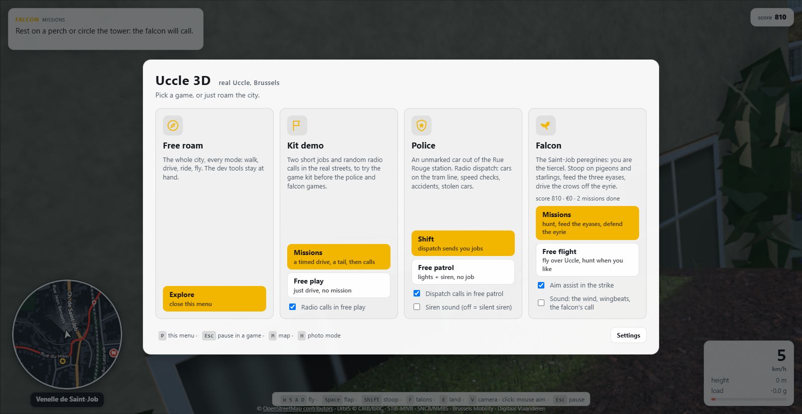
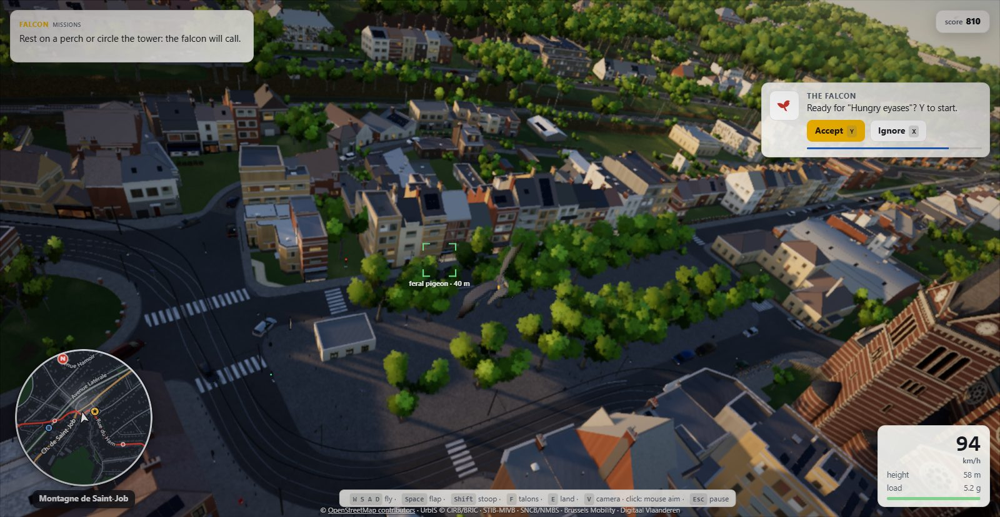
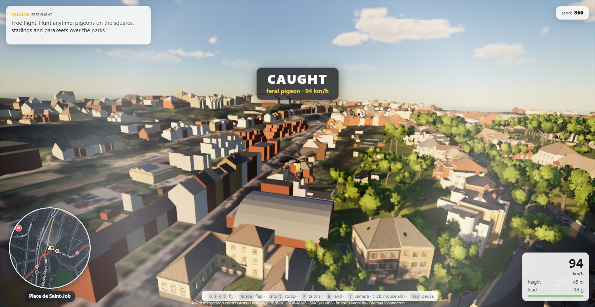
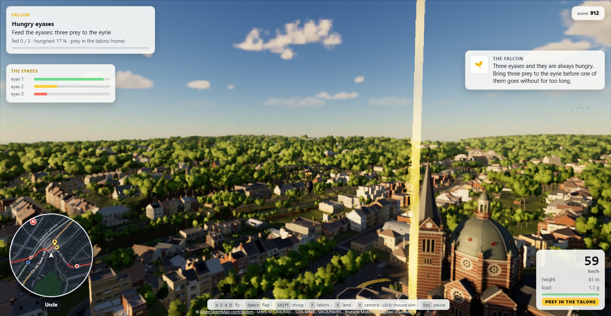
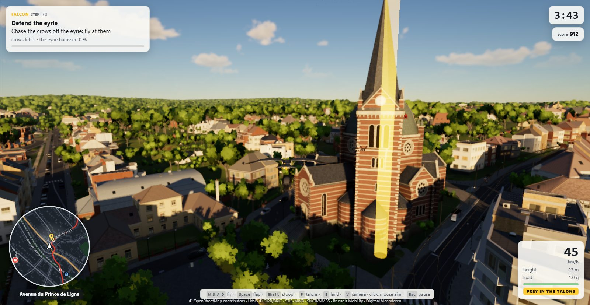
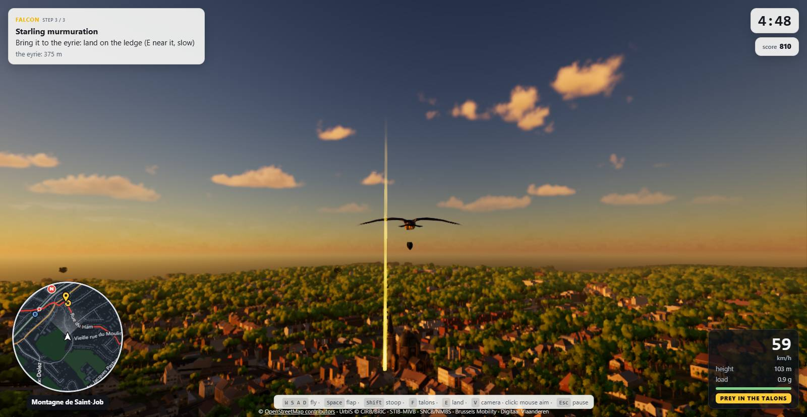

# Falcon game, round 1

The life of the real Saint-Job peregrines. The pair nests in the belfry of Saint-Job church in Uccle (one of the Brussels
city nests with Saint-Michel cathedral and the ULB belfry; the "Falcons for Everyone" webcams of the Natural Sciences
museum). **You are the tiercel**, the male. During the nestling weeks he does most of the hunting, while the female
broods and feeds the young. She takes his prey at the eyrie and feeds the three eyases. Peregrines build no nest: the
eyrie is a gravel scrape on the belfry floor (`models/falcons/nest.glb`).

The game is registered on the game kit (`docs/GAMEKIT.md`) with id `falcon` and replaces the "coming soon" card. Start
it from the start menu (**P**) or with `?game=falcon` (`&gmode=free` for free flight). Branch `claude/falcongame1`.

| | |
|---|---|
|  |  |
|  |  |
|  |  |

## Controls

These are the falcon flight's own controls (`viewer/falconFlight/falconInput.js`). Since **falconfix** (2026-11-16,
`docs/falconfix/README.md`) the **flight assist** (`viewer/falconFlight/flightAssist.js`) flies the bird where the player
points: the old raw stick controls are `?falconctl=old`. Since 2026-11-27 the default controller is the Falcon Gym's
(rule falcon-gym "the gym in the city") and the default bird the v2; `?falconctl=current` / `?falconmodel=current` keep
the old ones.

| key | action (assisted, the default) |
|---|---|
| click, then the mouse | aim: the falcon turns and climbs / descends toward the aim; the camera looks along it |
| A / D | turn left / right (the bird banks by itself; let go: wings level) |
| W / S | a gentle descent / climb (let go: the bird holds that height) |
| hands off | wings level, the height held (rising air lifts it), light wingbeats keep ~50 km/h |
| Space | climb: full wingbeats (costs stamina) |
| Shift | the stoop (W steeper, S shallower); let go: wings open, pull-out, then the height is held |
| C / Q | half fold (a fast glide) / brake (flare) |
| F | talons (with aim assist on, they also come out by themselves in the last half second of a good strike) |
| E | land on the perch in reach. With prey, near the eyrie, this lands on the eyrie's ledge = the delivery |
| V | chase / head camera |

The kit adds: **Esc / P** pause, **Y / X** accept / ignore the falcon's call, **M** map. Losing the pointer lock (Esc in
mouse aim) pauses too. The intro (the hop from the scrape to the ledge, the launch) can be skipped with **Space**.

Start menu options (remembered per game): **Aim assist in the strike** (on by default), **Flight assist: steer clear
of roofs, trees and the ground** (on by default; `?falconavoid=0`) and **Sound: the wind,
wingbeats, the falcon's call** (OFF by default, as the owner asked; it is the flight's own `falconAudio.js`. The kit's
radio beeps follow the kit's volume setting).

## Modes

- **Missions**: a short campaign. The first mission still to do starts after the intro. Each passed mission offers the
  next one on the radio card (Y). A failed one is offered again 25 s later. When all four are done, they repeat.
- **Free flight**: fly anywhere over Uccle. Hunt whenever you like: pigeons at the six squares (Saint-Job, the town
  hall, Saint-Pierre, Wolvendael, Héros, Vanderkindere), starling parties and ring-necked parakeets over the parks,
  jackdaws round the towers by day. There is no objective. Every catch scores (10 + km/h ÷ 6), and every delivery to
  the eyrie scores 40.

## Missions (`viewer/falconGame/falconMissions.js`)

| mission | steps | fail | reward |
|---|---|---|---|
| **First hunt** | gain height (70 m over the Place, or perch on the spire's cross) → over the Place de Saint-Job → stoop: the pigeons flush and you take one in the air → land on the eyrie's ledge | step timers (180 / 150 / 240 / 240 s); prey lost | 200 (+100 under 170 s) |
| **Hungry eyases** | three eyas hunger bars drain (full to empty in 4-5 min, each at its own rate). Bring 3 prey to the eyrie. A pigeon or jackdaw refills ~0.5 of every bar, a parakeet ~0.38, a starling ~0.28 (hungrier bars get a bit more). Under 25 % the falcon warns you | a bar at 0 | 300 |
| **Starling murmuration** | dusk is set (the sun at +2.5° on this day of the year) and the murmuration is forced on over the nearest roost (Parc Fond'Roy from Saint-Job) → reach the flock → catch a starling of the murmuration (the flock scatters from a stooping falcon, and alarmed starlings fly at up to 27 m/s, so it takes a high stoop: ~40 m/s worked) → home | timers; the flock drops into the roost | 350 |
| **Defend the eyrie** | 5 carrion crows come and circle in front of the ledge, turning on the falcon when it is near. **Chase them off**: pass within 7.5 m of one, faster than 13 m/s, heading at it. A crow jinks sideways when a slow falcon comes straight at it. → hunt something → a herring gull chases you for it: get home, or fly at the gull (it veers off for 15 s) | the "harassed" meter fills (0.5 %/s per crow within 24 m of the ledge); the gull robs you (within 2.6 m for 1 s) | 300 (+15 per crow) |

The radio-style cards come from "The falcon" (the female at the eyrie) and from "Saint-Job" (the narrator), for
example: "Drop on them: they burst up when you come. Take one in the air, fast and straight: a slow attack misses, the
pigeon out-turns you."

### Writing a mission

Missions are kit data (`docs/GAMEKIT.md`, "Writing a mission"), mostly `custom` steps over the game state `S`
(`falconGameDef.js`):

- `S.game()`: the `FalconGame`, with `.f` (the flight state), `.score` (catches, delivered), `.window` (the strike window)
  and `.mode`
- `S.flyer()`: the city's flyer, with `.bird.prey`
- `S.hunt`: the hunt layer, with `.mux.lastTaken` (`{ kind, slot }`) and `.hunger`
- `S.mobbers`: the crows and the gull
- `S.eyrie` / `S.out`: the ledge and the direction its tower face points
- `S.height()`: height over the Place de Saint-Job
- `S.murmuration()`: the murmuration's leader point

Setup that must be undone however the mission ends (dusk, the crows, the hunger) is a mission ENTITY with `release()`.
See `S.duskEntity()`, `S.mobEntity()` and `S.hungerEntity()`: the kit releases entities on success, fail or abandon.
`deliverStep(S)` is the reusable "land on the eyrie's ledge" step. Add the new mission to `order` in `makeMissions()`
for the campaign, and give it a line in `onMissionEnd`.

## Falcon fun (claude/falconfun, 2026-11-24: the default; `?falconfun=old` = the catch below)

The owner's playtest found the catch too hard and the falcon never fast. The rule is `docs/rules/falcon-catch-fun.md`:
a first-time player must be able to catch a pigeon within ~30 s of the start. The code is
`viewer/falconFlight/falconFun.js`, and the gate row `falconfun` checks it headless with a simple player.

- **Look, hold, catch.**
  - The pigeon nearest the view centre is locked: a soft ring with its kind (easy / RACER x2 / tired) and "hold F".
  - Hold **F** (gamepad **X**, touch **STRIKE**), or **Shift** while a bird is locked. The falcon dives onto it by
    itself: the lead point, over the roofs in the way, a swoop that bottoms at the bird, homing in the last 14 m.
  - **A / D** and **W / S** still nudge the dive. Let go to fly yourself.
- **The grab** is automatic within 5.5 m. Just before contact the game slows down for a moment, then the hit-stop.
  Speed and angle are bonus points, never a miss:

  | bonus | when |
  |---|---|
  | PERFECT STOOP x2 | >= 108 km/h, diving |
  | HEAD-ON +5 | within 15 deg |
  | RACER x2 | a racer pigeon |
  | COMBO up to x3 | catches within 30 s of each other |
  | run +100 | "Catch 5 in 2:00" (the card at the top) |

- **After a catch:** 2.5 s before the next lock, and +25 % stamina. You keep hunting with prey in the talons. Landing on
  the eyrie's ledge is still a bonus (and still a mission step), but you never need it to score.
- **Speed:**
  - a 50 m stoop reaches ~150 km/h, 150 m ~250 km/h (`flightModel.js` arcade); the pull-out is guarded
  - tap **Space** (gamepad **RB**, a tap on FLAP) to sprint
  - the FOV, the air streaks and the wind come in earlier
- **Pigeons:**
  - most are easy: feeding, slow to notice, slow off the ground, low and slow in flight
  - every 8th is a pale racer: fast and dodgy
  - a dodge is warned (hard wingbeats, the ring turns orange "DODGE!")
  - after two escapes a bird is tired: slow, no dodge
- **Where:** with nothing locked, an arrow points to the nearest pigeons (or the nearest square with a flock). The two
  nearest squares with pigeons also show on the minimap and the full map as a flock glyph (three dots).
- **The camera:** in a hard pull-out the chase camera turns with the path faster, pulls back and up with the g, and a
  frame guard keeps the falcon within 60 % of the half field of view. When street-tree crowns hide the falcon (whole
  crowns, not only their cores), the camera first lifts over them (1.5-8 m) before coming in, eased in ~0.1 s.
- **The first catch:** a tame pigeon sits on a roof straight ahead under the eyrie's launch. The hint says "hold Shift
  (or F) to dive onto it". While it is uncaught it holds the lock whenever it is in range and within 70 deg of the view,
  so the ring, the hint and the first catch are the same bird.

## The catch (`viewer/falconGame/hunt.js`, on top of `falconFlight/falconGame.js`)

- **Prey**: a single prey source for the strike, `PreyMux`. Indices 0-255 are the pigeons of the nearest drawn square
  flock (`pigeons.js`, CPU). Indices 256 and up are the GPU sky flocks (`gpuPrey.js`: the murmuration, starlings,
  parakeets, jackdaws). **Only flying birds are targets.** A peregrine takes its prey in the air, so a pigeon on a ridge
  or on the setts is not a target until it flushes. They burst up when the falcon comes: about 32 m away, 1.8 times
  further when the falcon is fast, 1.3 times further when it stoops. That is the hunt: come in fast, flush them, take
  one in the air. A stoop at a perched bird used to end in the roof. A falcon with prey in its talons hunts nothing.
- **The window** is `falconGame.js`'s: within reach of the talons, closing faster than 8 m/s, approach within 35° of
  the path. A slow attack misses ("it jinked away").
- **Aim assist** (option, on by default): inside 70 m and 45°, the path is turned toward the LEAD point (the prey's
  position + its velocity × the time to intercept), at most 0.45 rad/s. Real peregrines steer by proportional
  navigation (Brighton, Thomas & Taylor 2017, PNAS 114: 13495). With assist on, the talons come out by themselves when
  the window is good and the strike is under 0.5 s away.
- **Feel** on a catch:
  - a ring-shaped hit flash (the bird at the centre stays visible)
  - the flight's 0.3 s hit-stop, then slow motion eased back to normal speed over ~1.1 s (`game.timeScale`: the
    falcon, the pigeons and the thermal hints slow down)
  - an FOV kick of +9°
  - the banner "CAUGHT · feral pigeon · 94 km/h"
  - the kek-kek call, if sound is on
  - the carried prey in the talons (the nest's `prey_carry` pigeon, smaller for a starling or a parakeet), +0.33 kg
- **G-force feel**: the screen edges darken with the load factor from 3.2 g to 6.5 g (a pull-out from a stoop). The
  flight camera already widens the FOV with airspeed (58° to 82°), shakes above 45 m/s, and adds air streaks and a
  speed vignette.
- **Prey marker**: four corner ticks round the target. They close in with the time to intercept, turn green inside the
  window, show an "F" pill when the talons should come out, and a label ("starling · 45 m"). It is updated every frame
  and writes one transform. The old ring of the flight HUD is hidden in the game.
- **Catching removes the bird**:
  - Pigeons: `pigeons.take()` (gone, a newcomer lands later).
  - GPU flocks: the **dead flag** in `viewer/birds/skyFlocks.js`, set by `kill(i)`. The bird's epoch becomes
    epoch + 0.5. The bird flies on invisibly with its flock, so a lattice neighbour of the murmuration is not torn out.
    It is never listed or drawn, and it respawns only with the slot's next epoch. This was verified on the GPU after a
    catch: `w = 13.5` for epoch 13.

## HUD

- **Kit** (`viewer/game/hud.js`): the objective card (steps, the live line, the progress bar), the timer, the score (€
  and reputation are hidden for this game), the radio cards and the result cards.
- **Falcon gauges** (bottom right, 4 Hz, diffed writes): km/h, height, load (g), stamina, and a chip: STOOP / PREY IN
  THE TALONS / PERCHED / LANDING.
- **The eyases' hunger**: three bars under the objective card (green, yellow under 50 %, red under 25 %), only while a
  mission feeds them.
- The flight's monospace dev HUD (`.fhud`) is hidden in the game. Its message line (missed: too slow…) moves to the
  bottom.

## Game tuning

- **The player is an adult tiercel.** The flight lab's numbers are a juvenile's, so in the game:
  - stamina drain is 0.045/s (from 0.075): about 22 s of wingbeats
  - stamina regain is 0.05/s (from 0.035)
  - the player's bird wears the adult plumage (the same texture node with the family's `adultMap`: a bind change,
    no new pipeline)
  - the family's own male is parked out of sight (state `test`) for the game and goes back to the spire's cross after
- **Delivery**: with prey in the talons, E near the eyrie (< 40 m, < 26 m/s, not behind) picks the eyrie's ledge, not
  the nearest louvre or roof ridge.
- **Where**: `S.drain` (hunger), the mission step times, `Mobbers` (crow speeds 10.5-14 m/s, chase radius 7.5 m, gull
  15 m/s, steal 2.6 m for 1 s), `FalconHunt.assist` (strength), `steer()` (0.45 rad/s), the catch feel in `caught()`.

## Cost

- **No game running**: nothing at all. No updater, the DOM is hidden, the mobbers mesh is hidden and there is no
  read-back. `startGame` loads the modules once (~25 KB of source).
- **In the game**: one updater.
  - Measured per frame: p50 < 0.1 ms, p95 0.2 ms, max 0.4 ms. This includes the GPU prey copy and the 4 Hz gauges.
  - The marker writes one style per frame. The mux copies 3.7 KB of states.
  - Kit logic runs at 10 Hz (0.1 ms).
- **GPU prey read-back**: only while a catchable sky flock is within 450 m of the falcon.
  - One reusable `THREE.ReadbackBuffer` (169 KB): no allocation per read.
  - Every 220 ms, every 90 ms when a bird is within 80 m. The latency is 40-120 ms, the copy < 0.1 ms.
  - Positions are extrapolated by velocity × age, capped at 0.5 s.
- **Kill**: one 1-thread compute dispatch per catch. It is compiled at game start (`kill(-1)`).
- **Mobbers**: 8 birds on the CPU (microseconds) and one instanced draw with the pigeons' own material (its pipeline
  warmed under the start card). They are drawn only while a mission has them.
- No light is added. No DynamicDrawUsage: the mobbers' instance attributes are static + `needsUpdate`, like the pigeons'.
- Not measured on a GREEN preflight: two other agents had WebGPU tabs open on this machine all along. Do it in the next
  perf pass.

## Verification (`debug/falconGameAuto.js`)

The tab was rarely in front, because other agents' WebGPU tabs shared the GPU. So the flows were validated with an
autopilot that drives the flight's own input (`FalconInput.script`):

- `go({ climb })`, `go({ to, alt })`, `go({ hunt, at, waitH, aim })`, `go({ chase: mobbers })`, `go({ home })`
- `A.state()` gives a summary

Results:

- **First hunt**: passed end to end. Climb, the flush, a catch at 79 km/h, landing on the ledge, delivery, "Mission
  passed".
- **Defend the eyrie**: passed. 5 crows chased off, then home.
- **Murmuration**: dusk and the flock come up. A 230 m stoop caught a starling of the murmuration at 144 km/h, and its
  dead flag was set on the GPU.
- **Hungry eyases**: the bars, the drain and the refill work. The autopilot was too slow at its first try with the
  first tuning, so the drain was halved.
- **Quit**: everything is restored (updater, prey source, perch rule, stamina, plumage, the family male, dusk, the
  murmuration force, hunger).

The feel (assist strength, slow-motion length, flash) still needs tuning by a human at the keys. See "Weak spots".

## Shared files touched (small, delimited)

| file | change |
|---|---|
| `viewer/game/cityGame.js` | 2 lines: register `FALCON_GAME` (as the police game) |
| `viewer/birds/skyFlocks.js` | the dead flag: steer does not respawn at epoch + 0.5; move integrates live and dead birds but lists only live ones; `killNode` + `kill(i)`. All marked "FALCON GAME". **For the motion-vector work (claude/motionvec)**: a dead bird is still integrated (its previous position stays valid), it is just never listed |
| `viewer/falconFlight/cityFlyer.js` | 1 condition: `ambient()` does not pick the hunted flock while `this.preySource` is set (the game's mux) |
| `viewer/falconFlight/flightModel.js` | 2 collision fixes (marked "falcon game round 1"). (a) The wall's real normal is used only if it opposes the velocity; else the bird stayed PINNED at the last free point at 10+ m/s, seen squeezed between the setts and a low crown on the Place. (b) A bird already moving out of a wall contact (a roof rim it sits a few cm inside) is set on top of the solid; before, it ping-ponged in place forever. `tools/falconFlightTest.mjs` is unchanged |

## Weak spots / next

- **Feel tuned by autopilot, not by hand.** The assist rate, the slow motion (1.1 s), the hit-stop, the flash and the
  G vignette thresholds need a human pass. The banner's CSS animation depends on the page's frame timing (in a
  background tab it starts late).
- **Murmuration difficulty.** Alarmed starlings reach 27 m/s (cityBirds' GPU tuning: vmax × 1.45). Only a 150-230 m
  stoop closes on them. It is hard and real, but climbing that high takes ~1-2 min of flapping and thermals at dusk.
  Consider a lower alarm boost for the falcon threat, or spawn the mission high.
- **Flight close to buildings.** The autopilot still got stuck against some façades at low height. The two pins found
  are fixed (see above); others may remain where the city's column floors have thin walls (2 m) near the church.
- **The carried prey** is always the nest's pigeon mesh (scaled down for a starling or a parakeet). Its offset is set
  at the catch and does not follow the bird's readable-size change, so it can hang a little low.
- **The GPU prey** is extrapolated from a read 40-120 ms old: the marker can sit 1-2 m off a bird that turns hard. A
  catch kills the bird that was intercepted, which may be invisible-close to another one in a dense flock.
- **Dusk** is set with `lighting.hourOverride` for the murmuration mission and put back at its end: the sky jumps.
- The eyases do not beg with the hunger yet (`falcons.js` updateChick begs only when an adult is near). The female's
  feeding is the existing `fam.force("feed")`.
- **Not done yet** (from the TODO's falcon list): teaching the fledglings, an intruding peregrine, an eagle owl at
  night, weather and seasons, a food pass in the air (the female flying out to take the prey), gamepad / touch for the
  kit's cards.
