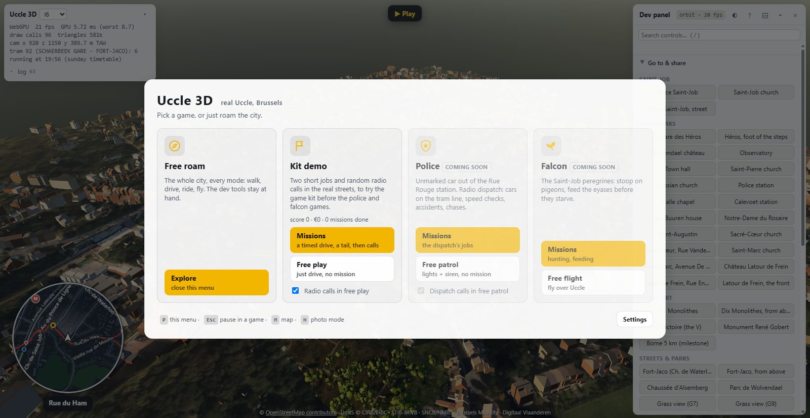
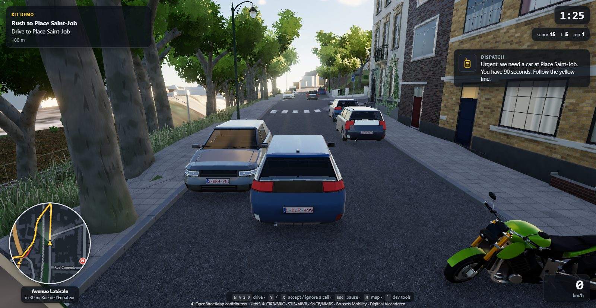
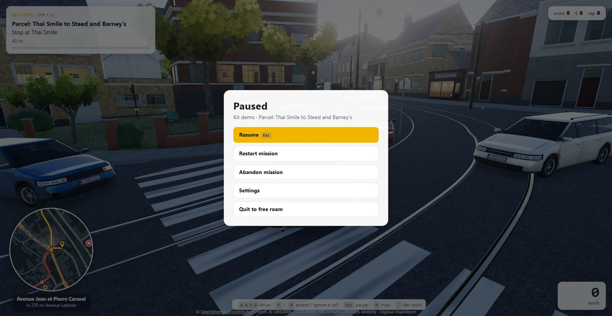
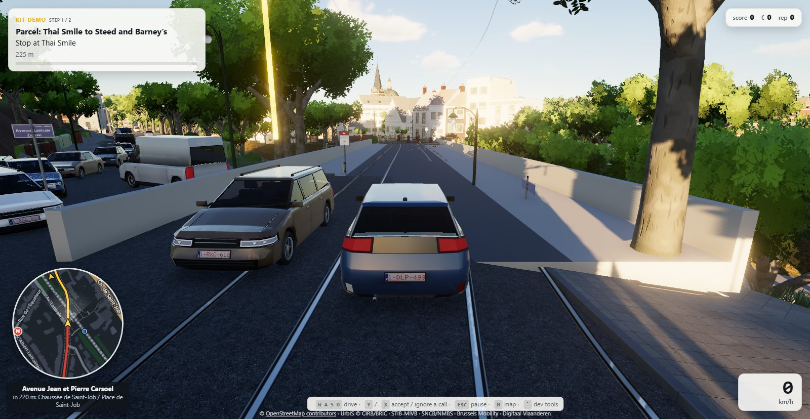
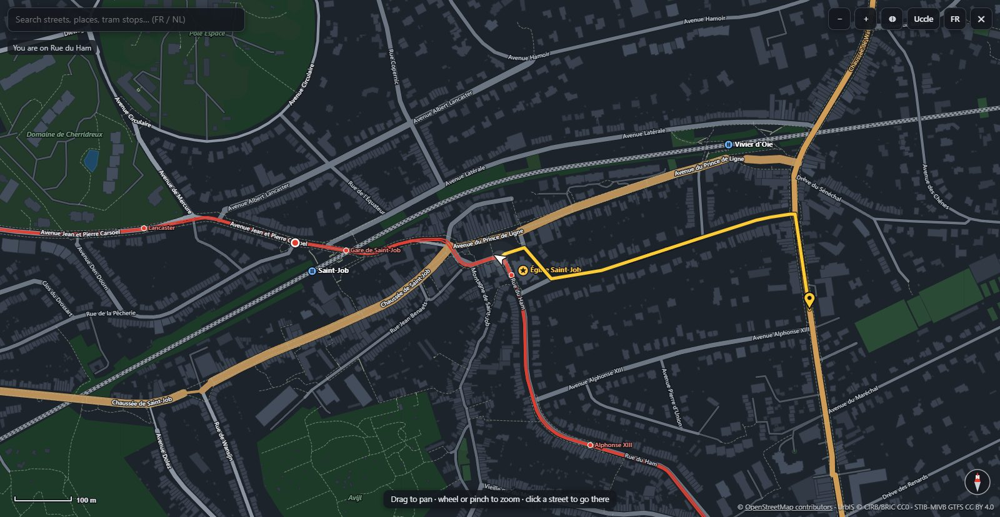
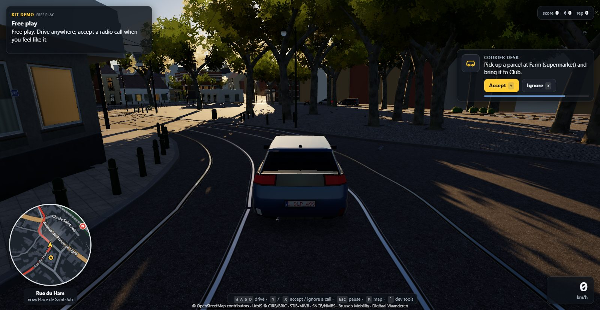

# Game kit + player HUD

The shared foundation of the games on top of the city (police, falcon, later others): a start menu, game modes
(missions | free play), data-driven missions, radio dispatch, waypoints + GPS route, entities, score / save, pause,
and a player HUD separate from the dev panel. Code: `viewer/game/`. Branch `claude/gamekit` (2026-11-15).



| | |
|---|---|
|  |  |
|  |  |
|  | |

## Switches and keys

| | |
|---|---|
| `?game=0` | no kit at all: pure free roam as before (no menu, no Play button, nothing loaded) |
| `?game=demo` | start that game right after the boot; `&gmode=free` for its free play |
| `?gamemenu=0` | no start menu at boot (the Play button / P still open it). A boot link with `?view=` or `?dev=` skips it too |
| **P** | free roam: the start menu. In a game: pause |
| **Esc** | in a game: pause / resume (it no longer leaves the drive / walk mode there). Closes a menu |
| **Y / X** | accept / ignore the radio call on the card (or click its buttons) |
| **E** | the interact prompt ("E  Talk to the witness"): only while a prompt shows (then E does not reach the ride / car keys) |
| **`** | in a game: the dev panel + dev HUD back on top (and off again). Photo mode (H) hides the HUD too |
| **M** | the full map (the route and the markers are drawn on it) |

Rows in `viewer/features.js` (Modes & camera > Games): `game`, `gamemenu`, `gmode`.

## Files

| file | what |
|---|---|
| `viewer/game/cityGame.js` | `startGameKit(host)`: main.js's hookup. Registers the games, fills the places, warms the marker's pipelines, Play button, start menu |
| `viewer/game/kit.js` | `GameKit`: registry, start / quit, pause, missions, waypoints + route, player spawn, entities, the loop (10 Hz logic, 4 Hz HUD) |
| `viewer/game/missions.js` | `MissionRunner` (the state machine) + `OBJECTIVES` (the step types) |
| `viewer/game/dispatch.js` | the call queue (priority), accept / ignore, random calls from templates |
| `viewer/game/gamePlaces.js` | the catalogue of real places (places.js, map landmarks / parks / tram stops, 463 named shops) |
| `viewer/game/waypoint.js` | the 3D marker: beam + ground ring, 2 draws, no light |
| `viewer/game/mapMarkers.js` | markers + route on the minimap / full map (through their `overlay` hooks) |
| `viewer/game/entities.js` | `takeTrafficCar()` / `TrafficCarTarget` (a traffic car as a mission target) |
| `viewer/game/hud.js` | the HUD + start / pause / settings menus (own DOM UI + CSS, dark / light) |
| `viewer/game/save.js`, `audio.js` | localStorage save (versioned), synthesised radio / success / fail cues |
| `viewer/game/demo.js` | the kit demo game (2 missions + 4 call templates) + the "coming soon" police / falcon entries |
| `viewer/map/mapRoute.js` | A* over the map's road graph (the GPS route), run in the map worker (`route` message) |
| `tools/game/build_places.py` -> `data/game/places.json` | the named shops / cafés / restaurants of the built tiles (OSM, 31 KB) |

Shared files touched (small, delimited): `viewer/main.js` (the `---- GAME KIT` block after the map hookup; `teleport()` takes
an optional `mode`), `viewer/map/minimap.js` + `fullMap.js` (an `overlay` hook, `redraw()`), `viewer/map/mapWorker.js`
(`route` message, `areas` in the ready info), `viewer/traffic/trafficSim.js` (a `keep` flag: a mission target is never
culled), `viewer/features.js` (3 rows), `viewer/devPanel.js` (P in the key help).

## Games: register one

```js
kit.register({
  id: "police", title: "Police", icon: "police",            // icons: hud.js ICONS (radio, police, falcon, car, person, demo, roam)
  tagline: "Unmarked car out of the Rue Rouge station…",
  modes: [{ id: "missions", label: "Missions", desc: "the dispatch's jobs", primary: true },
          { id: "free", label: "Free patrol", desc: "lights + siren, no mission" }],
  options: [{ id: "calls", label: "Dispatch calls in free patrol", default: true }],   // checkboxes on the card, remembered per game
  idleText: { missions: "Wait for dispatch.", free: "Free patrol." },                   // the objective card with no mission
  keys: { default: "<kbd>W A S D</kbd> drive · <kbd>Y</kbd>/<kbd>X</kbd> calls · <kbd>Esc</kbd> pause" },
  async start(kit, { mode, options }) {      // put the player somewhere, set up the mode
    await kit.spawnPlayer({ at: "police", mode: "drive", face: "stjob" });
    if (mode === "missions") kit.dispatch.push({ priority: 1, text: "…", mission: MISSIONS.tramLine });
    else if (options.calls) kit.dispatch.setGenerator({ first: [15, 25], every: [45, 90], make: (k, rng) => randomCall(k, rng) });
  },
  stop(kit) {},                              // undo what start did (lights off, hide own props…)
  tick(kit, dt) {},                          // optional, 10 Hz
  onMissionEnd(kit, runner) {},              // offer the next job, unlocks…
  onAction(kit, action) {},                  // custom toast buttons
});
```

The start menu lists every registered game (registration order) with one button per mode + its options. Register with
the same id as a `COMING` entry (demo.js) to replace it: drop the entry from `COMING`, or register after it (a Map: the
last one wins, `comingSoon` gone). **Free play** is just a mode whose `start()` spawns the player and sets no mission;
dispatch calls there follow the `calls` option (the owner's toggle).

## Writing a mission

A mission is a plain object (or a function returning one, for random calls). No code in the kit changes.

```js
{
  id: "police-tram", title: "Car on the tram line", giver: { name: "Dispatch", icon: "radio" },
  brief: "A car is blocking tram 92 at Saint-Job. Go and get it moved.",   // said on the radio at the start
  start: { at: "police", mode: "drive", face: "stjob" },                    // optional spawn (else: where the player is)
  timeLimit: 300,                                                           // optional, whole mission (s)
  steps: [
    { type: "reach", target: "stop:Saint-Job (tram 92)", radius: 25, time: 120, text: "Drive to {target}" },
    { type: "interact", target: "stop:Saint-Job (tram 92)", radius: 10, prompt: "Talk to the driver", text: "Talk to the tram driver" },
    { type: "stay", target: "stjob", radius: 20, seconds: 8, maxSpeed: 5, text: "Wait while it is towed",
      radio: { from: "Tow truck", text: "On my way, 2 minutes." } },
  ],
  reward: { score: 120, money: 50, rep: 2 }, timeBonus: { under: 90, score: 40 }, failRep: 1,
}
```

Start it with `kit.startMission(def)` (from a call's `mission`, a game's `start`, a trigger in `tick`).

**Targets** (`target`): a place id (`"stjob"`, `"police"` from viewer/places.js; `"lm:<id>"` map landmarks; `"area:<n>"`
parks; `"stop:<name>"` tram stops; `"shop:osm:n123"` shops), `[x, z, "name"]`, `{ x, z, name }`, `(kit) => spec`, or
`"@<entity id>"` (an entity made by this or an earlier step). In a road vehicle a place target 0.6 x radius or more off
the road is moved onto the nearest street (a car cannot reach a park's middle); `snap: false` keeps it.

**Step types** (missions.js `OBJECTIVES`; add one there if a game needs more):

| type | fields | done when |
|---|---|---|
| `reach` | `radius` (20), `maxSpeed` (km/h, optional) | inside the radius (and slow enough) |
| `stay` | `radius` (15), `seconds` (5), `maxSpeed`, `reset` (true: leaving restarts the count) | `seconds` inside |
| `follow` | target `"@id"`, `near` (60 m), `lose` (140 m), `loseTime` (8 s), `tooClose` (m), `seconds` / `distance` (the target's metres) | the goal met, or the target parks (its destination); fails when lost for `loseTime` |
| `catch` | target `"@id"`, `radius` (7), `hold` (1.5 s), `lose` (m) | within `radius` for `hold` s |
| `interact` | `radius` (6), `prompt` | E pressed inside the radius (the prompt shows) |
| `wait` | `seconds` (3) | time (radio chatter, a statement) |
| `custom` | `check(ctx, dt)` -> true / false / `"fail: why"`, `status(ctx)` -> `{ line, progress }` | `check` says so |

Common step fields: `text` (`{target}`, `{entity}` filled in), `time` (s, fails at 0: the HUD timer), `radio`
(`{ from, text, urgent, icon }`), `marker: false`, `route: false`, `entity: { id, kind: "trafficCar", min, max, missing }`
(made when the step starts, kept until the mission ends), `onStart(ctx)`, `onDone(ctx)`, `failIf(ctx) -> reason`.
`ctx` = `{ kit, mission, step, vars, entities, player, dt, t, stepT, target, entity, say(from, text), fail(why) }`.

Result: success adds the reward to the game's record (+ time bonus), saves the best time; fail costs `failRep`; the
centre card offers Retry / Continue; `onMissionEnd` of the game runs after.

## Dispatch

`kit.dispatch.push({ priority: 1 | 2 | 3, from, icon, text, mission, expires: 25, onAccept, onIgnore })`. The card shows one
call at a time with a time bar: Y accepts (the mission starts), X or the timeout ignores. While a mission runs only
priority-1 calls show (accepting drops the current job). Random calls: `setGenerator({ first: [a, b], every: [a, b], make })`;
`make(kit, rng)` returns a call or null, built from `kit.places.pick({ kinds, near: kit.player, min, max, exclude, filter })`.
demo.js `TEMPLATES` has four: a parcel between two real shops, a check at a landmark / park, a witness at a tram stop
(E), tail / stop a traffic car. `kit.radio(from, text, { icon, urgent })` is a plain message (queued, 4-9 s each).

## Places, waypoints, route

`kit.places`: 588 real places inside the built tiles (34 from places.js, 40 of the map's 67 landmarks, 37 parks / woods,
14 tram stops, 463 shops; shops carry `what`: "restaurant", "bakery"…). `kit.setWaypoint({ x, z, name, radius } | { entity } | null)`
(the mission runner does it per step): the beam + ring in 3D, a pin on the minimap (an arrow on its rim when off the
disc) and on the full map, and the **GPS route**: A* over the city's road graph in the map worker (`viewer/map/mapRoute.js`;
one-way streets and service roads respected in a road vehicle; 0.3-5 ms off the main thread), redone when the player
strays > 35 m from it (at most every 3 s). Why the map's graph and not the traffic lane graph: the lane graph exists only
for the 3 x 3 loaded tiles; a target is often 1-3 km away. The route can be switched off in Settings.

## Entities

`kit.spawnEntity({ kind: "trafficCar", min, max })` takes the best driving car of the traffic between min and max metres,
ahead of the player first; it is flagged `keep` in the simulation (never culled while targeted) and released when the
mission ends. It exposes `x, z, y, speed, heading, travelled, alive, arrived` (parked into a free slot = its destination),
`label` ("black hatch": paint colour + type). Missing for the police job: forcing a destination / a flee behaviour (the
traffic picks random turns), pedestrians, items.

## HUD

Top left the objective card (game, step n / m, title, objective, a live line: distance, "hold 3 s", "losing it! 6 s",
progress bar); top right timer (red under 10 s, a tick in the last 5) + score / € / reputation; right the radio card
(icon, from, text; calls with Accept / Ignore and a time bar); bottom centre the E prompt; bottom right the speed in a
vehicle (the drive mode's own speed line hides in a game); centre the result card. The key line sits at the bottom.
`hud.js` writes the DOM only when a value changes (setters called at 4 Hz). Dark by default, light with the OS / the dev
panel's theme. In a game the dev panel and the dev HUD hide (` brings them back); photo mode hides everything.

Pause menu: Resume, Restart mission, Abandon mission, Settings, Quit to free roam. Pausing stops the render loop
(`renderer.setAnimationLoop(null)`): the world, the traffic and the timers freeze; the GPU idles. Settings: sound volume,
GPS route on / off, graphics preset (High = the defaults; Medium = `grasspreset=medium&ssr=0`; Low = `grasspreset=low&ssr=0
&ao=0&plants=0&ivy=0&far=2`; applying reloads the page).

## Save

`localStorage["uccle3d.game"]`, every access in try / catch: `{ v: 1, settings: { volume, route, quality }, games: { <id>:
{ score, money, rep, played, options, missions: { <id>: { done, fails, best } }, unlocks: [] } } }`. A new format bumps
`VERSION` and adds a step to `MIGRATE` in save.js (old saves are upgraded, never dropped).

## Cost

- No game running: nothing per frame (no updater is registered; the start menu / Play button are static DOM). The kit's
  modules load after the minimap (one dynamic import, ~70 KB of source) and its places file (31 KB) once.
- In a game: one updater (the marker follows its target, a uniform write: < 0.1 ms, the timer's resolution), logic at
  10 Hz (< 0.1 ms), HUD at 4 Hz (diffed writes, < 0.1 ms); no allocation per frame (getPlayer allocates one object per
  logic tick, 10 a second). The minimap redraws when a moving target moves (~8 Hz) as before when the player moves.
- GPU: 2 small draws while a waypoint shows (beam 12 x 1 quads, ring 48 quads), additive, no light, no shadow, zero
  into the normal / metal-rough targets; the beam is hidden within 20 m. Its 2 pipelines are built under the start menu
  (a few invisible frames), never on the first waypoint. Not yet measured on a GREEN preflight (another agent's WebGPU
  tab was open during this job): do it with the next perf pass.
- The route: a worker job of 0.3-5 ms per request (a few per mission).

## For the police and falcon jobs

- **Police**: register `id: "police"` (replace the COMING entry). `start()`: `kit.spawnPlayer({ at: "police", mode: "drive" })`
  (the station's place; the unmarked car is the player's vehicle: swap the drive mode's car before / after the teleport),
  `missions` mode = dispatch jobs pushed by priority; `free` mode = `options.calls` turns the generator on. Missions as
  data with `reach` / `stay` (`maxSpeed: 5` = stopped) / `interact` (talk, ID check) / `follow` + `catch` (the stolen car;
  a flee behaviour for the target car is the missing piece: steer its route away from the player in trafficSim) /
  `custom` (speed check: read `kit.player.speed` of a traffic car). Real places: `kit.places.pick({ kinds: ["stop"] })` for
  the tram line, shops for shoplifting later. The siren / beacon keys: use keys the kit does not take (P, Esc, Y, X, E
  only while a prompt shows).
- **Falcon**: register `id: "falcon"`; `start()`: `kit.host.fly()` (the nest start) instead of `spawnPlayer`; missions with
  `custom` steps reading `kit.host.flyer` (catches, deliveries: viewer/falconFlight/falconGame.js already scores them) and
  `reach` to the eyrie (`"stjob-church"`). Free flight = mode `free` with no mission. The pointer-lock mouse aim: the kit
  pauses when the lock is lost (the browser eats that Esc).
- Both: `kit.radio()` for story lines, `kit.hud.toast()` for big moments, `kit.save.game(id).unlocks` for unlocks,
  `kit.on("mission:success", fn)` for side effects.

## Weak spots / next

- Not measured on GREEN (see Cost). The beam is a plain additive cylinder: thin at 1 km (2-4 px), invisible against a
  bright sky; a screen-space edge arrow for off-screen targets would help.
- Spawning teleports (the tile streams in: 1-15 s under an "On your way" card); the car can land on a parking lane
  beside a parked car (the road snap is the centreline: the drive mode keeps right).
- `follow` targets roam randomly (traffic has no destinations): "follow to its destination" ends when it happens to park,
  otherwise by `distance` / `seconds`.
- The route ignores turn restrictions and the traffic's own lanes; a route through a living street / service road can
  happen (weighted x1.4 / x2).
- Pause stops the render loop: a window resize while paused leaves the old frame until resume.
- No gamepad / touch for the HUD buttons yet (the call card and toasts are clickable); voices later (audio.js hook).
