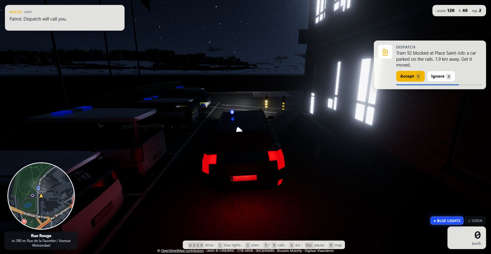
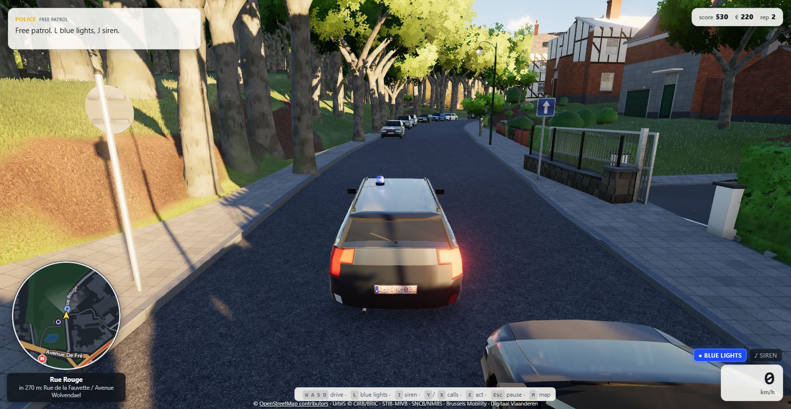
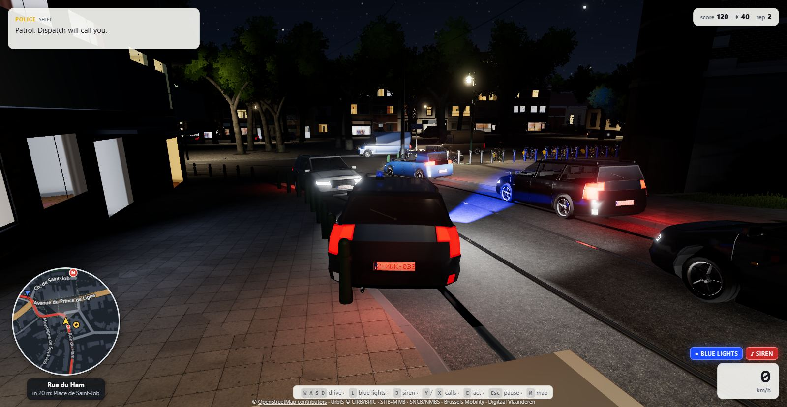
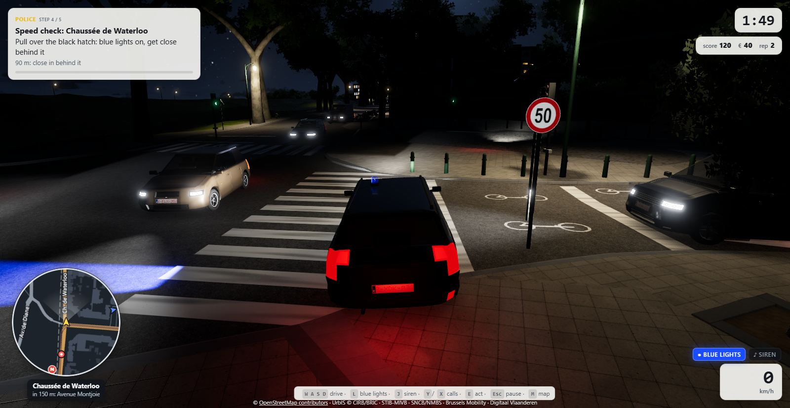
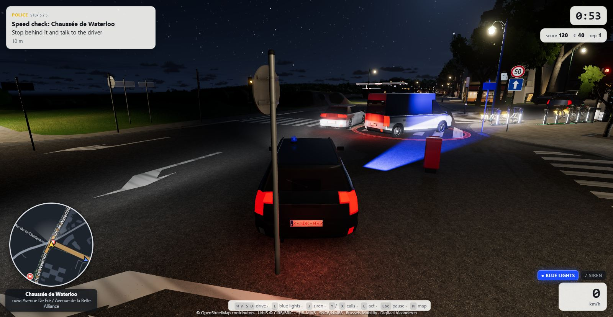
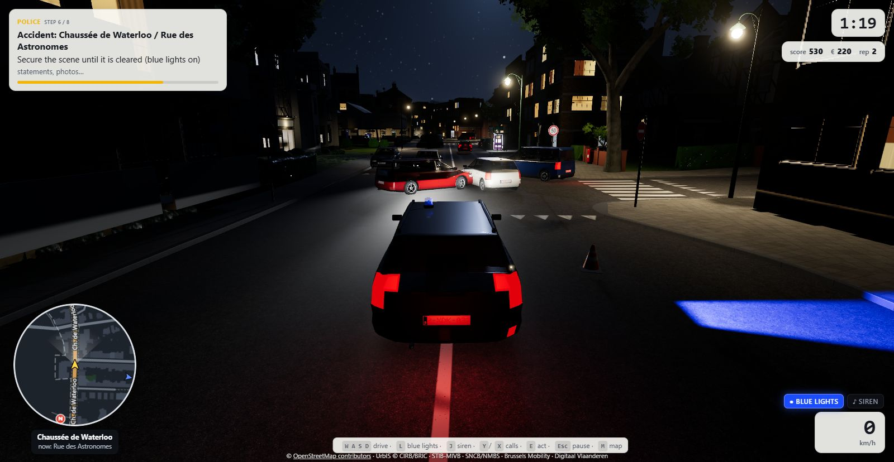
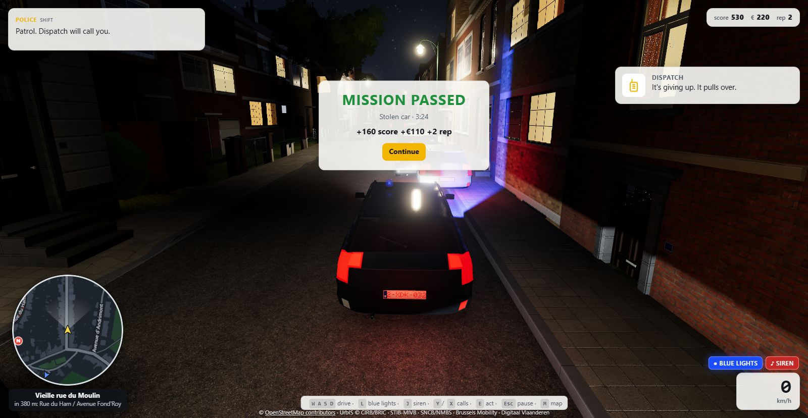
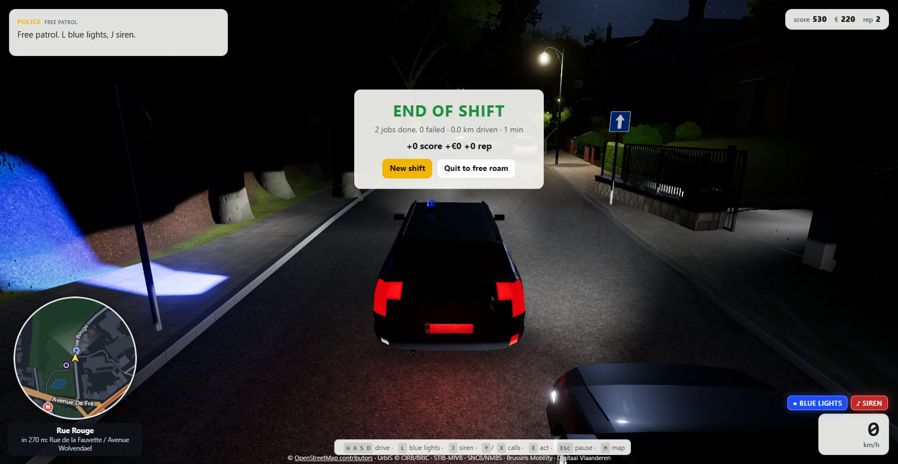

# Police game, round 1 (branch claude/police1, 2026-11-15)

The owner's first game on the game kit (docs/GAMEKIT.md): a civilian (unmarked) police car based at the real Uccle
police station, Rue Rouge 17. You patrol; the radio sends you to real places with tasks. Code: `viewer/police/` (the
game), `viewer/policeCar/` (the car kit, from the claude/police-car lab, code only: none of its 21 MB of PNG / WAV).

| | |
|---|---|
|  |  |
|  |  |
|  |  |
|  |  |

## Start

Start menu (P / Play) > **Police**: **Shift** (dispatch jobs one after another) or **Free patrol** (no job; dispatch
calls if "Dispatch calls in free patrol" is ticked). Option "Siren sound" (OFF by default, the owner's rule for vehicle
sounds: with it off the siren is silent but still "on" for the traffic). URL: `?game=police` (`&gmode=free`).

The shift starts in the station's yard (the site frame of models/police_rouge/site.json, facing along the bays; out
through the vehicle gate to the left). HQ = a blue pin on the minimap / full map at the gate. Back at HQ with no job
running (once the car has been > 120 m away), the objective card says "Back at the station" and **E ends the shift**:
a summary (jobs done / failed, km, minutes, score / € / reputation earned), then "New shift" or "Quit to free roam".

## Keys

| key | |
|---|---|
| **L** | blue lights: beacon, grille + visor flashers, head lamp wig-wag (and siren off when the lights go off) |
| **J** | siren (switches the lights on too: a Belgian priority vehicle uses both) |
| E | the job's action when the prompt shows (talk, cones, arrest, end the shift) |
| Y / X, P / Esc, M, ` | the kit's (accept / ignore a call, pause, map, dev tools) |

H is photo mode and K / B / V switch to the scooter / motorbike / Villo in the city: in this game K / B / V are held
back while driving (the shift is in the car). A chip bottom right shows BLUE LIGHTS / SIREN.

## The car (viewer/police/policeCar.js)

- The faceted pack's **estate** (VW Passat / Skoda Octavia class, the usual Belgian unmarked car) in dark blue-grey
  `0x1c232c`, its own material (`packMaterial` with a wig-wag head-lamp node), no livery, no lettering.
- The lab kit fitted on its own mesh (fitCar.js): magnetic rotating beacon above the driver with its cable into the
  driver's window, two LED heads in the grille, the LED bar behind the windscreen; flash pattern (pattern.js): beacon
  150 rpm, grille L / R double flashes alternating, visor in the beacon's dark slot. Emissive lenses + the city bloom.
- **Wig-wag**: head lamps alternate left / right at 2.2 Hz while the lights run (uniforms, no rebuild).
- **Siren** (siren.js, unchanged from the lab): Belgian two-tone 495 / 440 Hz, 27 cycles / min, through the kit's
  audio master (its volume setting), scheduled on the audio clock.
- **The real light**: ONE slot of the night pool (viewer/nightLights LightPool), reserved once per page the first time
  the game starts (`pool.reserve(1)`): the pool is typed arrays, so this adds no Light object and no shader variant
  (fixed light count; no pipeline is built). The slot is 0 by day (the pool's scale follows the night) and when the
  lights are off. Shape: a **tall narrow fan** (the pool's APERTURE profile: a light behind a 0.30 x 1.10 m opening 1 m
  out: +-8.5 deg wide, +-29 deg tall), turning with the reflector, its apex 1.3 m out from the dome (no hot spot on the
  own roof). Fixes the lab's "round blob" weak spot.
- **No light through walls**: the fan's range (30 m) is cut where its axis first enters a building footprint (a march in
  1.5 m steps against the drive colliders' building polygons round the car, gathered within 36 m when the car has moved
  6 m): the first wall is lit, the street behind it is not.
- With `?night=0` (no pool): lenses only.
- Pipelines: the car and the props are drawn for 8 frames out of sight under the "Getting the car ready" card
  (viewer/police/warm.js, the waypoint's trick; `renderer.compileAsync` builds a wrong MRT variant and hung on hidden
  objects), so no frame stalls in play.

## Traffic yields (viewer/traffic/trafficSim.js `emerg`)

With **lights AND siren**: every traffic car within 95 m of the police car
- ahead, same direction (along 2-80 m, < 7 m aside): pulls right 0.8 m (as far as parked cars allow) and slows, stops
  when within 45 m (IDM toward 0.8 x its speed: ~2.5 m/s2, no jerk);
- oncoming (ahead 0-70 m): slows to 3.5 m/s, keeps 0.5 m right;
- crossing (any other direction, -25..75 m along): holds at its stop line (a junction it has not committed to);
- behind: nothing. Without the siren (or lights only): nothing changes. Measured: a car at 22 km/h 22 m ahead stops in
  1.5 s, 1.1 m to the right, and moves on when the police car is past.

## Missions (viewer/police/policeMissions.js)

Data missions for the kit's MissionRunner, built by factories from real places when the call comes. In a shift the
calls come in the order tram, speed, accident, stolen (then round again), 8-20 s after the last job; an ignored call
is followed by the next one 25 s later. Every job: rewards, fail on time, failRep.

| job | where | how it plays | numbers |
|---|---|---|---|
| **Car on the tram line** | tram 92's stops (STIB GTFS), Place Saint-Job first | a car stands on the rails 16 m past the stop; both directions' trams stop 7 m before it (viewer/tramline.js `setBlock`: the trip's timetable clock is held, it runs late afterwards, no jump); stop by it, E: "find the driver", the car pulls out into the traffic (sim `joinFrom`), the trams roll again | reach: route time (1.45 x straight / 8.5 m/s + 45 s), stop 2 s < 6 km/h within 13 m, E within 13 m, 120 pts / 40 EUR / 2 rep, bonus +40 under 55 % of the time |
| **Speed check** | the street kit's C43 30 / 50 / 70 and F4a (zone 30) signs (119 in the built tiles, `data/game/police_spots.json`) | park by the sign (3 s, stopped); the radar reads each passing car's top speed within 42 m; after 2 cars (or 12 s) one driver 70-220 m away coming this way speeds (x1.95 on a 30, x1.5 on a 50); when it passes: "62 km/h in a 30!"; lights on, follow it within 18 m behind for 2 s: it pulls over (sim ctl 2), E: the fine (EUR 53 + 11 per km/h over 10; over +30: the prosecutor) | radar 150 s, chase 120 s, lost > 260 m for 12 s, 160 / 60 / 2 |
| **Accident** | 224 junctions of two French-named through roads (OSM, the same file) | two cars (a crumpled corner in the vertex shader, hazard lights blinking) 6 m past the junction on the snapped road; arrive, park within 26 m stopped with lights on (2.5 s), place 3 cones (E) 12 / 18 / 24 m back on the lane (a taper from the kerb out), keep the scene 16 s with lights on, both cars drive off (into the traffic), pick the cones up (E) | arrive 0.9 x route time, 60 s per cone, 200 / 70 / 3, bonus +50 |
| **Stolen car** | a car of the live traffic 90-320 m away | get within 48 m: it FLEES (sim ctl 1: desired speed max(1.75 x limit, 15 m/s), bends taken 1.4 x faster, overtakes a slow car on the left for 3.2 s, runs ~2 in 3 lights / stop signs / give-ways, at each junction prefers the exit away from you: weight e^(2.5 cos)); stay within 12 m (or box it: it < 2.5 m/s and you < 9 m, x1.6) for 6 s in total (the count decays 0.5 s/s when you drop back): it gives up and pulls over; E: arrest. Each hit on a traffic car > 3 m/s = a ram: -40 pts each, 4 = failed | find 120 s, chase 220 s, whole 330 s, lost > 230 m for 10 s, 280 / 110 / 4 (2 rep with 2+ rams) |

**How to add a job**: a factory `(G, kit, rng) => call | null` in policeMissions.js returning
`{ priority, from, icon, text, mission }` (the mission as in GAMEKIT.md "Writing a mission"); add it to `JOBS` and to
`ORDER` in policeGame.js. Props: `G.props.addCar({ x, z, heading, type, paint, damage })`, `driveOff(car)`,
`setCones([[x, z], ...])`. A traffic car you control: `adopt(G.traffic(), i)` (keep + its control reset on release),
then `sim.ctl[i] = 1 | 2`, `sim.speedF[i]`. Clean-up whatever the end: a custom entity's `release()` (sceneEntity).

## Free patrol

The yard start, no job; the minimap's HQ pin; L / J with the traffic yielding; with "calls" on, a random job (one of the
four, where a fitting place exists) every 60-110 s (first after 25-40 s); Y takes it, X lets it go.

## Cost (measured in the city at night, 55 traffic cars)

- Car update (pattern, uniforms, the pool slot, the wall march): **0.06 ms / frame**; the building gather when the car
  moved 6 m: 0.07 ms. No allocation per frame (reused vectors, `lampState`'s reused object, the gather's reused list).
- Traffic: a sim step 0.158 ms with the emergency car on vs 0.160 off (the yield test is per car within 95 m, cheap).
- GPU: one pool light (the clustered loop shades only the pixels in its fan; 0 by day: the day gate still skips the
  cluster pass). NOT measured on GREEN: another agent's WebGPU tabs were running all session and my tab ran
  background-throttled (the A/B gave p50 35-60 ms both ways: noise). Do it with the next perf pass.
- Draws: the kit's ~18 small meshes on the player's car (the lab's figure); props: 5 draws per standing car (LOD1),
  one InstancedMesh for 8 cones.

## Shared files touched (small, delimited "POLICE GAME")

- `viewer/traffic/trafficSim.js`: per-car `ctl` (flee / pull over / stopped), `speedF`, `yr` (sideways room), `overT`;
  `emerg` (the yielding), `chaser` + `fleeWeight` (the flee route choice), `extraObs` (static obstacles), `joinFrom()`.
  Nothing changes while no game sets them (ctl 0, speedF 1, emerg off).
- `viewer/tramline.js`: `setBlock()` (a held track), `trackNear()`, `shapePoint()`; trips read `tripD` (their delay).
- `viewer/game/kit.js`: one line, `def.idleObjective(kit)` (a game's own objective card + prompt when no mission runs).
- `viewer/game/cityGame.js`: registers the police game (replaces the "coming soon" entry).
- `docs/TODO.md` (section 8). New: `viewer/police/*`, `viewer/policeCar/{beaconModel,fitCar,pattern,siren}.js`,
  `tools/game/build_police_spots.py` -> `data/game/police_spots.json` (31 KB).

## Weak spots / next

- **Tuning was done with scripted driving** (an autopilot stepping the loop with a fake clock: my tab was in the
  background behind other agents' tabs), not by hand: the chase's 6 s / 12 m, the find radius and the radar timings
  want a human playtest. The scripted chase lost the target round corners: a human keeps up easily on the straights;
  the flee car averages ~8-10 m/s through Uccle's bends.
- Overtaking flee cars move 2.7 m left into the oncoming lane without checking it (they can pass through an oncoming
  car); flee cars ignore other traffic during the 3.2 s.
- Yielding cars only shift 0.8 m (parked cars), they do not mount the kerb; a car already in a junction finishes it.
- Pulled-over / stopped cars stand in the lane (shifted 0.9 m), the cars behind them queue (they do not overtake).
- The blocked tram only holds trips that reach it while blocked: no tram may come in a short job (they run every
  7-10 min); both directions are held (the car blocks the rails), a second tram of the same direction would stand in
  the first one's place.
- Accident cones block their lane (an obstacle for the traffic): a queue forms behind them until you pick them up.
  Junctions are any two-road junctions (some are roundabouts: the cars then stand on its ring).
- Dispatch spawns the jobs' props when the call is accepted, possibly before the tile is loaded: they are re-grounded
  when the tile arrives (10 Hz check within 400 m).
- The siren is the player's only (no Doppler for other listeners); no voices yet (radio text, English).
- The rotating fan reads well on walls and the road; the LED beacon mode (pattern.js "led") exists but is not offered.
- GPU cost not measured on GREEN (see Cost).
