# Reality round 1 (2026-11-26, claude/reality1)

Part A: the owner's Montjoie note, fixed. Part B: 14 Street View spots across Uccle, what we miss or get wrong, each
finding mapped to a CLASS a generator / rule can fix (not one-off patches). Look only: Google imagery was viewed in the
one shared page and never stored, traced or shipped; every picture here and on the owner sheet is OUR city
(`docs/reality/round1/`, full size in `C:\Users\tibog\Downloads\uccle-reality\`, sheet `round1_sheet.png`).
Street View dates are given per spot (older panoramas flagged: re-check before acting).

## Part A: Institut Montjoie (owner: "the Montjoie school buildings are not at all like this")

**Which school.** Institut Montjoie, Avenue Montjoie (OSM way 30996013, amenity=school, wikidata Q42432471; its primary
site is a second campus on Rue Stanley, OSM 1495029200). Our OSM extract has no amenity=school polygons (found via
Nominatim / the OSM API). The site is x 970..1093, z -1311..-1214 (tile I2). UrbIS solids: **506834** (the main block,
1,967 m2, U-shaped, 87 x 64 m), 546951 (court north block, 11 m), 546598 / 546597 (low west classrooms), 546825 (a 1.4 m
shelter strip).

**Real (Street View Jun 2024 + aerial + UrbIS ortho 2024, measured from UrbIS / ortho):**
- massing: a ~62 m street wing straight on the Avenue Montjoie sidewalk (facade line (1031.8, -1224.7) -> (1092.5,
  -1239.8)), east and west wings running north round an asphalt court open to the north; a taller plain-brick block at
  the west end (UrbIS ridge 129 m vs 127.4 m); low flat-roofed classrooms west.
- height: eaves ~121.7 m, ridge ~127.4 m (UrbIS); ground + 3 storeys of windows over a stone plinth with cellar lights.
- roof: steep (45-55 deg) RED CLAY TILES (aerial + ortho), a row of ~7 crow-step (stepped) gable dormers on the street
  slope, big stepped gables at both ends; the east end a slightly projecting pavilion.
- materials: dark orange-red face brick, light grey stone plinth (~1.2 m) with arched cellar windows, white window frames.
- window rhythm: bays ~3.2 m between full-height brick pilaster strips; per bay a PAIR of tall small-paned windows; the
  top storey under pointed / round relieving arches; brick corbel friezes under every window row; iron grilles on the
  ground floor.
- entrance: oak double door in the east pavilion, a white "Institut Montjoie" plate on the facade; bus shelter + stop
  (Montjoie) in front.
- yards: the U court is grey asphalt with a basketball court painted on it, sand/gravel and trees at its north end; a
  second big asphalt yard west, by a small red-tiled pavilion.
- fences / walls: none along the front (the facade IS the street wall); west of it a low red-brick wall with stone
  pillars and a black iron railing in front of the yard and trees.

**Ours before (`?montjoie=old`):** the classifier (form only: big + tall = "block", period draw) made it TYPE.BLOCK:
white render, continuous balcony slabs on every floor, grey-brown roof, render dormers; the front-garden kit drew a
brick wall with piers along a facade that stands on the sidewalk; both yards lawn.

**Fix (default on, `?montjoie=old` = before; dev panel row `montjoie`):**
- data/overrides.json buildingLooks 506834 + 546951, set `montjoie`: style 0 red brick, type 1 (tall windows, no
  balconies), roofColor clay tile [0.30, 0.10, 0.06], no garage;
- grounds `montjoie_court`, `montjoie_west_yard` (rings from the UrbIS ortho 2024, 0.3 m off the footprints): asphalt;
- plantsClear `montjoie_front` (set montjoie; main.js now drops a set's plantsClear with its switch): no garden wall;
- viewer/tileData.js lookSet: the `montjoie` set; viewer/main.js the `montjoie` entry switch.
Perf: no new mesh, material or draw (looks / grounds / clear rings are data in existing systems).

| | before | after |
|---|---|---|
| street | 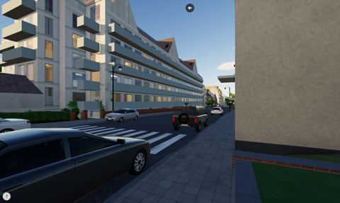 | 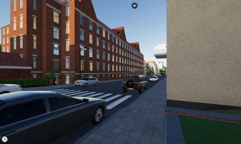 |
| front | 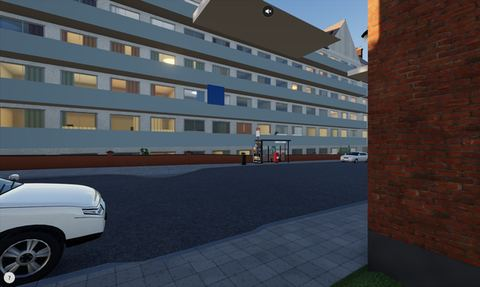 | 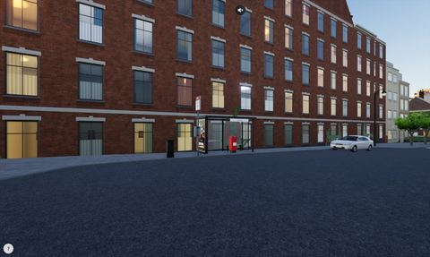 |
| above | 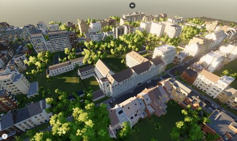 | 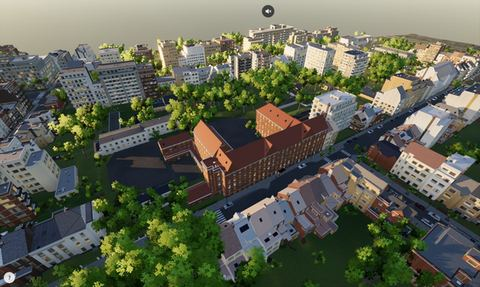 |

**WHY + RULE + CHECK.** Why: the classifier sees only form; a big tall pitched-roof institution falls into "block"
and can draw post-war balconies; nobody had checked the school. Rule `docs/rules/institution-not-balcony-block.md`.
Check: gate row `montjoie` (tools/audit/montjoieCheck.mjs): A the Montjoie entries (brick, type never 4, clay roof,
yards on the switch, the front strip covering every metre of the front); B every curated look / plantsClear `set` is
wired to its switch (a set nobody filters is an A/B that cannot show the old); `--census` the class: **1,856 buildings
drawn as balcony blocks, 194 of them under a steep pitched roof** (>= 70 % of the roof at >= 35 deg), tallest first
(H4 759503 27.9 m, E7 528339, F5 539036, E3 526412, F2 534086 / 531505 ...).

**Left for Montjoie (hero round 2, the hero method: Blender scripted, named slots, LODs):** the crow-step gable
dormers and end gables, the pilaster strips + paired windows + corbel friezes, the grey stone plinth with cellar lights,
the east pavilion's oak door and name plate; storeys read slightly too many/low (type 1's 3.25 m storeys vs ~3.6 m real).
Biggest gain was the look class (done); the dormers are the next most visible thing.

## Part B: the round

Ranking inside each spot = visual gain. Tags = the classes below.

### 1 Place Saint-Job (SV Oct 2020, old) 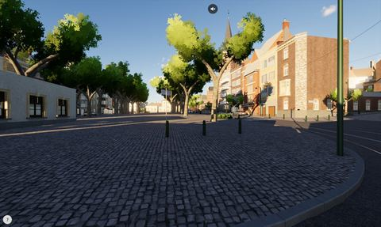
- C11 the setts square is used as a car park: rows of cars both sides of the trees (ours: empty setts).
- C7 tall green cast-iron lantern posts with double lanterns and hanging red-flower baskets; tram poles + wire.
- C3 corner shop with a red lit fascia, white letters. Nice: the double plane-tree avenue reads right in ours.

### 2 Parvis Saint-Pierre (SV Apr 2024) 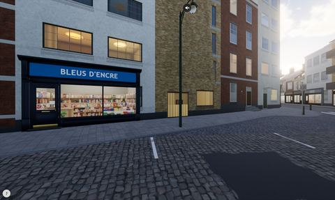
- C3 **fixed here (data):** OSM says "Bleu d'encre", the sign says BLEUS D'ENCRE (librairie): curated front
  (data/shops/terraces.json osm:n3930461153) with the real name and blue board. Still: real = the WHOLE ground floor
  painted mid blue incl. pilasters (our classic paint palette has only navy-black).
- C12 above: buff brick with white stone, a stone oriel bay with a wrought-iron balcony on top; next door Beaux-Arts
  bays, a red brick corner with white stone bands and a turret (ours: flat grey render with modern windows).
- C2 restaurants with terraces/umbrellas along the Parvis; C11 kerb parked solid.
- odd: a dark asphalt patch on the setts in front (surface data, check).

### 3 Rue Xavier De Bue (SV Apr 2024) 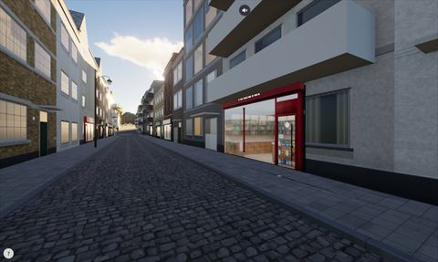
- C1 balcony slabs on a 1900 shop street (real: brick with stone oriels on the first floor).
- C2 every ground floor is a shop (ours: a few).
- C3 Kruidvat: anthracite front with two big arches, red-white oval lit box, red flag banners hanging out (ours: a
  red generic frame, sign unreadable). Chains: name + colours with generic lettering, owner's call.
- C7 green bracket lanterns on the facades; C8 black steel kerb railings, planter on the railing.

### 4 Chaussée d'Alsemberg, Uccle centre (SV Apr 2024) 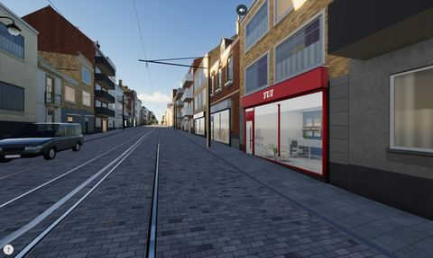
- C3 TUI: real a light / sky-blue panel with a projecting flag blade (ours red frame); MELINI black fascia + blade;
  a bedding shop with gold letters painted straight on a white facade.
- C9 carriageway + parking in red-brown brick pavers with the tram in it (ours grey pavers).
- C2 continuous shops; facades mostly white-painted 2-3 storey houses (ours brick / beige with balconies: C1).

### 5 Fort-Jaco, Ch. de Waterloo 1366 (SV Jul 2024) 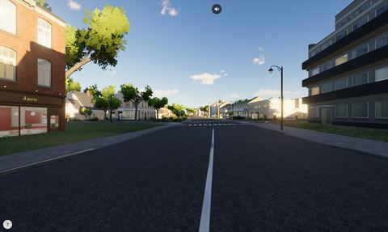
- markings: 4 lanes with dashed lane lines and painted bike symbols (ours one continuous centre line: street model).
- C2 shops straight on wide paved pavements, a timber terrace deck on the parking lane; ours lawns along the sidewalks.
- C3 Vapshop black awning; Pearle green totem + blade; digital clock/temperature pylon. C14 projecting signs.
- the 1960s brown-brick office block with stone frames (ours a balcony block: C1).

### 6 Vivier d'Oie, Ch. de Waterloo 1169 (SV Jul 2024) 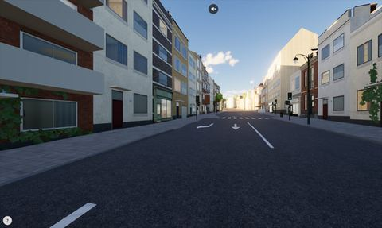
- C2 every ground floor a shop: IMMO DUGO (big white serif letters on an anthracite fascia), Traks (navy fascia,
  orange text, vertical blade), ambiance cuisine (black fascia, white letters).
- C1 red-brick houses with white stone bands, segmental arches, slate mansards (ours: a balcony block at left).
- C14 a house-number tile beside the door, a flag hung from a window; C7 hanging flower baskets.
- nice: our road (arrows, lights, crossing) already reads right.

### 7 Calevoet, Rue Egide Van Ophem (SV Jul 2013, old) 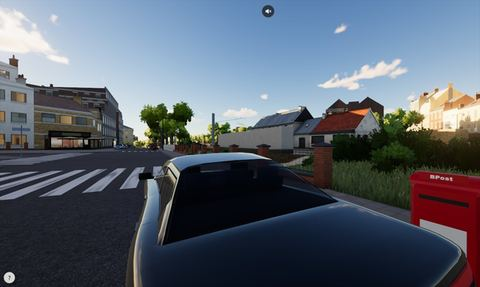
- C4 along the station green: a timber post-and-rail fence in wild hedge (ours brick piers + railing = a house front).
- C8 brown timber bollards with red reflective bands; kids-painted bollards; SNCB B sign; red bpost box on a post
  (ours has the box). Zebra with shark-teeth give-way.

### 8 Avenue de la Floride, by Montjoie (SV Jun 2024) 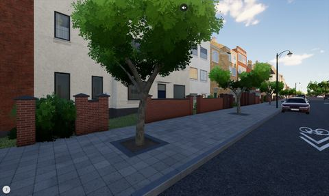
- C4 front gardens behind a LOW white plinth (~0.5 m) with black wrought-iron railing, brick piers with stone caps,
  small iron gates (ours: solid 1.2 m brick walls).
- C15 a grass verge between pavement and kerb with flower beds and young street trees (ours: tree pits in the paving).
- a bank of black letterboxes set in the front railing (flats); Art Nouveau white render with red-brick horseshoe
  arches and white oriels (C12). Worth copying in spirit: this is the typical Uccle front.

### 9 Avenue Brugmann 398 (SV Aug 2014, old) 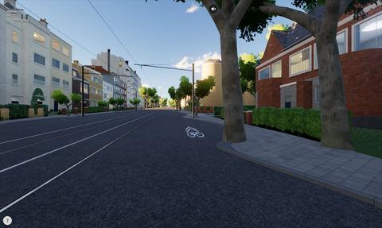
- C9 the tram on a central strip of setts, asphalt lanes each side (ours all asphalt).
- C7 green decorative cast-iron catenary poles carrying lanterns on brackets (ours plain rust-brown poles).
- yellow-painted kerb (no parking), raised tree-pit edging with bark; low brick walls + clipped hedges (C4, ok in ours).

### 10 Chaussée de Saint-Job, the hill (SV Jul 2024) 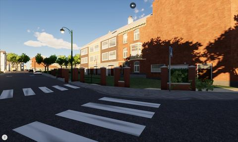
- C6 1960s-70s blocks with PAVED forecourts where cars park nose-in (ours lawns behind piers).
- C12 white roller shutters, many half down, white PVC frames; a ground-floor office front.
- C8 timber bollards with red bands; tall slim green lamp posts; small blue street-name plates on walls.
- Also near n. 701 (curated Agam / Brico): black hairpin pedestrian barriers along both kerbs, a blue timber-clad shed.

### 11 Stalle, Rue Camille Van Exter (SV Oct 2010, old) 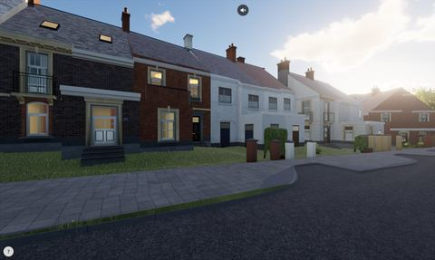
- C10 a 1990s estate: buff/salmon brick, red clay-tile roofs with gabled bays, oculus windows, brown sectional garage
  doors, crazy-paving drives, box-edged beds, freestanding letterbox posts, herringbone brick shared street.
  Ours: maison-de-maître dress, dark brick + stone, slate, lawns, asphalt (the 1990s type 6 exists but only curated).

### 12 Avenue De Fré 159 (SV Apr 2009, old) 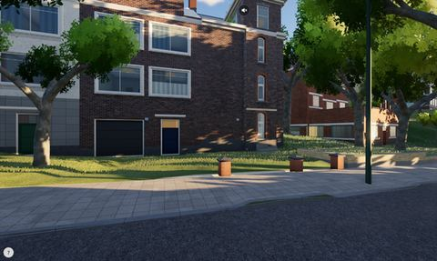
- C5 our garage door opens onto a LAWN: no drive (real: a paved drive from the dropped kerb to every garage).
- C6 open concrete-tile forecourts, no front walls; a white letterbox pillar at the drive (ours lone brick piers).
- 1960s bel-étage fronts with window bands and dark-blue enamel spandrels; heavily pollarded plane trees (C15).

### 13 Dieweg 60, school sports hall (SV Apr 2024) 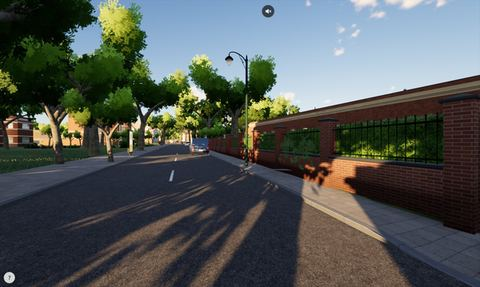
- C13 a long low glazed hall with diagonal steel V-braces in front of the glass, beige panels (ours a brick block
  behind a brick wall); C4 a black steel bar fence and sliding gate, "NO PARKING / KISS & RIDE" sign, notice boards.
- narrow tree-lined road, cars parked along the verge (C11), no centre line visible.

### 14 Avenue Wolvendael 4, by the Carrefour Marlow (SV Apr 2024) 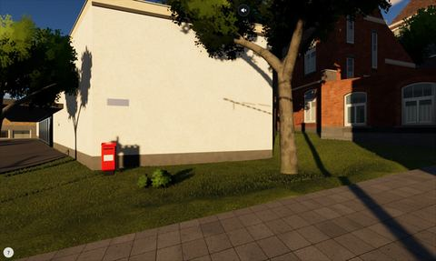
- around the curated store: paving, a low brick planter wall, bike hoops, a green Bruxelles-Propreté bin, two red
  textile containers, the red bpost box (ours: lawn all round, the box on grass) (C8).
- C3 / C14 Brasserie MA POULE: a white house with a black glazed extension front, "MA POULE..." white letters, a
  ROOFTOP sign board on the ridge, a black takeaway totem (ours: red brick house).
- the store wall reads cream; real greige (known, claude/carrefour notes).

(Observatory skipped: no Street View on Avenue Circulaire at the points tried; it is a hero already.)

## The classes (top 10 by visual gain city-wide)

| # | class | spots | what a generator / rule does | check idea |
|---|---|---|---|---|
| C1 | pre-war / steep-roofed buildings drawn as post-war **balcony blocks** | Montjoie, 3, 4, 5, 6 | buildingTypes.js classify: a steep pitched roof (>= 70 % at >= 35 deg) never takes TYPE.BLOCK (-> MAITRE / DECO by period); curate the named institutions | montjoieCheck `--census` (194 today) -> a ceiling that only goes down |
| C2 | **shop streets**: a shop on every ground floor | 2, 3, 4, 5, 6 | street-life: on a run of >= N OSM shops per 100 m (or landuse=retail), fill the other ground floors with invented / generic fronts (agency, hairdresser, vacant with a FOR RENT board) | share of street-front ground floors with a front on the named shop streets |
| C4 | **front-garden boundary** by period | 7, 8, 13 (+ Montjoie) | gardens kit: maître / Art Nouveau = low rendered or stone plinth + black iron railing + small gate; brick wall only where seen; station / park edges a timber post-and-rail; schools a steel bar fence | census of boundary types per type / period |
| C3 | **shop fronts**: real name, colours, sign TYPE | 2, 3, 4, 5, 6, 14 | terraces.json fronts per shop (name, board / ink, sign type: lit box, letters on facade, blade, flag banners, rooftop, totem; painted ground floor); a chain table (owner's call per chain: real name + colours in our lettering, or invented); no logos | curatedplaces: every curated front's sign text + type present |
| C7 | **lamp + pole kit** | 1, 3, 6, 9, 10 | streetkit: green cast-iron lantern posts (double lantern, flower basket) on squares and chaussées, wall bracket lanterns in narrow old streets, tram catenary poles with lantern brackets on Brugmann / Alsemberg | kit placed per street class |
| C5 | **every garage door has a drive** | 11, 12 | facadeGeom garage bay -> a paved drive polygon from the door to the kerb + a dropped kerb; no lawn / pier in front of it | a census row: garage doors without a drive = 0 |
| C8 | **kerb furniture** | 3, 7, 10, 13, 14 | black hairpin barriers along busy kerbs and school fronts, timber bollards with red bands, green bins, bike hoops, textile containers | furniture per km on those street classes |
| C11 | **parked-car density** | 1, 2, 9, 13 | parked cars at real density (both kerbs on residential / shop streets, the Place Saint-Job square as a car park); TO CONFIRM with traffic on (the shots ran quick mode, traffic off) | parked cars per 100 m kerb vs measured |
| C10 | **1990s estates** | 11 | classify the 1980s-90s lotissements (regular footprints, red tile roofs from the ortho roof colour, cul-de-sacs) as type 6 with garages + crazy-paving drives | count of type 6 outside curated sets |
| C9 | **tram reservation and carriageway materials** | 4, 9 | surfaces: an OSM tram on its own reservation = setts strip; Alsemberg's red-brown brick pavers | surface vote rows |

Also seen (smaller gain): C6 paved forecourt parking on 1960s-70s blocks (10, 12); C12 window dress (stone oriels on
1900 streets, white roller shutters on 60s-70s blocks); C13 institutions (the OSM schools list: Notre-Dame des Champs,
École du Longchamp, the Dieweg school, Collège Saint-Pierre: each a curated look under rule
institution-not-balcony-block); C14 projecting / rooftop signs, house-number tiles, hanging flags; C15 verges with
flower beds and pollarded planes, hanging flower baskets.

## Later jobs (one or two classes each, small, data audit first)

1. C1 generator rule + census ceiling (city tour: 194 buildings change).
2. Montjoie hero round 2 (crow-step dormers, pilasters, plinth) by the hero method.
3. C5 garage drives (+ C6 forecourts) in the gardens kit.
4. C4 boundary types by period (the low plinth + iron railing first).
5. C2 shop-street fill, then C3 the chain table (owner decides each chain).
6. C7 lamp / pole kit, C8 kerb furniture.
7. C10 1990s estates; C9 tram strip setts.
8. Re-check the old panoramas (Calevoet 2013, Brugmann 2014, De Fré 2009, Stalle 2010) for newer dates first.

## Follow-up jobs the owner approved ("go ahead with 1 and 3": C1 and C4)

**C1, building types from evidence (`?bldclass=old`, rule bldclass-evidence, row `bldclass`).** data/bldclass/<T>.json
(tools/bldclass/build_evidence.py) gives each UrbIS solid what open data knows: the Brussels heritage inventory
(urban.brussels Irismonument, 2,847 Uccle records, CC BY 4.0, facts only: year, style, typology), OSM buildings /
start_date / school, hospital, worship sites, and a street prior from dated neighbours. viewer/buildingTypes.js classify
uses it first (near and far tiles): no balcony block for an institution, anything dated before 1946, or a row front /
small block under a steep pitched roof. Census: balcony blocks 1,856 -> 1,539, steep-roofed 191 -> 17 (15 big free-
standing blocks left to the draw, 2 dated post-war), 577 buildings change type or wall. Street View spot-check (look
only), 10 changed buildings: Churchill 4 (1924 flats: maître ✓), Edith Cavell 143 (Beaux-Arts school ✓ after the dated-
institution clause), Alphonse Renard corner (1925 ✓), Av. Molière 292 (1938 modernist: window bands ✓), Brugmann 304
(1938 beige modernist ✓), Kinsendael 7 (old outbuilding ✓), Brugmann 291 turret house (✓); wrong and fixed by a clause:
Churchill 123 (a post-war block took the house beside it), Churchill 242 (a bare 1913 record under a 2010s block),
Château de Walzin 13 (a 1970s residence with balconies under a steep roof). Fixtures (true balcony blocks): 534086,
555120, 555004, 535480, 539036. Seen and noted: Xavier De Bue 14 (1975 brutalist) has concrete bands, no balconies (a
later "post-war bands" refinement). Shots + sheet: C:\Users\tibog\Downloads\uccle-reality\c1\c1_compare.png.

**C4, front-garden boundaries by context (`?frontgarden=old`, rule frontgarden-by-context, row `frontgarden`).**
tools/gardens/build_gardens.py takes the boundary mix from the house's family (tools/gardens/faces.mjs: the building type
with the C1 evidence): pre-war rows a low plinth + black railing (+ gate, often a hedge behind) 82 % of their metres,
solid walls 4 %; post-war fronts hedges / low walls / modern railings; 1990s estates hedges; 163 institution fronts a
1.4-1.6 m steel bar fence. Family railings have piers at ends, corners and gates, panels up to 8 m (the per-tile pier
budget). The old data is frozen in data/gardens/fgold. Not done: timber post-and-rail on station / park edges (a new kit
piece); the Dieweg school's wall is not a garden piece (another kit). Seen while shooting: E3 near (-740, -670) floating
wall fragments and missing walls, same with every switch old (an existing walls defect, not this job).

## Round 3 (coordinator, owner away): A wall material, B timber fences, C shop fronts

**A. The wall from the evidence (rule bldclass-evidence, round 3).** The inventory style now dates the wall: eclectic /
Beaux-Arts / Flemish neo-Renaissance / regionalist -> red brick with white stone bands (15 % klinker), neoclassical ->
pale stone (cream); a dated or old-street maison de maître with no style word leans brick. 800 buildings change type or
wall (577 after C1). Street View spot-checks (look only, today): Av. Churchill 4 brick ✓, Rue Alphonse Renard corner
brick ✓, Rue Edith Cavell 143 stone ✓ (the three are the check's wall fixtures), Avenue Brugmann 291's turret house brick
✓, Avenue Brugmann 304 (1938 modernist, beige tile) still red ✗ (a modernist style dates no material).

**B. Timber post-and-rail fences (rule timber-fence, row timberfence, `?timberfence=0`).** OSM wooden fences (15 ways; 10
in the built tiles, 404 m, 212 posts) as weathered posts every 2.4 m (0.45 m footing in the drawn ground) with two rails
following the slope; one shared material and box, two instanced meshes a tile, hashed-alpha fade at 110-160 m, colliders
as a hero root per tile. The check: placed per the data, out of buildings, every footing under the ground, the low rail
>= 0.1 m over the ground along every span. Not done: the Calevoet station edge is not a fence in OSM (needs an obs line
from Street View); landuse edges are not fenced by rule.

**C. Shop fronts (rule shop-street-fill, row shopfill).** C2: build_streetlife.py fills the other ground floors of shop
streets (a building on the sidewalk, >= 3 real shops of the street within 45 m, no shop of its own, 85 %): 290 generic
fronts with a trade word (BOUTIQUE, COIFFURE, À LOUER, IMMOBILIER...), never an invented brand, each picking a room its
neighbours within 13 m do not show (rule shop-room-layers). Rue Xavier De Bue 9.6 -> 12.1 fronts per 100 m, the
Chaussée d'Alsemberg 1.4 -> 3.5 and de Waterloo 2.9 -> 4.2 over their whole lengths. C3: real names, colours and sign
types (Street View, look only, no logos): Bleus d'Encre, Vapshop, IMMO DUGO (letters on an anthracite fascia, new extra
POI at Ch. de Waterloo 1167), traKKs (navy + orange, a vertical blade, new extra POI); **chains (owner decision 2026-11-26: they keep the real name + colours in our lettering, no logos; settled for every later round)**
(name + colours in our lettering, or an invented name): Kruidvat x 2 (red lit sign, red flag blades), TUI (sky-blue panel,
flag blade), Pearle (green totem as a tall blade). Not done: MELINI, ambiance cuisine, Ma Poule (not in OSM; their
address points not confirmed).

## Round 4 (claude/reality2): C1 leftover, C5 garage drives, C7 lamps, C8 kerb furniture

Shots (ours only, no Google imagery): `C:\Users\tibog\Downloads\uccle-reality\round4\`.

Owner decisions 2026-11-26: (1) chain shops keep their REAL name and real colours in our own lettering, no logos
(Kruidvat, TUI, Pearle and any future chain; rule shop-street-fill); (2) the Brussels heritage inventory
(urban.brussels, CC BY 4.0) is kept: owner-confirmed in docs/DATA_LICENCES.md, credited in CREDITS.md and on screen.

1. **C1 leftover** (rule bldclass-evidence): a solid on a commercial row (a street-life front on its BU_ID, pre-war or
   unknown era, party walls > 15 %, <= 24 m) is a shop house (maison de maitre type), never a balcony block; interwar
   Modernisme / Art Deco apartments (1919-45) take the buff / yellow brick wall (style 2). Balcony blocks 1,539 -> 1,390.
   Fixtures: shop house 528748 (the Kruidvat row, Rue Xavier De Bue), buff block 564563. Shots c1_*.
2. **C5 garage drives** (rule garage-has-drive, row `garagedrive`): 6,458 painted garage doors, 3,137 with a paved drive
   from the door to the line (the boundary opened there), 3,321 on the sidewalk line; fitGardens --lanes clears the
   rings last (8 hedges split, 4 piers dropped). `?garagedrive=old`. Shots c5_garage_drive_new / _old. Seen in both: a
   long thin sliver at the garden edge by the sidewalk (F3, -312, -500), not from this job: left for the defects list.
3. **C7 lamps** (rules lamps-from-osm, lamp-extras, row `lampextras`): the 243 OSM street lamps (92 in built tiles, 91
   drawn where surveyed) replace the generated row on their roads (`?osmlamps=old`); on the shop streets 87 green swan-neck
   wall lanterns (4.5 m up, only where the front's own eaves leave room: a one-storey shop extension gets none), 117
   red-flower baskets on the posts, the tram poles with >= 2 shopfronts within 22 m painted the lamp green with a lantern
   (`?lampextras=0`). No light added. Not done: double-headed lantern posts (a Blender variant of the lamp).
   Shots c7_*.
4. **C8 kerb furniture** (rule kerb-furniture, row `kerbfurniture`): hairpin barriers at 13 school fronts (78; the other
   19 schools have no measured kerb parallel to their front in reach), timber bollards with a red band on the green
   edges (57 of 1,048 on the checked tiles; a first cut at 30 m from any green put them on a maison-de-maitre street in
   E4: tightened to 15 m from a green >= 2,500 m2, shot c8_timber_bollards_overreach_before_fix). Bins and bike hoops
   were already drawn from OSM. Not done: black kerb railings on the shop streets, textile containers (no data source).
