# Street surfaces by name: the name vote fixed (TODO 8i)

Switch: **`?surfvote=old`** = the vote as before (features.js row "street surfaces by name as before", A/B section,
City defects). Branch `claude/surfvote`. Audit: `node tools/audit/surfvote.mjs [--json out.json]`.

## 1. The bug

`viewer/surfaces.js` draws each UrbIS measured carriageway with a paving (asphalt / setts / pavers / cobbles / gravel)
picked by a **name vote**: the OSM roads of the same street, their `surface=` tag, majority wins. It never matched:

- UrbIS names are **French only** ("Rue Geleytsbeek"); OSM names are **bilingual, either order** ("Rue Geleytsbeek -
  Geleytsbeekstraat", "Bemptstraat - Rue de Bempt"). The vote compared the strings as they are.
- The UrbIS names in the shipped `data/tiles/*/surfaces.json` are **double-encoded** ("Lycée", 147 of 553 distinct
  names): `pipeline/build_surfaces.py` read the GeoPackage with `encoding="cp1252"` ("the GPKG text is cp1252, not the
  UTF-8 it claims"), but the 2026-10-02 download holds plain UTF-8 (`Lyc\xc3\xa9e` read with sqlite).

Old vote: **58** of 4,394 measured carriageways matched (OSM ways with a French-only name). Everything else fell back to
its class's base surface: asphalt. Where the engine carriageway is kept over the measured surface it reads its own OSM
road's tag, so a setts street drew **setts down the middle and asphalt strips along the kerbs** (Rue Geleytsbeek, Rue
Langeveld, Square Coghen below), or asphalt wherever the measured surface showed.

## 2. The fix

| piece | what |
|---|---|
| `viewer/streetNames.js` (new, plain JS) | `fixMojibake` (UTF-8 read as Latin-1 / cp1252, idempotent); `normName` (repaired, accents stripped, lower case, punctuation / hyphens as spaces, Av. / Bd / Pl. / Sq. / St ... spelt out); `osmSides` (OSM "A - B" / "A / B" split, either side matches); `looseKey` (street-type words and articles dropped, words sorted: "Avenue de la Chênaie" = "chenaie"), used only when it names one street in the tile |
| `surfaceVote` | per measured surface: the matching roads **running inside it** vote by their length there (2 m samples), so a street that is setts at one end and asphalt at the other gets each end right; none inside: the street's roads in the tile by length; no road of the street in the tile (a surface running past the tile's road buffer): the city-wide table; untagged roads count as asphalt (conservative) |
| `fillUntagged` | an OSM way of the street with **no** `surface=` tag that runs (at least half its length) in measured surfaces voted not-asphalt takes that surface, so the engine carriageway over it matches (7 ways city-wide) |
| `data/roads/streetVote.json` | the city-wide table (street key -> code, non-asphalt streets only, 7.8 kB), `node tools/build_street_vote.mjs` from `data/roads/network.json` + overrides; fetched once per worker |
| `data/overrides.json` `surfvoteRoads` | OSM road id -> surface where Street View contradicts OSM (applied with the switch on only; re-run build_street_vote after a change) |
| `viewer/tileData.js` | the vote built in the worker after every override (cortenbosch `streetSurfaces` included), handed to surfaces.js as `surf.surfVote`; `entry.surfVote` from main.js (`?surfvote=old` = not built, the old raw-name vote) |
| `pipeline/build_surfaces.py` | `fix_text()` repairs the names at the source for the next rebuild (tested on the GPKG: 22,817 double-encoded names, 0 left). The shipped tiles are **not** rebuilt: the runtime repair is idempotent, and a rebuild would also change the `surveyed` road test in surfaces.js (see What's left) |

Only the `aSurf` attribute of the measured carriageway changes: no geometry, no lift, no new mesh, no new draw. The
markings (engine pieces, measured paint) and the tram rails keep their tiers exactly as before; the borders between two
pavings follow the UrbIS polygon edges (smooth, no raster step).

## 3. Counts (all 121 tiles, `tools/audit/surfvote.mjs`)

| | old | new |
|---|---|---|
| measured carriageways matched to a street | 58 | **3,341** (3,122 exact, 219 loose key; 2,546 decided by the roads inside them) |
| from the city-wide table | - | 6 |
| unmatched (forest paths, cemeteries, parks, streets OSM does not have: they stay on their base surface) | 4,336 | 1,040 (107 names) |
| surfaces whose paving changes | | **264** surfaces, **120,573 m2**, **72 streets** |

Streets that change (area m2, old -> new, tiles; full table in `docs/surfvote/audit.json`):

Chaussée d'Alsemberg 8,761 (asphalt -> setts 5,155 / pavers 3,606; E2-E4), Avenue de la Chênaie 6,930 (setts), Avenue
Vanderaey 4,512, Rue Geleytsbeek 4,259, Drève des Gendarmes 3,592, Avenue du Maréchal 3,589, Rue Roberts Jones 3,551,
Drève des Renards 3,411, Rue Keyenbempt 3,331, Rue Zandbeek 2,901, Avenue Dolez 2,746, Rue Engeland 2,722, Avenue des
Chalets 2,665, Rue de Percke 2,653, Rue de Verrewinkel 2,568, Square Coghen 2,494, Avenue Buysdelle 2,445, Rue Langeveld
2,427, Bosveldweg 2,336 (setts / gravel), Chemin du Crabbegat 2,180, Chaussée de Saint-Job 2,063, Avenue de la Clairière
1,972, Rue Jean d'Osta 1,889, Montagne de Saint-Job 1,834 (setts / pavers), Avenue Hippolyte Boulenger 1,710, Parvis
Saint-Pierre 1,682, Chaussée de Boitsfort 1,629 (setts / pavers, the side branch N5), Avenue Moscicki 1,532, Moensberg
1,513 (cobbles -> setts), Avenue Kamerdelle 1,490, Rue de Linkebeek 1,416, Rue Professeur Hustin 1,412 (pavers), Avenue
du Vivier d'Oie 1,393 (pavers), Drève du Caporal 1,345, Rue du Roseau 1,232, Drève de Carloo 1,190, Rue Rittweger
1,188, Chemin du Puits 1,098, Avenue du Fort-Jaco 1,093 (gravel), Rue des Archives 1,084 (pavers), Rue du Repos 1,083,
Avenue du Val Fleuri 1,083 (gravel), Chemin des Oiseleurs 1,040 (gravel / setts), Chemin de la Forêt 1,035, Rue des
Trois Rois 1,023, Rue Colonel Chaltin 1,003, Avenue du Vossegat 989, Avenue François Folie 957, Clos de la Charmeraie
923 (pavers), Clos de la Vigne Kersbeek 905, Rue du Château d'Eau 854 (cobbles), Rue Victor Gambier 825, Parc Jacques
Brel 759 (gravel), Rue Xavier De Bue 741, Rue Kinsendael 702, Rue de Lisala 666 (pavers), Avenue Pierre d'Union 625,
Petite Drève du Maréchal 597, Champ du Vert Chasseur 588, Vieille rue du Moulin 585, Venelle de Saint-Job 554,
Keyenbempt 465, Clos des Fuchsias 457 (pavers), Avenue des Courtilières 421 (pavers), Rue de Stalle 319, Rue Baron
Perelman 311, Drève du Maréchal 309, Rue Molensteen 260, Place Homère Goossens 221, Avenue Victoria 182, Chemin du
Vossegat 177, Carré Cassimans 76. (All setts unless said.) Plus Avenue Legrand: its engine carriageway setts -> asphalt
(the override below).

## 4. Against reality (OSM tags + Google Street View, look only, newest panorama there, 2026-11-17)

| street | OSM | Street View (date) | verdict |
|---|---|---|---|
| Rue Geleytsbeek | sett | setts (Aug 2014, the newest there) | ok |
| Chaussée d'Alsemberg n. 671 | sett / paving_stones | rectangular red-brown setts with the tram rails flush (Apr 2024) | ok |
| Avenue Vanderaey | sett | setts (Oct 2010, the only one) | ok |
| Square Coghen | sett | setts, fan pattern (Apr 2024) | ok |
| Rue Xavier De Bue | sett | setts (Apr 2024) | ok |
| Rue Langeveld | sett | setts (Jun 2024) | ok |
| Rue Roberts Jones | sett | setts (Jun 2024) | ok |
| Avenue de la Chênaie | sett | setts (Jun 2024) | ok |
| Chaussée de Saint-Job (D7, n. 14) | sett | setts (Apr 2024) | ok |
| Avenue Moscicki | sett | setts (Jun 2024) | ok |
| Drève des Gendarmes | sett | setts in the wood (Apr 2024) | ok |
| Rue des Archives | paving_stones | hexagonal concrete pavers (Apr 2024) | ok (drawn as the stretcher-bond pavers we have) |
| Montagne de Saint-Job | paving_stones | tan rectangular pavers (Apr 2024) | ok |
| Chaussée de Boitsfort (N5 side branch, n. 61) | paving_stones | concrete pavers (Apr 2024) | ok |
| Avenue du Val Fleuri | gravel | worn gravel / old patched asphalt (Apr 2019) | ok (gravel closest) |
| Avenue du Fort-Jaco (K6) | gravel | no panorama (private) | not checked |
| **Avenue Legrand (I1, n. 45)** | **sett** | **asphalt** with the tram rails; setts only on the parking strips (May 2017, the newest) | **override**: `surfvoteRoads` r399062052_0 -> asphalt |

15 of 16 agree; one OSM tag is outdated and is overridden.

## 5. Before / after (city, midday; `?surfvote=old` vs default)

| view | before | after |
|---|---|---|
| Rue Geleytsbeek (F6): asphalt strip beside the engine's setts -> setts kerb to kerb | 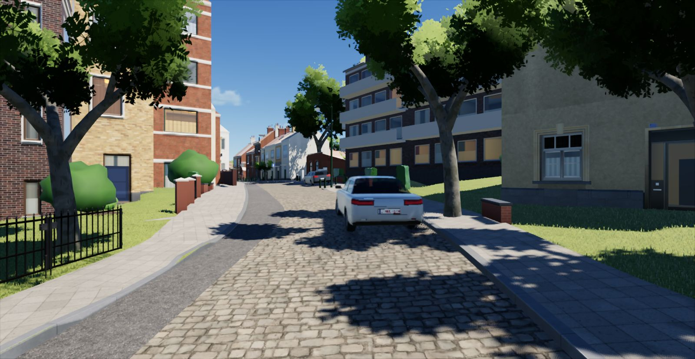 | 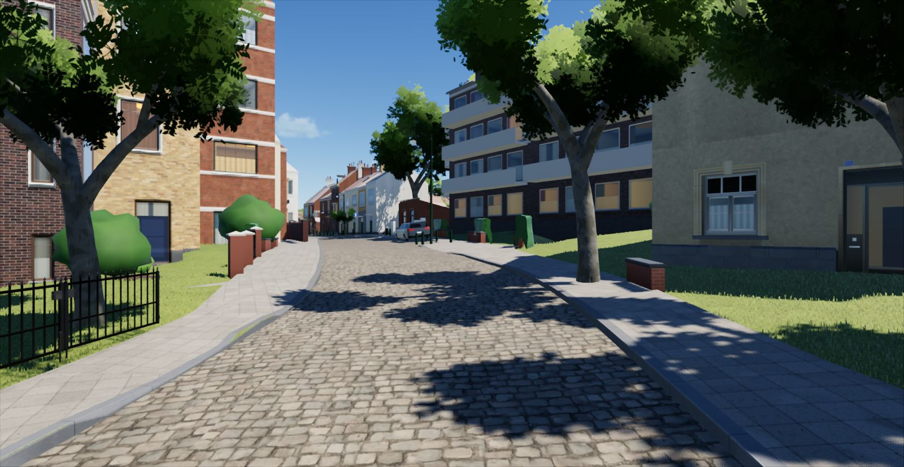 |
| Rue Langeveld (I3): half asphalt -> setts | 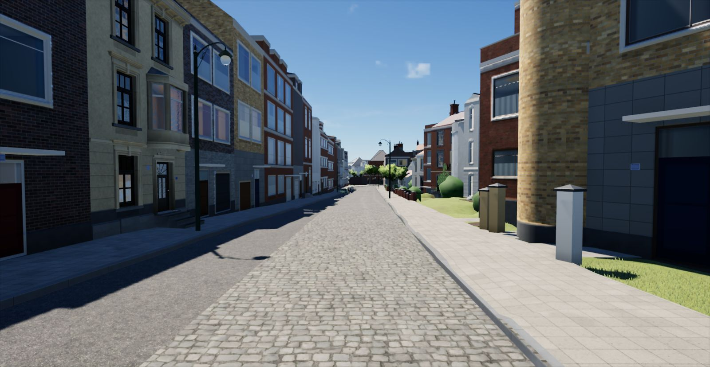 | 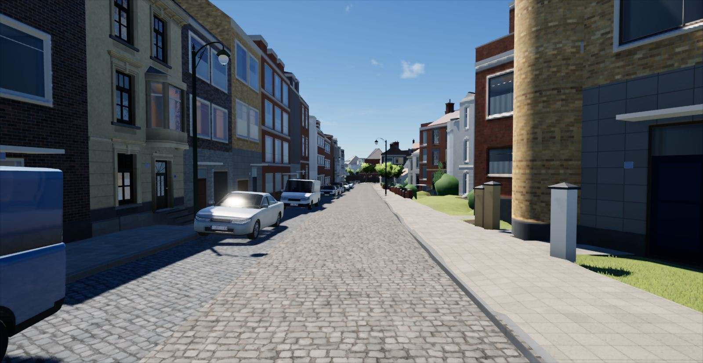 |
| Square Coghen (E3): the parking side asphalt -> setts | 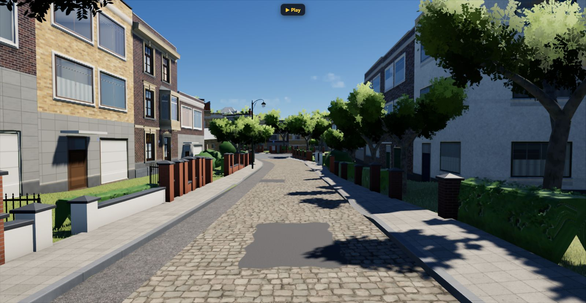 | 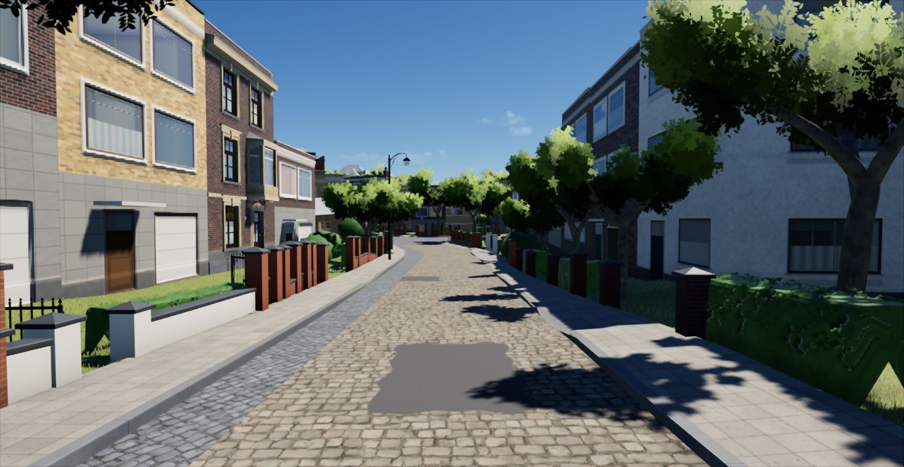 |
| Rue Roberts Jones (G3): the far carriageway asphalt -> setts | 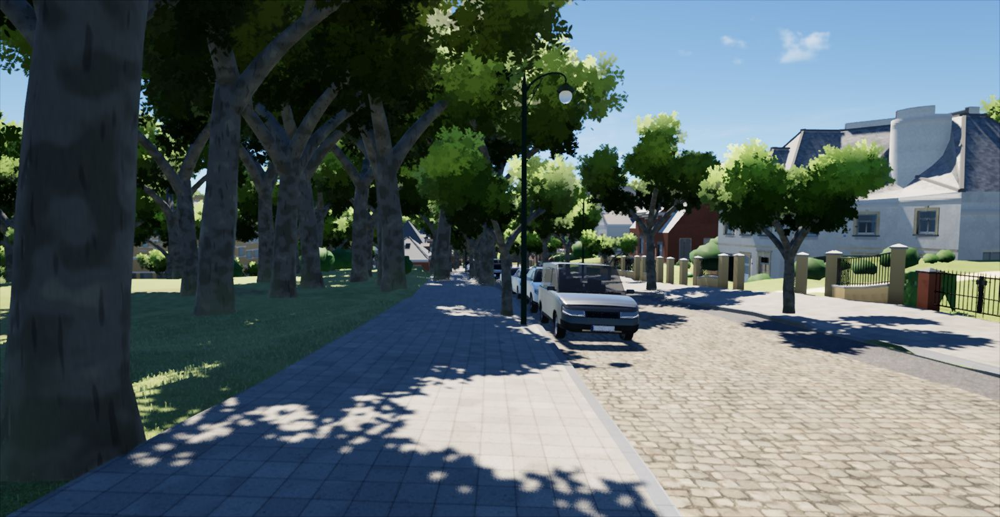 | 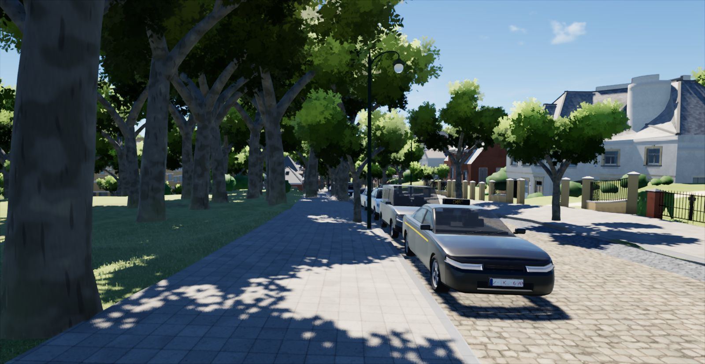 |
| Rue Xavier De Bue (E4): the gutters and the far end -> setts | 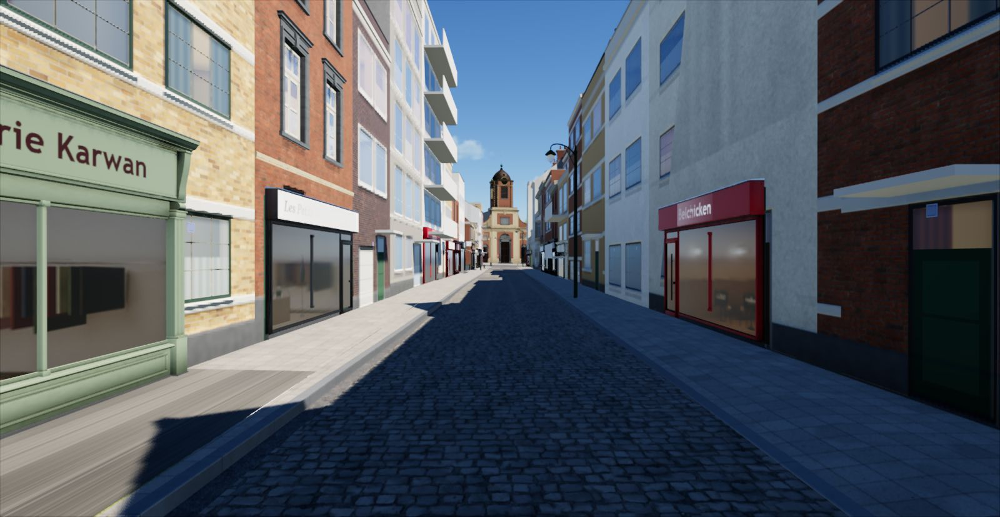 | 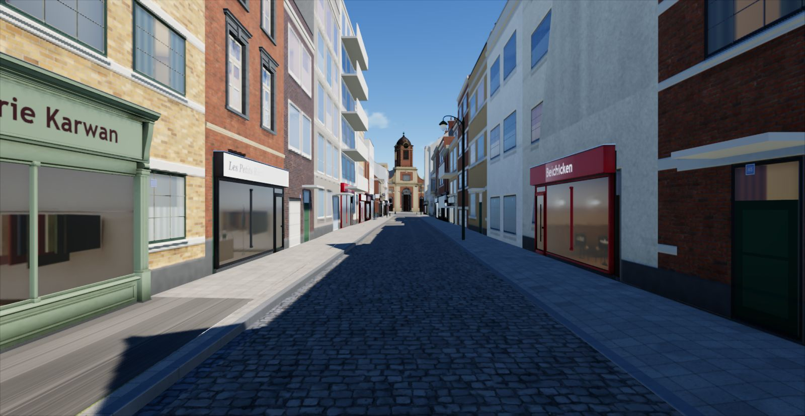 |
| Avenue Legrand (I1): OSM's setts -> asphalt (Street View override) | 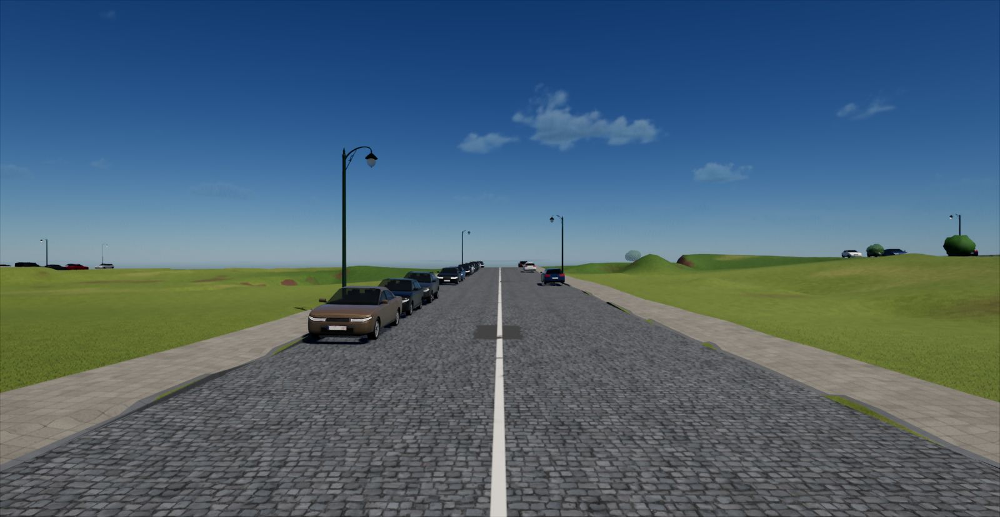 | 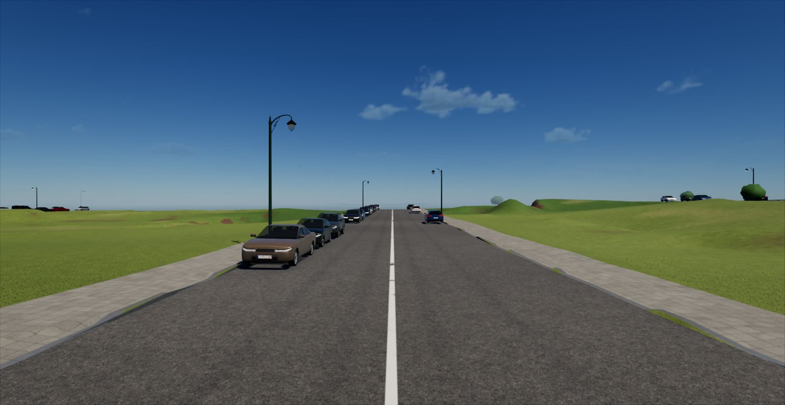 |

Also `surfvote/junction_after.jpg`: Rue Geleytsbeek at Avenue du Lycée Français from above: the setts / asphalt borders
follow the polygon edges (smooth, no saw-tooth), no z-fighting, the crossings sit on the junction pad as before.
(Parked / passing cars differ between shots: the traffic is random.)

**Checks.** One console error, twice in ~20 loads (F6, default mode; not seen with `?surfvote=old` in fewer runs):
`THREE.Object3D.add: object can't be added as a child of itself` from `viewer/warmup.js flushJobs` (perf8's compile
flush under the loader: a root whose top parent is already a flush holder). Not from this change (worker-side data
only; the flush is main-thread scene code), reported for the perf8 owner. Ground: only the shader layer changes, so no new seam, z-fight or floating edge is
possible; the borders seen are UrbIS polygon edges. Markings: on asphalt (Avenue Legrand centre line, the Geleytsbeek
junction crossings) unchanged; rails on setts unchanged (Chaussée d'Alsemberg, tram site). Cost: zero draws, zero
triangles, zero lights; the worker builds the vote once per tile (node, all 121 tiles: median 3.4 ms, max 12 ms; 2 m samples
with box tests on the street's own roads) and fetches a 7.8 kB table once.

## 6. What's left

- **Junction pads**: `roadData.js surfaceAttribute` gives a node the surface most of its arms have, a tie going to
  asphalt; a setts street meeting an untagged way draws an asphalt pad among setts (Rue Geleytsbeek at Avenue du Lycée
  Français, `junction_after.jpg`). A rule "tagged arms only" would fix it; it changes the engine everywhere, so not here.
- **`surveyed` in surfaces.js** (an engine road is "mapped" when its street name is on the measured surfaces) has the
  same name bug (raw UrbIS names vs the French half of OSM's name). Fixing it changes which engine roads are kept
  (geometry), so it needs its own switch and a road-checker pass. A rebuild of surfaces.json with the pipeline fix would
  change it silently: do both together.
- **Two setts tones** where the measured setts meet the engine's setts (Square Coghen's parking strip is grey, the
  engine's carriageway tan): per-piece tone of the texture array; worth a look in the paving pass.
- **Herringbone / hexagonal pavers** (Rue des Archives, the Cortenbosch lane): the texture array has stretcher bond only.
- 107 names stay unmatched (parks, cemeteries, forest drèves OSM maps as paths, "Inconnu (...)"): they keep their base
  surface as before.
- Untagged OSM ways still count as asphalt in the vote (a street with a few `sett` segments and many untagged ones stays
  mostly asphalt, e.g. Drève du Caporal); worth a Street View pass street by street rather than a rule.
