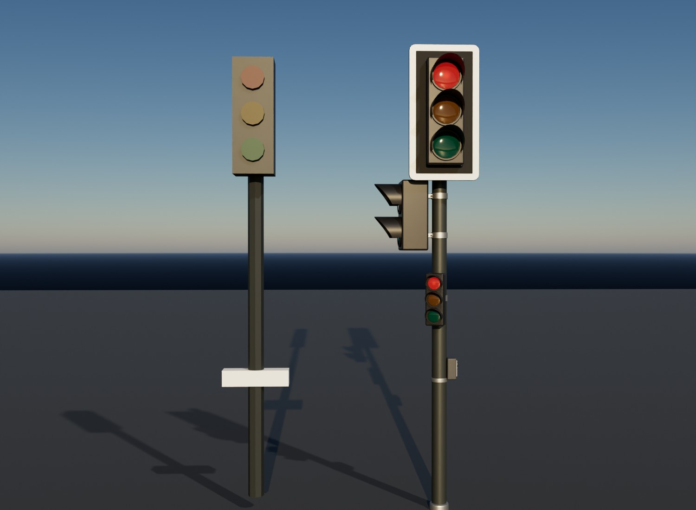
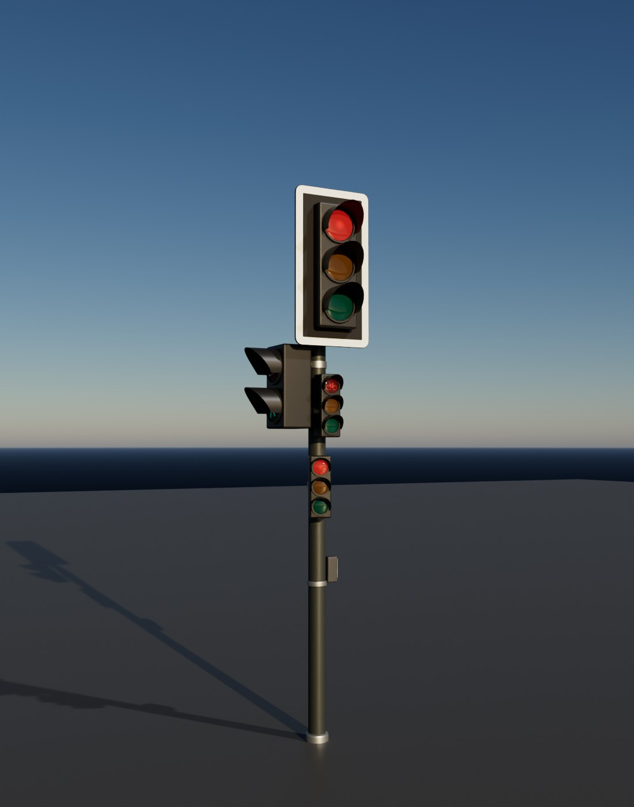
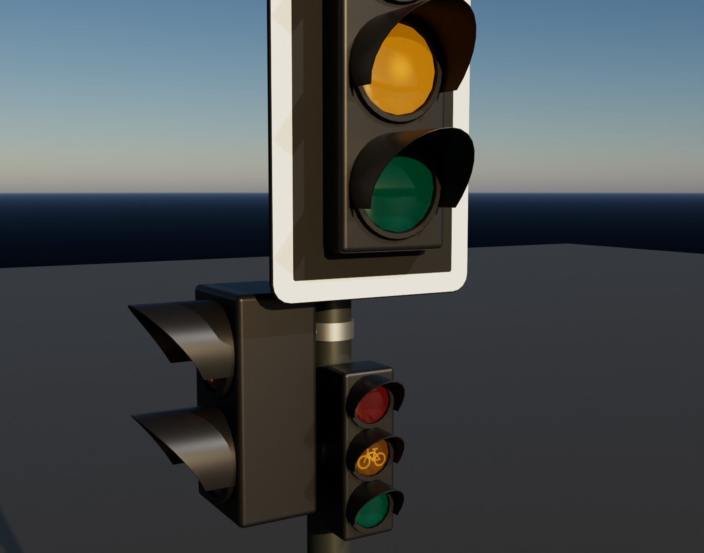
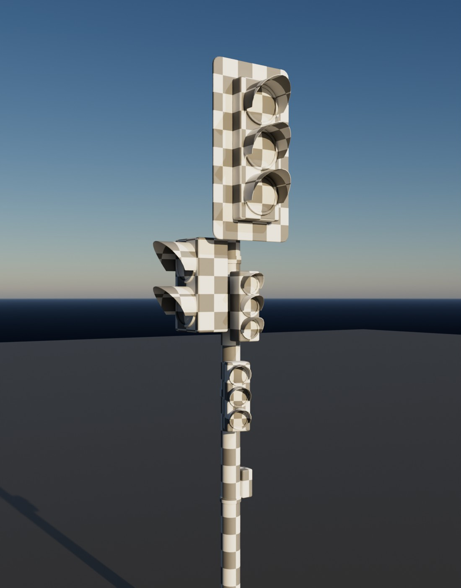
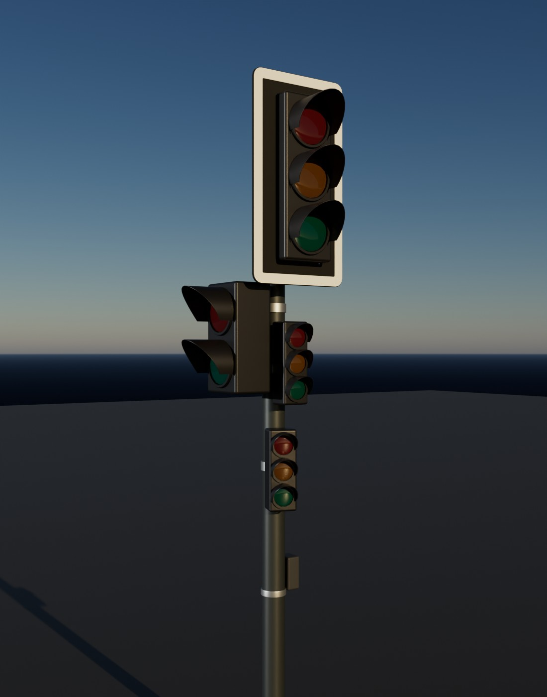
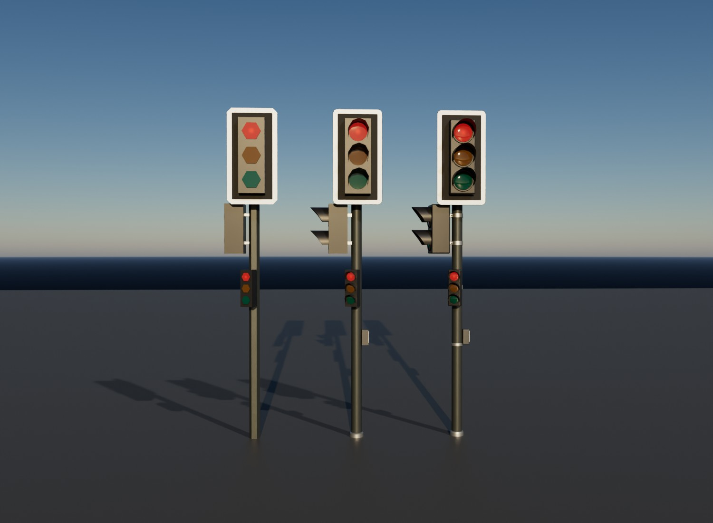
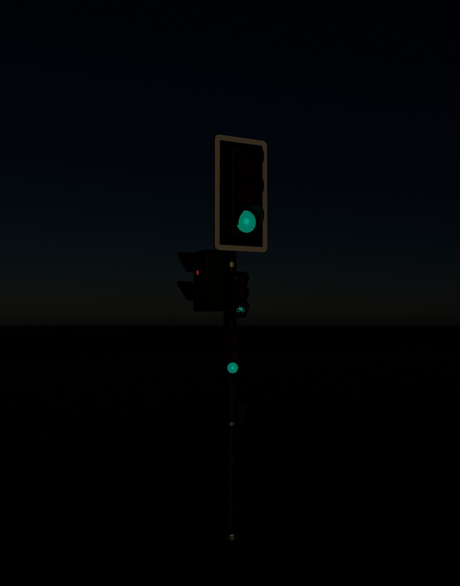

# Traffic lights (claude/tlights)

Owner playtest 2026-11-18: "make better traffic lights in Blender". The signals were `viewer/furniture.js`
`MODELS.signal`: an 8-sided pole, one box head, three flat discs and a white band (built in JS, one colour per
vertex). Now: a scripted Blender kit of the Brussels-Capital Region signal post, streamed like the furniture kit, lit
by the same signal cycle the traffic stops on. `?tlights=old` = the old posts at the old spots (dev panel: A/B, Places &
assets).


*left: the old post (`?tlights=old`), right: the new one; same light, same camera.*

## What a Brussels / Uccle signal post is (looked at on Street View, nothing traced, stored or shipped)

- **Pole**: round steel tube (~114 mm), painted anthracite with a green-grey cast, straight out of the pavement; a
  small galvanised collar where the paving meets it; a domed cap on top. No base plate visible.
- **Main head**: 3 aspects (200 mm lenses), each under a cap visor longer at the top; black housing on two clamp
  brackets, a black contrast **backplate edged in white retro-reflective tape**.
- **Repeater**: the small 3-aspect head (100 mm) at eye level (~1.6 m), turned a little toward the road: the driver
  stopped at the line cannot see the main head over the windscreen.
- **Pedestrian head**: 2 aspects (red standing / green walking figure), on the road side of the post, looking
  **across** the street at the people waiting on the far kerb.
- **Push button**: a small box at hand height on the pavement side, white plate, black button, a raised tactile
  arrow under it.
- **Bike head**: a small 3-aspect head with bicycle figures where a cycle lane comes up to the line.
- **Mast arms** (potences) are rare in Uccle (a few on the big Ring / Churchill junctions): not modelled.

## The kit: `tools/blender/trafficLights.py` -> `models/tlights/`

```
"C:/Program Files/Blender Foundation/Blender 5.0/blender.exe" --factory-startup -b -P tools/blender/trafficLights.py -- models/tlights [--no-bake] [--previews docs/tlights] [--samples 64]
```

| piece | LOD0 | LOD1 | LOD2 | budget |
|---|---|---|---|---|
| `tl_post` (pole, main head + backplate, repeater, pedestrian head, push button) | 7,630 | 1,140 | 226 | 9,000 / 1,500 / 300 |
| `tl_post_bike` (+ the bike head) | 8,928 | 1,356 | 250 | |

- **LODs authored, not decimated**: LOD0 (to 25 m) bevelled housings (4 segments: no streak), lathed bezels (32
  segments on the 200 mm lenses, 20 on the 100 mm ones: round, not octagonal; polish round), domed lenses behind the
  bezel lip, cap visors (18 / 12 steps round the arc) with a ROUNDED lip (two quarter arcs, r 1.3 mm), clamp bands with bolts, the collar, the button's
  tactile arrow; LOD1 (25-80 m) the same shapes with fewer segments, no bevels, no small parts; LOD2 (80-450 m) boxes,
  a hexagonal pole and flat lens discs 8 mm proud (resolvable at 450 m): a lit aspect still reads far away. A
  simplifier (meshopt) eats the visors and lens discs the far levels need.
- **Topology**: weighted normals (face area, sharp edges kept) on every LOD, flat faces flat (backplate: 0 deg off),
  the backplate's white border and black field ONE plane in two slots (no decal over it, no z-fight), every part
  open where it meets another (visor and bezel backs sink 3 mm into the housing face, arms 8 mm into pole and housing),
  shared clamp bands where two heads meet one height. tools/mesh_audit on each LOD node at its band's end: **0
  blocking** (warnings only: slivers of thin bevel strips, seams).
- **Slots by name** (no baked colour): `tl_pole`, `tl_housing`, `tl_backplate`, `tl_border`, `tl_bracket`,
  `tl_buttonbox`, `tl_buttonplate`, `tl_button` and the lenses `lens_red`, `lens_amber`, `lens_green`, `ped_red`,
  `ped_green` (the repeater and bike lenses share the car slots: same phase). Palette: `viewer/tlights/tlightKit.js`
  SLOTS.
- **Lenses emissive-ready**: UV0 on a lens = its cell of `tlights_picto.png` (2 x 2: plain disc, standing man, walking
  man, bicycle; signed-distance capsules, anti-aliased, mipmapped in the viewer: the figures are pre-filtered, rule 26).
- **AO**: baked per vertex by Cycles on the GPU (OptiX, RTX 4050) into COLOR_0 (softened, 0.25..1; the white border
  kept open); the viewer packs it into the slot attribute's fraction.
- **Foot**: the pole runs 0.30 m under the origin (JOINS rule: a post on a slope keeps its foot in the paving).
- Frame (glTF / three.js): y up, the pole on the origin; vehicle heads look along **-z** (toward the coming cars), the
  pedestrian head along **+x** (across the road), the button along -x.

Renders (Cycles, OptiX):

| | |
|---|---|
|  |  |
| the bike variant, car red / walking man green | round rims, rounded visor lips, saturated amber with a hot centre, bike figure |
|  |  |
| 10 cm checker, object space: no stretching | sun 7 deg over the horizon: no shading bands |
|  |  |
| LOD2 / LOD1 / LOD0 | night: the lit aspects only (no light added) |

## The lit aspect (polish round)

An LED aspect is saturated, with a hot centre only. The engine tone-maps with three's ACESFilmic (viewer/post.js,
exposure ~1; 0.55 on the path without the post chain), whose curve and channel mixing wash a bright emissive out: the
first cut (amber (1, 0.48, 0.04) x 2.2 by day .. x 6 at night) came out pale cream / near white (saturation 0.16-0.54
on screen). Now (`viewer/tlights/tlightPlace.js` LIT / EMIT, used by the shader and the gate):

| aspect | colour (linear) | emissive strength (day; x 1.15 at night) | on screen at exposure 1 (ACES, sRGB) |
|---|---|---|---|
| red (cars, pedestrian, bike) | (1, 0.04, 0.02) | 1.1 | hue 9, saturation 0.81 |
| amber | (1, 0.40, 0) | 0.85 | hue 44, saturation 0.82 |
| green (blue-green, as Belgian LEDs) | (0.02, 1, 0.72) | 0.38 | hue 171, saturation 0.77 |

The centre (inner ~45 % of the lens, from the atlas UV) goes up to x 1.9: the hot spot may go pale, the rim keeps the
hue. Green is the weakest: ACES desaturates it first (and it reads brightest). The gate runs every colour through the
same ACES at exposures 0.55 / 1 / 1.6, day and night: hue within 15 deg, saturation >= the target at exposure 1 by day,
>= 0.4 everywhere. Bloom works before the tone map, so the glow stays coloured. The lit lens's albedo is lit x 0.25 (not
0.55: daylight on it paled it too). The Blender previews use the same colours / strengths with the ACES 1.3 view
transform.

## In the city: `viewer/tlights/`

- `tlightPlace.js` (three-free): the piece per site (`tl_post_bike` where the approach has a `bike` lane on the
  traffic's right in roads.json), the seat: `ground + fit.lift` (the measured pavement's raise, as the lamps; +0.12
  without a measured street, as before), the triangle budgets.
- `tlightKit.js`: loads the GLB + atlas; per piece and LOD one geometry (position, normal, uv, slot + AO); three
  shared materials (one per LOD) with the slot palette, the LOD dither bands (25 / 80 / 450 m, viewer/lodFade.js: same
  noise in the shadow pass, no pop, no shadow snap) and the tile fade slot; the **lit aspect**: per instance its phase
  (iVar.x), the car state `SIGNAL_STATE` A/B and the new pedestrian state `WALK_STATE` A/B (`viewer/furniture.js`
  updateSignals, from `viewer/traffic/signals.js` walkState: the walking man shows for the first 60 % of the crossed
  road's red). Emissive only: **no light added, no DynamicDrawUsage** (static pools with update ranges).
- `cityTLights.js`: one pool per piece for the whole city (viewer/instanceStream.js, like the furniture kit); per tile
  an invisible `furniture-signal` stand-in (LOD2 triangles) so the car / walker colliders read the posts as before.
- `viewer/main.js`: `buildFurniture(..., { noSignals: cityTLights.drawing })` still computes the sites
  (`furn.signals`) and hands them to `cityTLights.addTile`; `?tlights=old` (or a kit load failure) draws the old posts.

### Placement fixes (`viewer/streets/signalPlace.js`, the sites both versions use; `?tlights=old` = as before)

Measured by `tools/audit/tlightsCheck.mjs` on the 249 posts of the 40 signal tiles:

| | before (`--old`) | after |
|---|---|---|
| heads > 35 deg off their approach (the lane 15 / 25 m back up the road) | 22 | 0 (worst 15.5 deg) |
| feet not seated within 5 cm (a post across a kerb line) | 10 (worst 13.9 cm) | 0 (worst 4.6 cm) |
| posts in a driven lane | 5 | 0 |

- **Why**: the heads were set along the road's tangent at the stop point (a bend before the line turned them up to
  45 deg away from the cars that come); the kerb snap took the nearest raised kerb within 5 m, also a median's (one
  post 1 m from the centre line, on the far side); a post still in a carriageway walked 16 x 0.5 m to the right
  (8-12 m off, across a parallel slip road); nothing checked that the foot stood on ONE surface; a signal point near a
  one-way street's exit got a post for traffic that never comes.
- **Fix**: the heads aimed at the lane centre 20 m back up the approach (walked along the road's polyline, stopping at
  a hairpin), at most 30 deg off the road; the kerb snap only on this traffic's right beyond half its carriageway;
  else the NEAREST spot (10 cm rings, up to 8 m) on the traffic's right, out of every carriageway, on raised paving
  where the street is measured, its foot ring (r 10 cm) level within 3 cm; one-way streets: one approach, their own
  flow.
- **Rule**: docs/QUALITY_RULES.md rule 36. **Check**: `tlights` in tools/audit/mergeGate.mjs.

## Checks

- `node --import ./tools/road_audit/register.mjs tools/audit/tlightsCheck.mjs [--quiet] [--tiles T,T] [--old]` (~80 s):
  the kit (budgets, slots, lens facing per LOD: 6 + 2 lenses, 9 + 2 with the bike head, foot, mesh audit per LOD) and
  the city (facing, pedestrian head across the road, seated, not in a lane), + static: no light / DynamicDrawUsage in
  viewer/tlights, the `?tlights` row, main.js wiring.
- Browser turn (not done on this branch, Chrome belongs to another agent): see "For the browser turn".

## For the browser turn

1. `?quick=1&place=stjob-street&with=traffic` (+ `&at=1077,514` Saint-Job junction): the posts on the pavement at the
   junction mouths, heads toward the coming cars, the cars stopping on the red the head shows; the walking man green
   while the crossed road's cars have red. `__tlights.report()` (tiles, instances, drawn meshes, stream stats).
2. Drive / walk toward a post from 120 m: LOD2 -> LOD1 (80 m) -> LOD0 (25 m) dissolve with no pop, shadows with them.
3. Night (`&hour=22`): the lit aspects glow (emissive, bloom), no extra light; the shader compiles (WALK_STATE uniforms,
   pictogram texture) with no WebGPU error, `pipelinesCreated` steady while driving past posts.
4. `?tlights=old` alternated: the old box posts at the old spots (A/B), the visual tour flags the views with signals
   (expected).
5. Spots the placement fix moved (look at them): E2 (-834.7, -1238.3), F2 (-242, -1272), H2 (584, -1391),
   K11 (2362.5, 3250.9: the secondary_link hairpin), I3 (1373.7, -655.8: was on a median).
