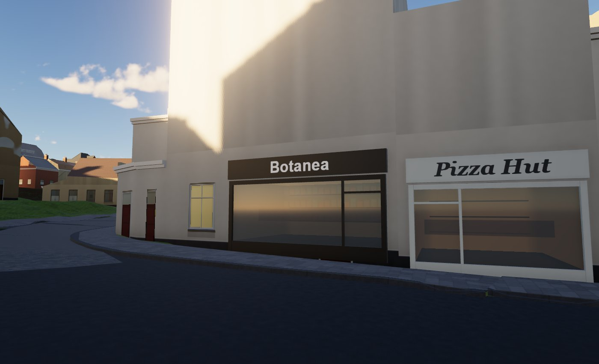
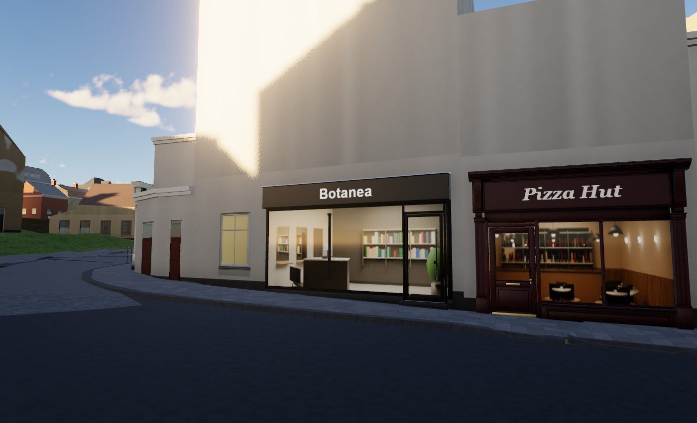
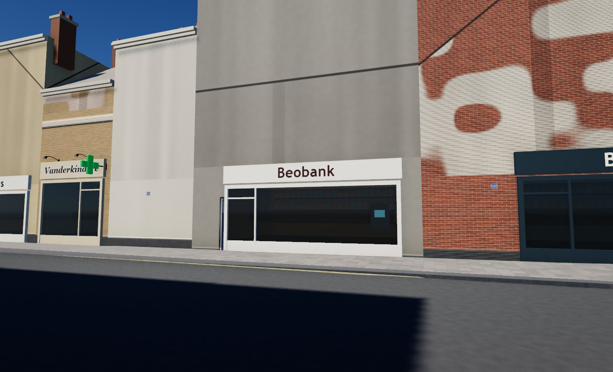
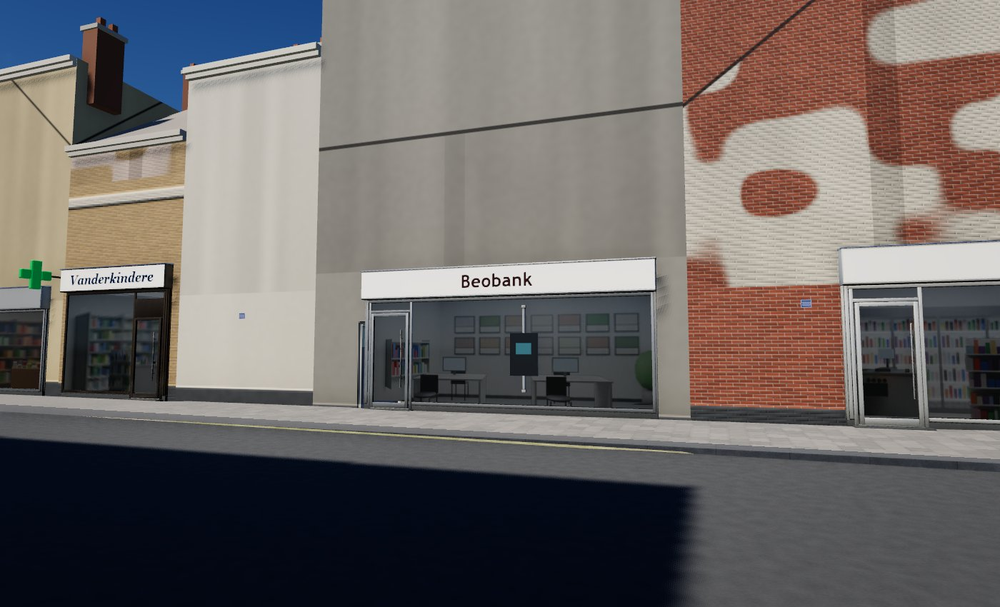

# Shops: realistic shopfronts, interiors and terraces (branch claude/shops, 2026-11-14)

The owner's playtest verdict on the street-life fronts ("Botanea", "Pizza Hut"): *the shop stores are way too cheap; it
should not be hard to make them realistic, with an inside for some and a nice outside; some of the restaurants have
terraces around Place Saint-Job*. This branch replaces the flat fronts (a textured box frame + a procedural parallax
window) with a **Blender shopfront kit**, **Blender-rendered shop interiors** behind every window, and the **real
terraces** of Place de Saint-Job. **On by default; `?shops=old` gives the old flat fronts back** (same data, same text,
same placement). Lab: `labs/shops-lab.html` (sites Place de Saint-Job, Rue Vanderkindere, Fort-Jaco, Alsemberg).

| | before | after |
|---|---|---|
| Place de Saint-Job, Botanea + Pizza Hut (day) |  |  |
| Rue Vanderkindere, Beobank (midday) |  |  |

More: `shops/after_stjob_night.jpg` (night, lit interiors and letters), `shops/after_city_le_refuge_terrace.jpg` (Le
Refuge's hedge terrace in the city), `shops/after_city_chez_clementine_covered_terrace.jpg` (the covered terrace under
the pavilion), `shops/flicker_stjob_strafe_heat.jpg` (flicker heat map), kit renders in `models/shops/previews/`.

## 1. Research: the real shops (look only: Google Maps / Street View, never traced, stored or shipped)

The data: 537 OSM points with a façade (`data/streetlife/<T>.json`): 288 shops (clothes 30, hairdressers 22,
convenience 21, chocolate 11, florists 10, bicycles 10, books 8, delis 8, butchers 7, jewellers 7, opticians 7 ...),
84 restaurants, 21 bakeries, 21 fast food, 17 pharmacies, 17 supermarkets, 16 banks, 15 cafés, 10 bars. The streets
with most fronts: Chaussée de Waterloo 136, Rue Vanderkindere 57, Chaussée d'Alsemberg 53, Rue Xavier De Bue 30,
Avenue Brugmann 21, Chaussée de Saint-Job 14, Parvis Saint-Pierre 10. Fronts are 3.7-6.5 m wide (median 5.5 m).

What Street View shows (Place de Saint-Job / Chaussée de Saint-Job, April and July 2024; Rue Vanderkindere, March 2023
and April 2024), the facts the kit is built from:

| place (Street View) | what is there | used for |
|---|---|---|
| 666 Ch. de Saint-Job (Botanea, the coiffeur, and Lilicup / Miska next door) | dark aluminium framed glazing, a slim black fascia ("COIFFEUR", "CAVE À VINS"), glazed doors, rounded painted brick piers; a **raised timber deck terrace with a white railing** in front of the café; a festoon of bulbs | the modern front (thin dark frames, fascia box); Miska's curated terrace |
| L'Enfant Terrible / Gabriella (Ch. de Saint-Job) | a **painted timber front** (dark green) with panelled stall risers, a small green canopy; a big flat sign board on posts; a passage terrace with parasols; a wrought-iron bracket | the classic front (pilasters, risers, sill, fascia, cornice), the blade bracket |
| Le Refuge (ex "Au Petit Job", 2018 user photo) | a **front-yard terrace behind a clipped hedge**, square market parasols, dark bistro chairs and square tables, planters with flowers, a blue awning with lettering on the valance | Le Refuge's curated terrace (hedge planters, parasols), the awning + valance text |
| Place de Saint-Job 36-31 (La Meute, the bakery, the press shop, Espace Photo, the convenience store) | a **varnished wood front**; a black fascia board with **gooseneck spotlights** over a **closed roller shutter**; a red fascia with red projecting signs; **grey fascia + red painted stall risers**; a lightbox fascia with coloured pilasters; a grey retractable awning with plants on the pavement (the florist) | classic paints (incl. varnished oak), the gooseneck spots on fascias, the curated fronts of Barat / Espace photo / Le Bouquet Varié |
| The square from Chez Clémentine (2016 user pano) | the glazed pavilion's covered terrace with long tables; the butcher's grey canopy with white lettering; Pizza Hut on brick with arched windows; a café with a red awning and bistro tables on the pavement | Chez Clémentine's terrace (no parasols: under its roof), the butcher's curated front |
| Rue Vanderkindere 152-156 (Beobank, SmartFix, a clothes shop) | full-height **aluminium glazing**, a thin fascia band, a glass door with a long pull bar, graffiti **roller shutters** on closed shops, clothes rails seen inside | the modern door, the bank / office and boutique interiors |
| Rue Vanderkindere 356 (Dante) | restaurant fronts with **retracted awning cassettes**, the name as window lettering, stone plinth | the awning cassette, the blue-stone plinth |

Brussels shopfront vocabulary checked against these: framed glass fronts set back behind the frame, the door at one end
on a stone step, stall risers under the windows, fascia boards with lettering (painted, backlit, lightbox, or lit by
goosenecks), projecting signs on brackets, folding-arm awnings with a lettered valance, roller-shutter boxes, lit
interiors at night.

**Terraces at Place de Saint-Job** (what really has one, 2024): Le Refuge (front-yard terrace, hedge, parasols; OSM
`outdoor_seating=yes`), Miska / Lilicup (timber deck), Chez Clémentine (covered pavilion terrace), L'Enfant Terrible
(passage terrace; not an OSM point of ours). **No terrace** on Street View for Madonna and Pizza Hut (curated `none`).
Elsewhere the rule stays: a café / restaurant / bar (or OSM `outdoor_seating=yes`) gets a terrace only when the
measured paved depth in front leaves 1.6 m of walking passage (`face.pave`), never on a pavement too narrow for it.
Curated entries: `data/shops/terraces.json` (each with the Street View fact it comes from).

## 2. The shopfront kit (`tools/blender/shopfronts.py` -> `models/shops/shopkit.glb`)

Blender 5.0 headless, named material slots only (no baked colour), AO lightmap (`shopkit_ao.png`, Cycles, 1024 px),
LOD1 by meshoptimizer at load (welded, 4-20 mm error, crease normals, AO per vertex; never Blender decimate).

| piece | tris LOD0 / LOD1 | what |
|---|---|---|
| `front_classic` | 3320 / 544 | painted timber surround: stone plinth blocks, fluted pilasters on base blocks with capitals, head rail + bead, a framed fascia board (raised bolection moulding round the sign panel) between two **scroll consoles** with turned drops, a moulded **cornice** (bed mould, ovolo, ogee, corona) with a lead flashing |
| `riser_classic` | 916 / 128 | a window bay's stall riser (stone plinth, panelled riser with a fielded panel), the moulded sill with its drip, the bottom glazing bead (never under the door) |
| `front_modern` | 1352 / 202 | blue-stone plinth, 60 mm aluminium jambs + head, roller-shutter guide rails (U channels), a projecting composite **fascia box** with the shutter slot underneath and a reveal line, a steel flashing |
| `riser_modern` | 120 / 24 | the bay's bottom rail + gasket |
| `door_classic` | 2412 / 254 | a panelled glazed door (stiles, rails, raised kick panel, glazing beads), its posts, transom and fanlight bead, brass knob, escutcheon, letter plate, kick plate, a blue-stone step |
| `door_modern` | 1340 / 186 | aluminium glass door, a 1.3 m stainless pull bar on stand-offs, steel threshold, stone step |
| `mullion` | 244 / 52 | a moulded glazing bar with foot and head blocks |
| `awning` | 1136 / 258 | folding-arm awning: cassette with end caps and wall brackets, a sagging canvas, front bar, valance, two arms with elbows |
| `blade` | 1004 / 340 | wrought-iron projecting-sign bracket: wall plate, top bar with a ball finial, brace, a scroll, two hooks |
| `parasol_sq` | 2484 / 416 | 2.6 m square market parasol: cross foot with four slabs, wooden mast, runner, 8 ribs + struts, a sagging canvas with valance flaps, vent cap |
| `table_sq` | 796 / 156 | square bistro table: laminate top, steel frame, column, cross base, levelling feet |
| `planter` | 2492 / ~160 | wooden trough (planks, corner posts, rim) with a clipped hedge (leaf mottle in the shader) |

**Stretching without distortion (a 3D 9-slice).** A real front is 2-10 m wide and its fascia sits at 2.55 or 3.0 m.
The pieces are modelled at a nominal 2.0 m width; in the vertex stage every vertex moves by a TRANSLATION only:
`x += sign(x) * (W - 2) / 2` (|x| > 2 cm) and `y += dH` above the piece's stretch line. Long spans are single faces
from end to end (the script's sweeps keep vertices only on the end rings), so bevels, mouldings and normals never
distort (`stretchCheck`: 0 vertices near x = 0 on every stretching piece). NOTE for three r187: the instance matrix is
applied BEFORE `positionNode` (positionLocal is already instanced there), so the shift is rotated by the instance's yaw
and added (`viewer/shops/shopKit.js sliceShift`).

**Placement (`viewer/shops/shopLayout.js`, in the street-life worker).** Per real front (the street-life layer's
façade fit: position, normal, width, floor height): the family (classic for cafés, restaurants (70 %), bakeries,
delis, chocolatiers, florists, bookshops ...; modern for banks, supermarkets, pharmacies, opticians, phone shops, fast
food; a hash for the rest), a heritage paint (bottle green, oxblood, navy, black, cream, grey-blue, varnished oak, sage)
or a powder-coat colour (anthracite, black, white, silver, bronze); the door at one end (none under 2.6 m), window bays
with mullions every ~1.6 m (classic) / 2.4 m (modern), a riser per window run; the name on the fascia panel (our
generic sign styles: painted, gooseneck spots, backlit letters, lightbox; real names as text only, no logos), the
awning (food and fresh shops, 80 %), the projecting sign on its wrought-iron bracket at the door end (cafés,
restaurants, bakeries, banks), the pharmacy's green cross, the ATM in a bank's glass. Curated fronts
(`data/shops/terraces.json` `front`): Le Refuge, Miska, Chez Clémentine, Pizza Hut, Barat, Espace photo, Le Bouquet
Varié, St-Job (the butcher).

**Joins.** Plinths, risers, steps and stone blocks run 0.30 m below the front's foot (`face.y`): on a sloping pavement
the downhill end still reaches into the ground (no floating edge). The glass sits 7.5 cm out, inside the frame's
depth (the frame projects 11-38 cm: the glass is SET BACK behind it). The façade (wall shader, façade kit) still leaves
its ground-floor opening out where the street-life front is (unchanged).

## 3. The interiors (`tools/blender/shopInteriors.py` -> `textures/shops/interiors.ktx2`)

Interior mapping with Blender renders, no geometry. Eight shop rooms of the real types (bakery / pastry / butcher,
pharmacy / optician, café / restaurant / bar, boutique, grocery / supermarket / florist, office / bank / agency, salon,
general shop), each 6 x 5 x 3 m, furnished by script (shelves of goods, bread racks, glass counters with pastries,
clothes rails, fridges with drinks, desks and screens, mirror stations, café tables, bars with bottles, ceiling panels,
spots or pendants), lit as an open shop (Cycles, 40 samples, denoised):
- **ROOM image**: a pinhole camera 3 m in front of the window whose frustum is exactly the window. The viewer
  (`viewer/shops/shopWindow.js`) intersects the view ray with the room box (the glass's width x 3 m from the shop floor
  x 4 m deep) and projects the hit point with the same pinhole: floor, ceiling, side and back walls in one image
  (Mr.doob's slop-newyork uses a procedural room; three.js has no interior-mapping example: this is the "single
  texture" variant, rendered).
- **CARD image**: the free-standing furniture (counter, tables, rail, gondola, desks) rendered alone (transparent film)
  by the same camera, drawn on a plane 1.1 m in: it slides against the back shelves as you walk past (true parallax).
- Per shop: its type, a mirror flag, the floor below the glass. Mip level from the footprint on the GLASS (no seam
  lines at the wall edges). A street-side reflection (sky / street grey by the reflected ray, Schlick-like with a 10 %
  floor) over the room by day; the room by itself at night.
- Atlas 4096 x 2048 (rooms in two rows, cards in two rows), **KTX2 UASTC + zstd: 3.4 MB download, 8 MB GPU + mips
  (BC7, ~10.7 MB)**; WebP fallback 0.3 MB (`?shopsktx=0`). Encoder: `tools/shops/png_to_rgba.py` + `encode_interiors.mjs`.

## 4. Terraces

`layoutTerrace`: square bistro tables with two chairs (three on a single deep row: the street-life kit's rattan bistro
chair), square parasols where deep enough and clear of an awning (an awning reaches 1.8 m out: the parasols stand
beyond it or are left out), a hedge of planters along the outer edge with a gap in front of the door, nothing in front
of the door. Colliders: an invisible instanced mesh per tile named `furniture-terrace` (table + chairs box, parasol
mast, planter) that the car (`viewer/drive/driveMode.js featureColliders`, as a box) and the walker
(`viewer/character/cityHook.js`, as a post) read.

## 5. Comparisons with Street View (look only)

| shop | Street View (2024) | ours |
|---|---|---|
| Botanea (coiffeur, Ch. de Saint-Job) | dark aluminium frames, slim black fascia "COIFFEUR", glazed door at one end | modern front, black frame, black fascia box with the name, glass door with pull bar at one end, a salon behind (mirror stations, reception desk) - matches the type; the real fascia is lower and slimmer |
| Pizza Hut (Place de Saint-Job) | brick ground floor with arched windows, red fascia | curated classic oxblood front with cornice and consoles, café interior (tables, bar); the arches are the building's, not modelled |
| Barat (bakery, Place de Saint-Job 36) | black fascia, three goosenecks, roller shutter (closed in the photo) | curated: modern black front, goosenecks, bakery interior (bread racks, glass counter with pastries) |
| Le Bouquet Varié (florist) | grey retractable awning, plants on the pavement | curated: classic grey-blue front with a grey awning; the plants on the pavement are not modelled |
| Espace photo | grey fascia, red stall riser panels | curated classic grey-blue front; risers in the same paint (no two-tone riser yet) |
| Le Refuge | hedge, square parasols, blue awning with lettering | curated: navy classic front, navy awning with the name on the valance, five hedge planters, parasols, tables; the ground in front is the city's lawn (the real yard is paved) |
| Beobank (Rue Vanderkindere) | full-height aluminium glazing, glass door, ATM | modern white front (no brand colour), glass door, office interior, ATM on the glass |
| the butcher "St-Job" | grey fascia, white lettering, grey canopy | curated modern silver front with a grey awning |

## 6. Cost

`tools/perf/preflight.ps1` was **RED** all session (GPU 83 % busy before start, 82 C, power cap, 2.3 GB free: another
agent's city tab shares the GPU), so **no GPU millisecond is claimed**. Counts and CPU only.

**Placement, the whole city (120 tiles, `layoutTile` run in Node over every data/streetlife tile):** 492 shopfronts
(269 classic, 223 modern), 490 doors, 489 mullions, 492 risers, 65 awnings, 60 blade brackets; 492 interior-mapped
windows (café 130, shop 90, grocery / florist 68, bakery 58, boutique 44, pharmacy 39, office 32, salon 31);
terraces: 112 tables, 234 chairs, 15 parasols, 5 hedge planters (curated + rule).

**Draws and triangles** (Shops Lab, Place de Saint-Job, renderer.info, all passes incl. shadows, `?shops=old` vs new):

| view | old draws / tris | new draws / tris | shop pools drawn (of which cast shadows) |
|---|---|---|---|
| Botanea + Pizza Hut, 9 m | 68 / 848 k | 101 / 1085 k | 20 (12) |
| the square, ~45 m | 70 / 848 k | 98 / 960 k | 17 (9) |
| from above, ~130 m | 70 / 876 k | 87 / 911 k | 11 (6) |

The kit draws ONE instanced mesh per piece and LOD for the whole city (streamed, `viewer/instanceStream.js`), never
per shop: 12 pieces x 2 LODs, the two tiny ones (riser_modern, mullion) single-LOD; a pool with nothing near is
hidden. Pieces' LOD0 / LOD1 switch at 20-40 m, end 140-420 m (dithered, the shadow pass uses the same mask: no pop,
no shadow snap). The interior is the street life's existing window draw (one per tile; its shader is heavier: ~2
texture reads, a ray-box and a plane intersection per pixel).

**Memory:** interiors atlas KTX2 3.4 MB download -> BC7 8 MB + mips (10.7 MB GPU); the kit 1.6 MB glb + 0.27 MB AO
(1 MB R8 + mips); per-tile instance records (12 floats each: ~500 fronts x ~4 pieces city-wide, < 0.2 MB).

**CPU:** kit load + LOD build 0.38 s at start (meshoptimizer, before the first tile; the old kits 0.04 s), interiors
0.35 s (parallel). Worker per tile: I6 178 ms (old 194), I5 97 ms (old 95): the layout is the same cost. Main
thread per tile (addTile): I6 5.8 ms in the lab's first frames (old 3.2), I5 0.8 ms (old 1.0).

**Drive-stutter harness** (`debug/driveStutter.js`, path "stjob", 14 m/s, city): with the shops ON, the street-life
streamer (which now also streams the 12 shop pools) cost max 0.3-0.4 ms, p99 0.2 ms, 1.5-1.6 ms per second, 0 frames
over 0.5 ms in all 4 legs (2 valid; the frame times themselves are meaningless on a RED machine: p50 33 ms). The
`?shops=old` run for the A/B was invalidated (the tab was throttled in the background, 533 ms frames): **re-run the
A/B on a GREEN machine** (`D.run({ repeats: 2, path: "stjob" })` with and without `?shops=old`).

**Flicker test** (`labs/flickerTest.js`, Shops Lab, Botanea + Pizza Hut at 9 m, midday): strafe 50-54 px (42-45 ppm),
dolly 24 px, far strafe 3 px. The heat map (`shops/flicker_stjob_strafe_heat.jpg`) puts ALL of it on one distant roof
edge behind the corner building, **none on the fronts, the doors, the glass or the interiors** (the interior's mip
level comes from the footprint on the glass: no seam lines). `?shops=old` at the same view: 4 / 8 / 3 px.

**Mesh audit** (`tools/mesh_audit`, per piece, `models/shops/audit/<piece>/`): mullion, riser_modern, riser_classic,
awning clean of coincident faces; remaining "blocking" items are (a) faces against the WALL (z = 0, facing into it:
never seen), (b) internal faces of stacked mouldings / capitals hidden inside the solid, (c) the bevel `bentflat` /
`streak` items on cylinders and the hedge's leaf mass. The visible ones the audit found were fixed (the head bead's
underside shared with the capitals, the mullion's blocks, the parasol ribs crossing the canvas, the crossed cast feet
of the parasol and table). The flicker test confirms no z-fight on the fronts.

## 7. Switches

- `?shops=old`: the old flat fronts (the street-life box frame + the procedural parallax window).
- `?shopsktx=0`: the interiors from the WebP instead of the KTX2.
- `?streetlife=0`: no street life at all (unchanged).
- Lab panel "Shops": A/B old / new (reloads at the same view), jump to any shop, close-up / oblique, interior by day /
  at night, the furniture card, glass specular and street reflection.

## 8. Shared files touched (for the merge)

| file | change |
|---|---|
| `viewer/main.js` | ONE line: `cityStreetLife.start({ scene, updaters, log, renderer })` (the renderer, for the KTX2 interiors) |
| `viewer/drive/driveMode.js` | `featureColliders` regex: `|terrace` added (terrace tables, parasols, planters as boxes for the car) |
| `viewer/character/cityHook.js` | `KIND`: `furniture-terrace` added to the "post" list (the walker) |
| `viewer/streetlife/streetlife.js` | shop pools on the same Streamer, the interior window material, `iWinT`, terrace colliders, **`shrinkToward`** (the shrink about the instance centre: a fix for every street-life box, window and glass) |
| `viewer/streetlife/layout.js` | `opts.shops` -> `viewer/shops/shopLayout.js`; WIN_STRIDE 20 -> 24 |
| `viewer/streetlife/streetlifeWorker.js` | WIN_IB 8 -> 12, the shop records + colliders, the curated terraces fetched once |
| `viewer/streetlife/cityStreetLife.js` | `?shops=old`, the renderer |
| `labs/streetlife-lab.js` | the Shops folder (only when `SHOPS_LAB`), the Vanderkindere site, `StreetLife.create(scene, { shops, renderer })` |
| `labs/index.html` | the Shops Lab card |
| `.gitignore` | `textures/shops/_work/`, `textures/shops/interiors.png` |

New: `viewer/shops/` (shopKit.js, shopLayout.js, shopPieces.js, shopWindow.js), `tools/blender/shopfronts.py`,
`tools/blender/shopInteriors.py`, `tools/shops/`, `models/shops/`, `textures/shops/`, `data/shops/terraces.json`,
`labs/shops-lab.html`, this file and `docs/assets/shops/`. No tile-worker change (`tileWorker.bundle.js` untouched).

## 9. Left / next

- Two-tone fronts (a different riser colour, Espace photo's red panels), roller shutters DOWN on shops closed at night,
  window lettering / vinyls on glass, goods on the pavement (fruit crates, flower buckets), the timber deck + white
  railing of Miska's terrace, festoon lights; a florist room of its own (florists use the grocery room: flower
  fridges + crates).
- Le Refuge's terrace stands on the city's lawn (the real yard is paved): a paved patch needs the ground layer.
- Terrace placement by rule checks the paved depth but not trees / lamp posts / stop poles in the walking strip.
- GPU A/B on a GREEN machine (the drive-stutter A/B and the lab's GPU A/B button).
