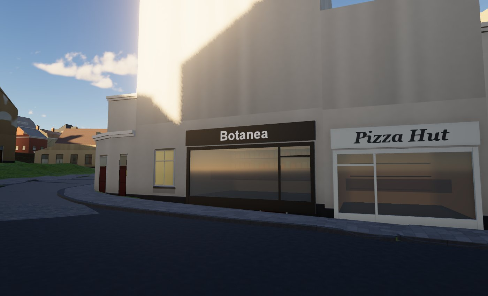
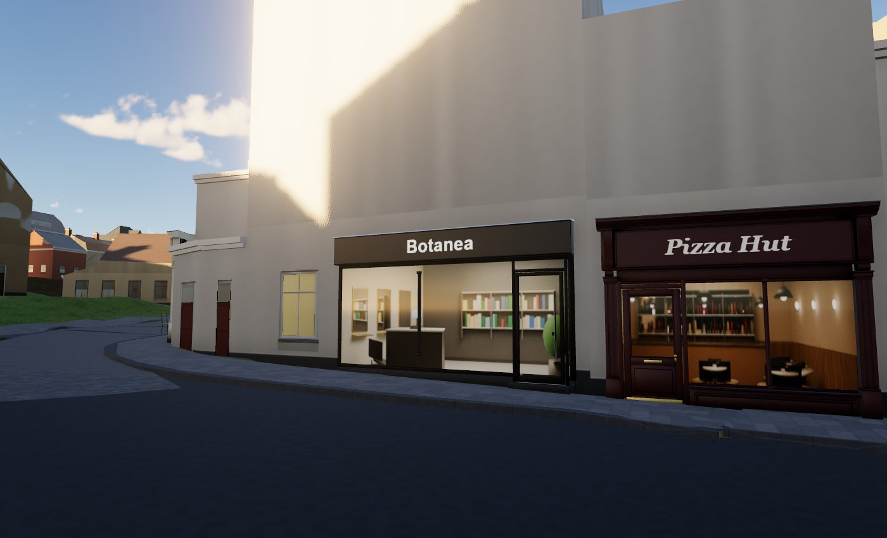
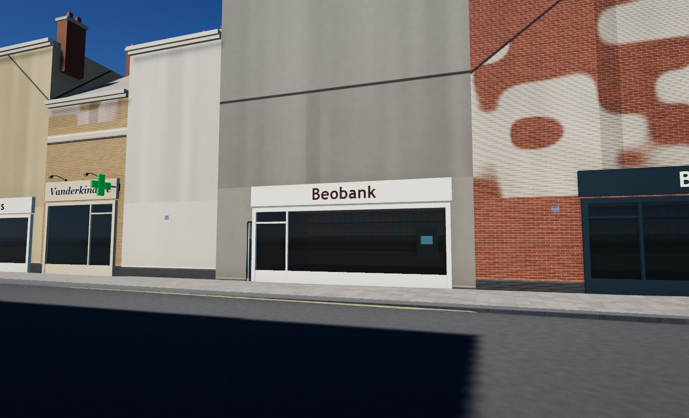
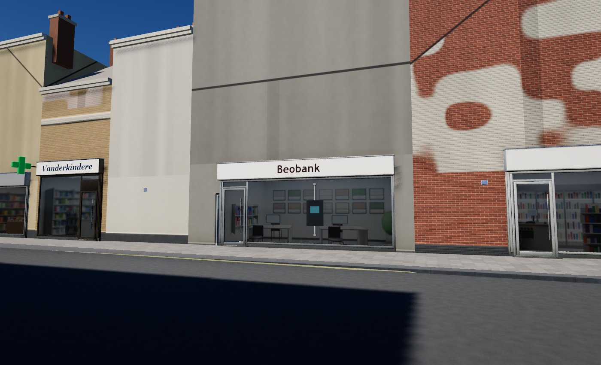

# Shops: realistic shopfronts, interiors and terraces (branch claude/shops, 2026-11-14)

The owner's playtest verdict on the street-life fronts ("Botanea", "Pizza Hut"): *the shop stores are way too cheap; it
should not be hard to make them realistic, with an inside for some and a nice outside; some of the restaurants have
terraces around Place Saint-Job*. This branch replaces the flat fronts (a textured box frame + a procedural parallax
window) with a **Blender shopfront kit**, **Blender-rendered shop interiors** behind every window, and the **real
terraces** of Place de Saint-Job. **On by default; `?shops=old` gives the old flat fronts back** (same data, same text,
same placement). Lab: `labs/shops-lab.html` (sites Place de Saint-Job, Rue Vanderkindere, Fort-Jaco, Alsemberg).

| | before | after |
|---|---|---|
| Place de Saint-Job, Botanea + Pizza Hut (day) |  |  |
| Rue Vanderkindere, Beobank (midday) |  |  |

More: `shops/after_stjob_night.jpg` (night, lit interiors and letters), `shops/after_city_le_refuge_terrace.jpg` (Le
Refuge's hedge terrace in the city), `shops/after_city_chez_clementine_covered_terrace.jpg` (the covered terrace under
the pavilion), `shops/flicker_stjob_strafe_heat.jpg` (flicker heat map), kit renders in `models/shops/previews/`.

## 1. Research: the real shops (look only: Google Maps / Street View, never traced, stored or shipped)

The data: 537 OSM points with a façade (`data/streetlife/<T>.json`): 288 shops (clothes 30, hairdressers 22,
convenience 21, chocolate 11, florists 10, bicycles 10, books 8, delis 8, butchers 7, jewellers 7, opticians 7 ...),
84 restaurants, 21 bakeries, 21 fast food, 17 pharmacies, 17 supermarkets, 16 banks, 15 cafés, 10 bars. The streets
with most fronts: Chaussée de Waterloo 136, Rue Vanderkindere 57, Chaussée d'Alsemberg 53, Rue Xavier De Bue 30,
Avenue Brugmann 21, Chaussée de Saint-Job 14, Parvis Saint-Pierre 10. Fronts are 3.7-6.5 m wide (median 5.5 m).

What Street View shows (Place de Saint-Job / Chaussée de Saint-Job, April and July 2024; Rue Vanderkindere, March 2023
and April 2024), the facts the kit is built from:

| place (Street View) | what is there | used for |
|---|---|---|
| 666 Ch. de Saint-Job (Botanea, the coiffeur, and Lilicup / Miska next door) | dark aluminium framed glazing, a slim black fascia ("COIFFEUR", "CAVE À VINS"), glazed doors, rounded painted brick piers; a **raised timber deck terrace with a white railing** in front of the café; a festoon of bulbs | the modern front (thin dark frames, fascia box); Miska's curated terrace |
| L'Enfant Terrible / Gabriella (Ch. de Saint-Job) | a **painted timber front** (dark green) with panelled stall risers, a small green canopy; a big flat sign board on posts; a passage terrace with parasols; a wrought-iron bracket | the classic front (pilasters, risers, sill, fascia, cornice), the blade bracket |
| Le Refuge (ex "Au Petit Job", 2018 user photo) | a **front-yard terrace behind a clipped hedge**, square market parasols, dark bistro chairs and square tables, planters with flowers, a blue awning with lettering on the valance | Le Refuge's curated terrace (hedge planters, parasols), the awning + valance text |
| Place de Saint-Job 36-31 (La Meute, the bakery, the press shop, Espace Photo, the convenience store) | a **varnished wood front**; a black fascia board with **gooseneck spotlights** over a **closed roller shutter**; a red fascia with red projecting signs; **grey fascia + red painted stall risers**; a lightbox fascia with coloured pilasters; a grey retractable awning with plants on the pavement (the florist) | classic paints (incl. varnished oak), the gooseneck spots on fascias, the curated fronts of Barat / Espace photo / Le Bouquet Varié |
| The square from Chez Clémentine (2016 user pano) | the glazed pavilion's covered terrace with long tables; the butcher's grey canopy with white lettering; Pizza Hut on brick with arched windows; a café with a red awning and bistro tables on the pavement | Chez Clémentine's terrace (no parasols: under its roof), the butcher's curated front |
| Rue Vanderkindere 152-156 (Beobank, SmartFix, a clothes shop) | full-height **aluminium glazing**, a thin fascia band, a glass door with a long pull bar, graffiti **roller shutters** on closed shops, clothes rails seen inside | the modern door, the bank / office and boutique interiors |
| Rue Vanderkindere 356 (Dante) | restaurant fronts with **retracted awning cassettes**, the name as window lettering, stone plinth | the awning cassette, the blue-stone plinth |

Brussels shopfront vocabulary checked against these: framed glass fronts set back behind the frame, the door at one end
on a stone step, stall risers under the windows, fascia boards with lettering (painted, backlit, lightbox, or lit by
goosenecks), projecting signs on brackets, folding-arm awnings with a lettered valance, roller-shutter boxes, lit
interiors at night.

**Terraces at Place de Saint-Job** (what really has one, 2024): Le Refuge (front-yard terrace, hedge, parasols; OSM
`outdoor_seating=yes`), Miska / Lilicup (timber deck), Chez Clémentine (covered pavilion terrace), L'Enfant Terrible
(passage terrace; not an OSM point of ours). **No terrace** on Street View for Madonna and Pizza Hut (curated `none`).
Elsewhere the rule stays: a café / restaurant / bar (or OSM `outdoor_seating=yes`) gets a terrace only when the
measured paved depth in front leaves 1.6 m of walking passage (`face.pave`), never on a pavement too narrow for it.
Curated entries: `data/shops/terraces.json` (each with the Street View fact it comes from).

## 2. The shopfront kit (`tools/blender/shopfronts.py` -> `models/shops/shopkit.glb`)

Blender 5.0 headless, named material slots only (no baked colour), AO lightmap (`shopkit_ao.png`, Cycles, 1024 px),
LOD1 by meshoptimizer at load (welded, 4-20 mm error, crease normals, AO per vertex; never Blender decimate).

| piece | tris LOD0 / LOD1 | what |
|---|---|---|
| `front_classic` | 3320 / 544 | painted timber surround: stone plinth blocks, fluted pilasters on base blocks with capitals, head rail + bead, a framed fascia board (raised bolection moulding round the sign panel) between two **scroll consoles** with turned drops, a moulded **cornice** (bed mould, ovolo, ogee, corona) with a lead flashing |
| `riser_classic` | 916 / 128 | a window bay's stall riser (stone plinth, panelled riser with a fielded panel), the moulded sill with its drip, the bottom glazing bead (never under the door) |
| `front_modern` | 1352 / 202 | blue-stone plinth, 60 mm aluminium jambs + head, roller-shutter guide rails (U channels), a projecting composite **fascia box** with the shutter slot underneath and a reveal line, a steel flashing |
| `riser_modern` | 120 / 24 | the bay's bottom rail + gasket |
| `door_classic` | 2412 / 254 | a panelled glazed door (stiles, rails, raised kick panel, glazing beads), its posts, transom and fanlight bead, brass knob, escutcheon, letter plate, kick plate, a blue-stone step |
| `door_modern` | 1340 / 186 | aluminium glass door, a 1.3 m stainless pull bar on stand-offs, steel threshold, stone step |
| `mullion` | 244 / 52 | a moulded glazing bar with foot and head blocks |
| `awning` | 1136 / 258 | folding-arm awning: cassette with end caps and wall brackets, a sagging canvas, front bar, valance, two arms with elbows |
| `blade` | 1004 / 340 | wrought-iron projecting-sign bracket: wall plate, top bar with a ball finial, brace, a scroll, two hooks |
| `parasol_sq` | 2484 / 416 | 2.6 m square market parasol: cross foot with four slabs, wooden mast, runner, 8 ribs + struts, a sagging canvas with valance flaps, vent cap |
| `table_sq` | 796 / 156 | square bistro table: laminate top, steel frame, column, cross base, levelling feet |
| `planter` | 2492 / ~160 | wooden trough (planks, corner posts, rim) with a clipped hedge (leaf mottle in the shader) |

**Stretching without distortion (a 3D 9-slice).** A real front is 2-10 m wide and its fascia sits at 2.55 or 3.0 m.
The pieces are modelled at a nominal 2.0 m width; in the vertex stage every vertex moves by a TRANSLATION only:
`x += sign(x) * (W - 2) / 2` (|x| > 2 cm) and `y += dH` above the piece's stretch line. Long spans are single faces
from end to end (the script's sweeps keep vertices only on the end rings), so bevels, mouldings and normals never
distort (`stretchCheck`: 0 vertices near x = 0 on every stretching piece). NOTE for three r187: the instance matrix is
applied BEFORE `positionNode` (positionLocal is already instanced there), so the shift is rotated by the instance's yaw
and added (`viewer/shops/shopKit.js sliceShift`).

**Placement (`viewer/shops/shopLayout.js`, in the street-life worker).** Per real front (the street-life layer's
façade fit: position, normal, width, floor height): the family (classic for cafés, restaurants (70 %), bakeries,
delis, chocolatiers, florists, bookshops ...; modern for banks, supermarkets, pharmacies, opticians, phone shops, fast
food; a hash for the rest), a heritage paint (bottle green, oxblood, navy, black, cream, grey-blue, varnished oak, sage)
or a powder-coat colour (anthracite, black, white, silver, bronze); the door at one end (none under 2.6 m), window bays
with mullions every ~1.6 m (classic) / 2.4 m (modern), a riser per window run; the name on the fascia panel (our
generic sign styles: painted, gooseneck spots, backlit letters, lightbox; real names as text only, no logos), the
awning (food and fresh shops, 80 %), the projecting sign on its wrought-iron bracket at the door end (cafés,
restaurants, bakeries, banks), the pharmacy's green cross, the ATM in a bank's glass. Curated fronts
(`data/shops/terraces.json` `front`): Le Refuge, Miska, Chez Clémentine, Pizza Hut, Barat, Espace photo, Le Bouquet
Varié, St-Job (the butcher).

**Joins.** Plinths, risers, steps and stone blocks run 0.30 m below the front's foot (`face.y`): on a sloping pavement
the downhill end still reaches into the ground (no floating edge). The glass sits 7.5 cm out, inside the frame's
depth (the frame projects 11-38 cm: the glass is SET BACK behind it). The façade (wall shader, façade kit) still leaves
its ground-floor opening out where the street-life front is (unchanged).

## 3. The interiors (`tools/blender/shopInteriors.py` -> `textures/shops/interiors.ktx2`)

Interior mapping with Blender renders, no geometry. Eight shop rooms of the real types (bakery / pastry / butcher,
pharmacy / optician, café / restaurant / bar, boutique, grocery / supermarket / florist, office / bank / agency, salon,
general shop), each 6 x 5 x 3 m, furnished by script (shelves of goods, bread racks, glass counters with pastries,
clothes rails, fridges with drinks, desks and screens, mirror stations, café tables, bars with bottles, ceiling panels,
spots or pendants), lit as an open shop (Cycles, 40 samples, denoised):
- **ROOM image**: a pinhole camera 3 m in front of the window whose frustum is exactly the window. The viewer
  (`viewer/shops/shopWindow.js`) intersects the view ray with the room box (the glass's width x 3 m from the shop floor
  x 4 m deep) and projects the hit point with the same pinhole: floor, ceiling, side and back walls in one image
  (Mr.doob's slop-newyork uses a procedural room; three.js has no interior-mapping example: this is the "single
  texture" variant, rendered).
- **CARD image**: the free-standing furniture (counter, tables, rail, gondola, desks) rendered alone (transparent film)
  by the same camera, drawn on a plane 1.1 m in: it slides against the back shelves as you walk past (true parallax).
- Per shop: its type, a mirror flag, the floor below the glass. Mip level from the footprint on the GLASS (no seam
  lines at the wall edges). A street-side reflection (sky / street grey by the reflected ray, Schlick-like with a 10 %
  floor) over the room by day; the room by itself at night.
- Atlas 4096 x 2048 (rooms in two rows, cards in two rows), **KTX2 UASTC + zstd: 3.4 MB download, 8 MB GPU + mips
  (BC7, ~10.7 MB)**; WebP fallback 0.3 MB (`?shopsktx=0`). Encoder: `tools/shops/png_to_rgba.py` + `encode_interiors.mjs`.

## 3b. Shops v2: the layered café / restaurant interior (claude/shops3, rule shop-room-layers)

The 135 café / restaurant / bar windows (interior type `cafe`) now use the Forza Horizon 4 layered method
(docs/SHOPS_V2_PLAN.md jobs 3-4); the other seven types stay on the v1 atlas above. `?shopsv2=old` = v1 everywhere.

**Bake** (`tools/blender/shopInteriors.py --v2`, Cycles on OptiX, 128 spp + denoise, ~2 min for all 20 renders): a
café (dark wood wainscot, ochre walls, a zinc bar with its mirror and bottle shelves, a chalkboard, marble bistro tables,
bentwood chairs, opal globes) and a brasserie / restaurant (cabochon tiles, a red leather banquette under brass mirrors,
white-clothed tables, a wine rack, the service counter + the lit kitchen pass). Each 6 m wide x 6 m deep (= the
viewer's café depth: metric, no depth scaling) x 3 m, the same pinhole camera as v1, five renders per variant and light:
- **L0** the shell (walls, floor, ceiling, bar, shelves, banquette); the free-standing tables / chairs / pendants are in
  the scene with `visible_camera = False`, so the floor keeps their shadows and AO; their floor-flush parts (foot plates,
  ceiling canopies, trestles) are left out of this one shot (under an invisible plate the floor would be black);
- **L1** the furniture 1.8-3.5 m deep, **L2** 0.6-1.8 m, **L3** the window display 0-0.6 m below 1.45 m (an oak shelf
  on trestles, a chalk menu on an easel, pot plants, cakes on stands / wine + a cloche): transparent film, every other
  object hidden from the camera but lighting and shadowing them;
- the **composite** (everything): the single fetch beyond 40 m;
- **day**: a sun through the glass (34 deg up, 28 deg aside; an invisible fascia, piers, glazing bars and transom shape
  the patch) + a sky + the shop lights; **night**: the lamps only.

**Pack** (`tools/shops/pack_v2.py`): cards premultiplied in linear light (srgb(lin(c) a)), the composite resized to
half height into the upper half of the L3 layer (L3 projects below the image's middle only: checked). **Encode**
(`tools/shops/encode_array.mjs`, ktx2-encoder's Basis module driven directly with `cBASISTexType2DArray`): one KTX2
2D array, UASTC + zstd, 11 mips: **16 layers x 1024 x 512 (café / brasserie x day / night x L0 / L1 / L2 / L3+composite),
2.85 MB download, 10.67 MB GPU (BC7)**. three r187's KTX2Loader makes a `CompressedArrayTexture`; `labs/shops-array-lab.html`
checks loader + TSL `texture(tex, uv).depth(layer).level(lod)` on WebGPU (BC7, all layers and mips: OK).

**Shader** (`viewer/shops/shopWindow.js`, one Fn per window pixel, still the one street-life window draw per tile):
the room box and metric layout of rule shop-room-metric; within 40 m L0 + the three cards at 2.6 / 1.2 / 0.3 m,
composited front to back (`c = L3 + (1 - a3)(L2 + (1 - a2)(L1 + (1 - a1) L0))`, each card only where its plane is in
front of the room's hit): **4 fetches**; beyond 45 m **1 fetch** (the composite through the room projection); a
cross-fade over 35-45 m (both: no pop). Day / night are uniform branches (dusk: both). Day x 0.2, night open x 0.7,
**closed at night** (the opening hours end before 19:00: 10 of the 135) = the night bake x 0.1 + a security light (a
cool glow at the back, a green exit sign). Grazing fresnel exponent 2.5 for v2 windows (3 for v1). The variant per shop
(`iWinT.w`, shopScale.js `v2Variant`): restaurants / fast food -> the brasserie (108), cafés / bars / pubs -> the café
(27). No light added, no DynamicDrawUsage, no new draw. Without the KTX2 (or `?shopsktx=0`) the cafés stay v1.

**Gate row `shopsv2`** (tools/audit/shopsV2Check.mjs): the array's layers / size / mips, GPU <= 12 MB, file <= 4 MB;
the fetch count of nearV2 / farV2 = shopScale.js V2_FETCH (4 / 1) within budget, only through fetchV2 at an explicit
level, near / far and day / night as branches; the bake's RD2 / planes / slabs / size = shopScale.js V2, RD2 =
DEPTH.cafe; every v2 window within +-10 % across and with a variant.

**Cost.** Per café pixel within 40 m: 4 array fetches (v1: 2) + ~60 ALU (four plane projections, the composite);
beyond 45 m: 1 fetch; the 35-45 m band and dusk: twice that. Memory +10.7 MB GPU, +2.85 MB download. Preflight was
RED all session (CPU 96 % busy, 1.5 GB free, GPU 37 % busy at rest): **no GPU millisecond claimed**; the A/B timing is
left for a GREEN machine (`?shopsv2=old` vs default, Place de Saint-Job at 2-5 m).

A/B shots (outside the repo): `Downloads/uccle-shops-ab/v2/index.html` (the 8 shops of the scale A/B + 4 cafés, 2 / 5 /
15 m, head-on / 45 deg, day / night, `?shopsv2=old` vs v2).

Left: L4 glass dressing (job 5); the other types (job 6); more variants + the neighbour rule (job 7: 27 cafés share one
room, 108 restaurants the other); the baked sun patch does not follow the city's sun (north-facing cafés too); 1024 px
across 6 m is soft at 2 m (a 2048 layer set would be 43 MB: over budget).

## 3c. Shops v2 rollout + glass dressing (claude/shops5, jobs 5-6, rule shop-room-layers)

Every interior type is now v2 (9 rooms); the v1 atlas is no longer loaded when the v2 arrays load (-10.7 MB GPU,
-3.4 MB download), only for `?shopsv2=old`, `?shopsktx=0` or a failed load.

**Rooms** (`tools/blender/shopInteriors.py --v2`, OptiX 128 spp, 90 renders in ~10 min), each as deep as the viewer's
room of its type (`V2_DEPTH` = shopScale.js `DEPTH`, metric), the café's method (L0 shell, free-standing groups hidden
from the camera but shadowing, L1 / L2 cards by group depth, L3 the window display below 1.45 m, floor-flush pieces
`_contact`), one variant each:
- bakery (4 m): cream metro tiles, checker floor, oak bread racks with slanted boards, jars, chalk price board; L1 the
  work counter (slicer, coffee machine); L2 the glass vitrine (slanted front glass, two tiers of pastry trays) + till,
  enamel pendants; L3 a tiered cake, pastry tray, baguette basket, bread crates;
- pharmacy (4.5 m): white shelving on three walls over drawers, a lit band + green cross, LED panels; L1 a gondola; L2
  the counter with two tills; L3 white plinths with boxes and pump bottles, a poster stand, a plant;
- boutique (5 m): rails of garments under folded stacks, a taupe back wall with a tall brass mirror, a fitting-room
  curtain, track spots; L1 a round table + a free-standing rail; L2 a dressed mannequin, a bench; L3 plinths with shoes
  and a bag, a dress form;
- grocery (5.5 m): grey shelving, a crate stand of fruit, glass-door drinks fridges; L1 a gondola; L2 the checkout +
  baskets; L3 a stepped fruit display, buckets of flowers;
- office / bank / agency (4.5 m): a navy feature wall with framed listings and a wall screen, carpet tiles, a brochure
  rack; L1 two desks with screens and task chairs; L2 a lounge corner; L3 a listing board on steel posts;
- salon (3.5 m): brass-framed mirror stations, washbasins at the back under a glass shelf of products; stylist chairs
  by depth (L1 / L2), a trolley, the reception desk; L3 a shelf of products, a plant;
- generic shop (4.5 m): oak shelving with books / boxes / jars, a sage back wall; L1 a display table; L2 the counter, a
  postcard spinner; L3 a stepped display of gift boxes.
Smooth cylinders now keep flat caps (edges over 40 deg sharp: rule no-bad-shading-topology).

**Arrays** (`tools/shops/pack_v2.py` + `encode_array.mjs`; ktx2-encoder is `tools/textures`' dependency: `cd
tools/textures && npm ci`). The Basis WASM encoder has a 2 GB heap and fails beyond ~24 layers of 1024 x 512 in one
file, so three arrays (shopScale.js `V2_SLOT`):

| file | size | layers | download | GPU (BC7 + mips) |
|---|---|---|---|---|
| `interiors_v2.ktx2` (A) | 1024 x 512 | 19: day L0 + day L3 / composite per variant, the sticker sheet | 5.63 MB | 12.67 MB |
| `interiors_v2c.ktx2` (C) | 1024 x 512 | 9: day L2 | 0.38 MB | 6.00 MB |
| `interiors_v2n.ktx2` (N) | 512 x 256 | 45: day L1 + night L0-L3 | 1.84 MB | 7.50 MB |
| total | | 73 | **7.85 MB** (<= 12) | **26.17 MB** (<= 40) |

The night layers and the day mid card are half size (one mip coarser, `lodN`).

**Glass dressing L4** (shopWindow.js; one more fetch within 40 m, none beyond): a sticker sheet drawn by
`tools/shops/stickers.py` (Pillow's Aileron, CC0; no brand, no real logo): opening-hours vinyl (FR; FR / NL), OUVERT /
OUVERT - OPEN - GEOPEND, SOLDES / SOLDEN -50 %, NOUVEAU - NIEUW, BIENVENUE - WELKOM, two strips of plain payment marks
(a card with a chip, a phone, a euro coin), a tileable lace curtain. Per shop by hashes of the window seed: the hours
(75 %) and payment marks (60 %) at one end at eye height (1.22 / 1.08 m over the shop floor), a promo sign at the other
end (by type: sale signs for boutiques / shops, open / welcome for food; taken in on a closed shop at night), lace along
the bottom of cafés and bakeries (45 %). The zones never overlap: one fetch through a select chain. Procedural (no
fetch): venetian blinds let down 0.25-0.7 m at the top of 35 % of offices / pharmacies / salons (never below 1.95 m), a
roller shutter half down (42-62 %, rolling with the dusk) on a shop closed at night (galvanised slats, a bottom bar, lit
as a surface, no glass reflection there), light dirt (a grime band along the sill and jambs, streaked). Slats fade to
their mean when finer than ~2 px. Lab uniforms `dressV2`, `shutterV2`, `dirtV2`.

**Types from tags.** interiorType() maps more OSM shop / amenity / craft values (second hand, department store,
fabric, tailor, dry cleaning -> boutique; health food, tea, tobacco, pet, variety store -> grocery; e-cigarette,
supplements, herbalist -> pharmacy; phone / electronics repair, funeral directors, photographers, garages, craftsmen,
surgeries, notaries, guest houses -> office; pet grooming -> salon): **the generic room 90 -> 50 of 502 windows
(17.9 % -> 10.0 %)**; bikes, books, furniture, toys, hardware, gifts stay generic.

**Neighbour rule** (shopScale.js `neighbourVariants`, in viewer/streetlife/layout.js per tile): two same-type windows
within 12 m facing the same way never show the same variant when the type has more than one. Today only the café type
has two (café / brasserie: 30 / 105 after the rule, was 27 / 108); the gate counts **15 same-type pairs waiting for a
second variant** of their type. Cross-tile pairs are not seen (the layout runs per tile).

Gate row `shopsv2` (rewritten): the three arrays' headers / mips / budgets and `V2_SLOT`; fetches 4 + 1 sticker near,
1 far; the procedural dressing fetches nothing; each variant's bake depth = DEPTH of its type; every window's variant
belongs to its type; generic <= 12 %; 0 neighbour clashes; the sticker cells inside the layer and not overlapping.

A/B (outside the repo): `Downloads/uccle-shops-ab/v3/index.html` (8 non-café shops, 2 / 5 / 15 m head-on + 5 m at
45 deg, day / night; before = claude/foundation). No GPU ms claimed (not measured on a GREEN preflight).

Left: more variants per type (the neighbour rule is ready for them); the v2 rooms read a little darker than v1 by day
(the café's `dayV2` 0.2 for every type); the salon's charcoal back wall is dark by day; the baked sun patch is still
fixed.

## 3d. Shops v2 gains per variant (claude/shops6, rule shop-room-layers)

Every v2 room used the café's day / night gain (0.2 / 0.7), so by day the dark rooms read at ~0.03 mean luminance
(boutique, salon with its charcoal back wall, generic shop) next to a pharmacy at 0.12. Now each variant has its own
gain (`viewer/shops/shopScale.js` V2_GAIN, a select chain on the variant in shopWindow.js; `dayV2` / `nightV2` are now
master scales at 1; `?shopgain=old` = the old 0.2 / 0.7):
- **measured**: the mean linear luminance of each variant's composite (the "L3 + composite" layer of arrays A / N,
  upper half) on a window crop (rows 20-95 %, columns 10-90 %: no ceiling), transcoded from the shipped KTX2 with three's
  Basis transcoder (V2_LUM). Day: café 0.27, brasserie 0.45, bakery 0.33, pharmacy 0.60, boutique 0.13, grocery 0.48,
  office 0.48, salon 0.12, shop 0.15;
- **day** gain = 0.075 / lum: every room the same mean (café 0.275, brasserie 0.167, bakery 0.224, pharmacy 0.125,
  boutique 0.56, grocery 0.156, office 0.158, salon 0.617, shop 0.512);
- **night** (open) = 0.7 x sqrt(0.15 / (0.7 lum)) clamped to 0.3-2: half-way in log, the white rooms toned down (pharmacy
  0.48, office / grocery 0.54), the café / bakery about as before (0.76 / 0.75);
- **closed** unchanged (the night bake x closedV2 0.1 + the security light).

Gate row `shopsv2` adds: both gains for every variant, day in 0.08-0.8, night in 0.3-2; day gain x V2_LUM within 5 %
of the target; the shader multiplies by gDay / gNight; closedV2 still 0.1.

A/B (outside the repo): `Downloads/uccle-shops-ab/v4/index.html` (bakery, office, boutique, pharmacy, salon at 2 / 5 m
by day; boutique + pharmacy at night: both closed, unchanged). Salon and boutique read clearly brighter, the pharmacy
less washed out, the bakery about the same.

Left: the boutique / salon / generic shop NIGHT bakes are nearly black (mean 0.007-0.02: their track spots and
downlights are too weak at night); the night gain is clamped at 2, so they stay dim when open: the next `--v2` bake
should give them more lamp power. **The office listing board** in the window display (L3) was a 1.7 m frame of eight
A3-size pockets that read as a wall of white boxes at 2 m: `shopInteriors.py` OFFICE_BOARD now makes it 3 x 2 A4
pockets (~1 m wide, posts ~1.3 m). **Not re-baked**: the `_work` renders are not kept, so even one layer means the full
90-render bake + the three arrays re-encoded (or a lossy decode / re-encode of the other 72 layers); the shipped
arrays keep the old board until the next full `--v2` bake (then re-measure V2_LUM: the gate holds gain x lum).

## 3e. Shops v2 job 7: lit night bakes, the office board, a second room per type (claude/shops7, rule shop-room-layers)

One full `--v2` bake (OptiX 128 spp + denoise, 16 variants x day / night x 5 renders = 160 renders, ~18 min) covers
three leftovers:
- **Night lighting.** The boutique / salon / generic shop night bakes were near black (mean 0.008-0.02 against the
  café's 0.18: 30-45 W spots only; a Blender spot of P W is a point of P W masked to its cone). Now layered shop
  lighting (`v2_strip`: an LED strip + a rectangular area light under shelves / over mirrors; `v2_wash`; stronger spots;
  a warm fill): boutique 0.31, salon 0.23, shop 0.25 at night. Gate: no night lum under `V2_NIGHT_MIN` 0.05.
- **The office board** (OFFICE_BOARD, 3 x 2 A4 pockets) is now in the shipped arrays.
- **A second room for every type** (shopInteriors.py `v2_patisserie` ... `v2_bookshop`, each at its type's depth, the
  same layer method): bakery -> *patisserie* (mint walls over a white wainscot, terrazzo, a marble counter along the left
  wall with cakes under domes, a lit glass cabinet, a tart vitrine, a macaron tower); pharmacy -> *officine* (walnut
  cabinetry with lit glass-fronted cases and apothecary jars, a mosaic floor, the green cross in a walnut arch, a display
  island, the counter on the left); boutique -> *concept* (white, birch slats with shoe shelves, a ceiling-hung rail,
  linear pendants, a plinth table); grocery -> *epicerie* (green walls, packed dark-wood shelving, a wine rack, a deli
  vitrine, enamel pendants, produce crates); office -> *bank* (oak slats with two cash machines, a glass meeting room, a
  reception pod, a lounge table, a plain roll-up banner); salon -> *barber* (metro tiles under teal, a checker floor, one
  long mirror, oxblood barber chairs, a leather bench); shop -> *bookshop* (teal cases to the cornice, a library ladder,
  a table of books, a reading chair, books on easels). No brands.
- **Pick + neighbour rule.** Non-café shops pick one of their type's two rooms by `hash01(id + "v")` (shopScale.js
  `v2Slot`), then the neighbour rule: **0 clashes, 0 pairs waiting** (was 15). Windows per variant: café 30, brasserie
  105, bakery 29 / patisserie 31, pharmacy 29 / officine 15, boutique 20 / concept 30, grocery 38 / epicerie 41, office
  28 / bank 24, salon 21 / barber 11, shop 22 / bookshop 28.
- **Root cause fixed on the way:** `Acc.cyl` along X / Y is centred on its position (along Z it starts there): the
  café's foot rail ran 2 m into the wall, the boutique's wall rails ran 1.5 m out through the glass (a stray line near
  the camera). `room_bounds_check` stops the bake when any piece leaves the room box (checked by the gate).

**Arrays** (shopScale.js `V2_ARRAYS` / `V2_SLOT`, pack_v2.py `SLOT_ARR`):

| file | size | layers | codec | download | GPU |
|---|---|---|---|---|---|
| `interiors_v2.ktx2` (A) | 1024 x 512 | 17: day L0 per variant + the sticker sheet | UASTC + zstd | 6.08 MB | 11.33 MB |
| `interiors_v2c.ktx2` (C) | 1024 x 512 | 16: day L3 + composite | UASTC + zstd | 4.06 MB | 10.67 MB |
| `interiors_v2n.ktx2` (N) | 512 x 256 | 32: day L1, day L2 | UASTC + zstd | 0.35 MB | 5.33 MB |
| `interiors_v2m.ktx2` (M) | 512 x 256 | 64: night L0-L3 | **ETC1S** (BasisLZ, q 255) | 0.84 MB | 10.67 MB |
| total | | 129 | | **11.33 MB** (<= 12) | **38.00 MB** (<= 40) |

Budget choices: the day near card (L2) dropped to 512 px like the mid card and every night layer (16 variants at
shops5's layout would be ~46 MB GPU). All-UASTC came to 13.75 MB download; UASTC's RDO level (1 -> 3) and a 32 KB RDO
dictionary only took 3-5 % off, so the night array is ETC1S (3.27 -> 0.84 MB; three's KTX2Loader transcodes it to BC3 on
desktop, <= 1 byte a texel; no visible blocking in the night A/B). `encode_array.mjs --etc1s=255` / `--rdo=` / `--dict=`.

**Gains** (V2_LUM by `tools/shops/v2_lum.py` on the packed slices: on the unchanged rooms it gives shops6's transcoded
numbers within 0.1 %; it prints V2_GAIN too). Day lum: boutique 0.42, salon 0.32, shop 0.38 (brighter: the new lamps
light by day too), patisserie 0.53, officine 0.29, concept 0.58, epicerie 0.25, bank 0.59, barber 0.32, bookshop 0.22;
night: 0.13-0.48, no gain clamped any more (the boutique / salon / shop were at the 2.0 clamp). Gate row `shopsv2` now
also holds the night gain to the formula on the night lum (+-5 %), the codec per array (KTX2 supercompression scheme),
2 variants per type, every variant shown somewhere, slot() = V2_SLOT, and the bounds check.

A/B (outside the repo): `Downloads/uccle-shops-ab/v5/index.html` (6 shops OPEN at night: two boutiques (one now the
concept room), two generic shops (one now the bookshop), an office (the board), a salon; 2 / 5 m head-on, day 13:00 /
night 22:00; before = claude/foundation). No GPU ms claimed (+1 sampled array binding, the same fetch count).

Left: the baked sun patch is still fixed; L2 at 512 px is a little softer at 2 m than before; a florist / optician /
shoe room of their own would need a third variant (budget: ~2.4 MB GPU and ~0.7 MB download a variant).

## 4. Terraces

`layoutTerrace`: square bistro tables with two chairs (three on a single deep row: the street-life kit's rattan bistro
chair), square parasols where deep enough and clear of an awning (an awning reaches 1.8 m out: the parasols stand
beyond it or are left out), a hedge of planters along the outer edge with a gap in front of the door, nothing in front
of the door. Colliders: an invisible instanced mesh per tile named `furniture-terrace` (table + chairs box, parasol
mast, planter) that the car (`viewer/drive/driveMode.js featureColliders`, as a box) and the walker
(`viewer/character/cityHook.js`, as a post) read.

## 5. Comparisons with Street View (look only)

| shop | Street View (2024) | ours |
|---|---|---|
| Botanea (coiffeur, Ch. de Saint-Job) | dark aluminium frames, slim black fascia "COIFFEUR", glazed door at one end | modern front, black frame, black fascia box with the name, glass door with pull bar at one end, a salon behind (mirror stations, reception desk) - matches the type; the real fascia is lower and slimmer |
| Pizza Hut (Place de Saint-Job) | brick ground floor with arched windows, red fascia | curated classic oxblood front with cornice and consoles, café interior (tables, bar); the arches are the building's, not modelled |
| Barat (bakery, Place de Saint-Job 36) | black fascia, three goosenecks, roller shutter (closed in the photo) | curated: modern black front, goosenecks, bakery interior (bread racks, glass counter with pastries) |
| Le Bouquet Varié (florist) | grey retractable awning, plants on the pavement | curated: classic grey-blue front with a grey awning; the plants on the pavement are not modelled |
| Espace photo | grey fascia, red stall riser panels | curated classic grey-blue front; risers in the same paint (no two-tone riser yet) |
| Le Refuge | hedge, square parasols, blue awning with lettering | curated: navy classic front, navy awning with the name on the valance, five hedge planters, parasols, tables; the ground in front is the city's lawn (the real yard is paved) |
| Beobank (Rue Vanderkindere) | full-height aluminium glazing, glass door, ATM | modern white front (no brand colour), glass door, office interior, ATM on the glass |
| the butcher "St-Job" | grey fascia, white lettering, grey canopy | curated modern silver front with a grey awning |

## 6. Cost

`tools/perf/preflight.ps1` was **RED** all session (GPU 83 % busy before start, 82 C, power cap, 2.3 GB free: another
agent's city tab shares the GPU), so **no GPU millisecond is claimed**. Counts and CPU only.

**Placement, the whole city (120 tiles, `layoutTile` run in Node over every data/streetlife tile):** 492 shopfronts
(269 classic, 223 modern), 490 doors, 489 mullions, 492 risers, 65 awnings, 60 blade brackets; 492 interior-mapped
windows (café 130, shop 90, grocery / florist 68, bakery 58, boutique 44, pharmacy 39, office 32, salon 31);
terraces: 112 tables, 234 chairs, 15 parasols, 5 hedge planters (curated + rule).

**Draws and triangles** (Shops Lab, Place de Saint-Job, renderer.info, all passes incl. shadows, `?shops=old` vs new):

| view | old draws / tris | new draws / tris | shop pools drawn (of which cast shadows) |
|---|---|---|---|
| Botanea + Pizza Hut, 9 m | 68 / 848 k | 101 / 1085 k | 20 (12) |
| the square, ~45 m | 70 / 848 k | 98 / 960 k | 17 (9) |
| from above, ~130 m | 70 / 876 k | 87 / 911 k | 11 (6) |

The kit draws ONE instanced mesh per piece and LOD for the whole city (streamed, `viewer/instanceStream.js`), never
per shop: 12 pieces x 2 LODs, the two tiny ones (riser_modern, mullion) single-LOD; a pool with nothing near is
hidden. Pieces' LOD0 / LOD1 switch at 20-40 m, end 140-420 m (dithered, the shadow pass uses the same mask: no pop,
no shadow snap). The interior is the street life's existing window draw (one per tile; its shader is heavier: ~2
texture reads, a ray-box and a plane intersection per pixel).

**Memory:** interiors atlas KTX2 3.4 MB download -> BC7 8 MB + mips (10.7 MB GPU); the kit 1.6 MB glb + 0.27 MB AO
(1 MB R8 + mips); per-tile instance records (12 floats each: ~500 fronts x ~4 pieces city-wide, < 0.2 MB).

**CPU:** kit load + LOD build 0.38 s at start (meshoptimizer, before the first tile; the old kits 0.04 s), interiors
0.35 s (parallel). Worker per tile: I6 178 ms (old 194), I5 97 ms (old 95): the layout is the same cost. Main
thread per tile (addTile): I6 5.8 ms in the lab's first frames (old 3.2), I5 0.8 ms (old 1.0).

**Drive-stutter harness** (`debug/driveStutter.js`, path "stjob", 14 m/s, city): with the shops ON, the street-life
streamer (which now also streams the 12 shop pools) cost max 0.3-0.4 ms, p99 0.2 ms, 1.5-1.6 ms per second, 0 frames
over 0.5 ms in all 4 legs (2 valid; the frame times themselves are meaningless on a RED machine: p50 33 ms). The
`?shops=old` run for the A/B was invalidated (the tab was throttled in the background, 533 ms frames): **re-run the
A/B on a GREEN machine** (`D.run({ repeats: 2, path: "stjob" })` with and without `?shops=old`).

**Flicker test** (`labs/flickerTest.js`, Shops Lab, Botanea + Pizza Hut at 9 m, midday): strafe 50-54 px (42-45 ppm),
dolly 24 px, far strafe 3 px. The heat map (`shops/flicker_stjob_strafe_heat.jpg`) puts ALL of it on one distant roof
edge behind the corner building, **none on the fronts, the doors, the glass or the interiors** (the interior's mip
level comes from the footprint on the glass: no seam lines). `?shops=old` at the same view: 4 / 8 / 3 px.

**Mesh audit** (`tools/mesh_audit`, per piece, `models/shops/audit/<piece>/`): mullion, riser_modern, riser_classic,
awning clean of coincident faces; remaining "blocking" items are (a) faces against the WALL (z = 0, facing into it:
never seen), (b) internal faces of stacked mouldings / capitals hidden inside the solid, (c) the bevel `bentflat` /
`streak` items on cylinders and the hedge's leaf mass. The visible ones the audit found were fixed (the head bead's
underside shared with the capitals, the mullion's blocks, the parasol ribs crossing the canvas, the crossed cast feet
of the parasol and table). The flicker test confirms no z-fight on the fronts.

## 7. Switches

- `?shops=old`: the old flat fronts (the street-life box frame + the procedural parallax window).
- `?shopsktx=0`: the interiors from the WebP instead of the KTX2.
- `?streetlife=0`: no street life at all (unchanged).
- Lab panel "Shops": A/B old / new (reloads at the same view), jump to any shop, close-up / oblique, interior by day /
  at night, the furniture card, glass specular and street reflection.

## 8. Shared files touched (for the merge)

| file | change |
|---|---|
| `viewer/main.js` | ONE line: `cityStreetLife.start({ scene, updaters, log, renderer })` (the renderer, for the KTX2 interiors) |
| `viewer/drive/driveMode.js` | `featureColliders` regex: `|terrace` added (terrace tables, parasols, planters as boxes for the car) |
| `viewer/character/cityHook.js` | `KIND`: `furniture-terrace` added to the "post" list (the walker) |
| `viewer/streetlife/streetlife.js` | shop pools on the same Streamer, the interior window material, `iWinT`, terrace colliders, **`shrinkToward`** (the shrink about the instance centre: a fix for every street-life box, window and glass) |
| `viewer/streetlife/layout.js` | `opts.shops` -> `viewer/shops/shopLayout.js`; WIN_STRIDE 20 -> 24 |
| `viewer/streetlife/streetlifeWorker.js` | WIN_IB 8 -> 12, the shop records + colliders, the curated terraces fetched once |
| `viewer/streetlife/cityStreetLife.js` | `?shops=old`, the renderer |
| `labs/streetlife-lab.js` | the Shops folder (only when `SHOPS_LAB`), the Vanderkindere site, `StreetLife.create(scene, { shops, renderer })` |
| `labs/index.html` | the Shops Lab card |
| `.gitignore` | `textures/shops/_work/`, `textures/shops/interiors.png` |

New: `viewer/shops/` (shopKit.js, shopLayout.js, shopPieces.js, shopWindow.js), `tools/blender/shopfronts.py`,
`tools/blender/shopInteriors.py`, `tools/shops/`, `models/shops/`, `textures/shops/`, `data/shops/terraces.json`,
`labs/shops-lab.html`, this file and `docs/assets/shops/`. No tile-worker change (`tileWorker.bundle.js` untouched).

## 9. Left / next

- Two-tone fronts (a different riser colour, Espace photo's red panels), roller shutters DOWN on shops closed at night,
  window lettering / vinyls on glass, goods on the pavement (fruit crates, flower buckets), the timber deck + white
  railing of Miska's terrace, festoon lights; a florist room of its own (florists use the grocery room: flower
  fridges + crates).
- Le Refuge's terrace stands on the city's lawn (the real yard is paved): a paved patch needs the ground layer.
- Terrace placement by rule checks the paved depth but not trees / lamp posts / stop poles in the walking strip.
- GPU A/B on a GREEN machine (the drive-stutter A/B and the lab's GPU A/B button).
